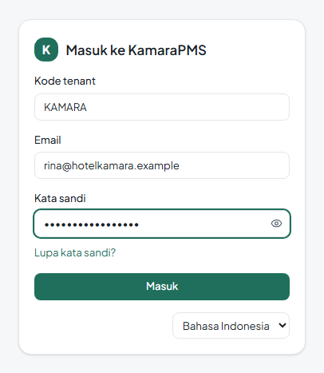
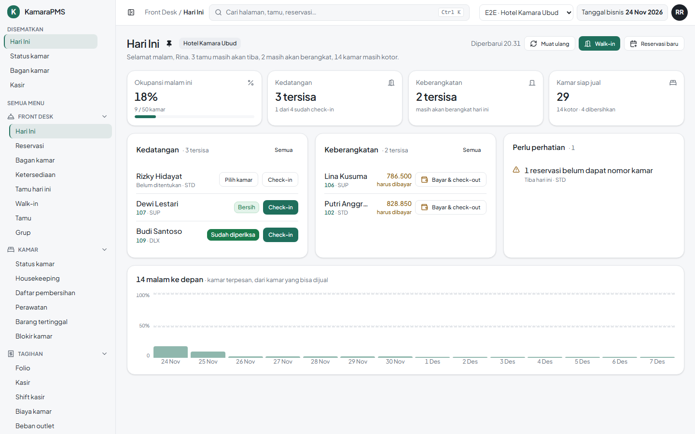
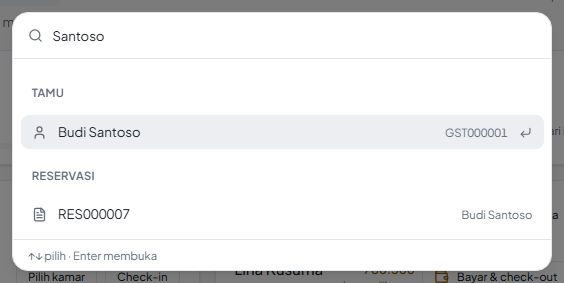

# Masuk dan mengenal layar

> 🎬 Video tutorial: menyusul

**Siapa yang melakukan:** semua staf yang punya akun KamaraPMS.
**Kapan dilakukan:** setiap kali mulai bekerja, atau setelah keluar dari aplikasi.
**Sebelum mulai:** siapkan tiga hal dari administrator hotel: **kode tenant**, **email**, dan **kata sandi** Anda. Alamat KamaraPMS di browser biasanya diberikan oleh bagian IT.

## Langkah-langkah

1. Buka alamat KamaraPMS di browser (Chrome, Edge, atau Firefox). Halaman **Masuk ke KamaraPMS** muncul.
   Kalau halamannya berbahasa Inggris (judulnya **Sign in to KamaraPMS**), pilih **Bahasa Indonesia** di daftar pilihan bahasa di pojok kanan bawah kotak masuk. Lihat [Mengganti bahasa dan tampilan](mengganti-bahasa-dan-tampilan.md).
2. Isi **Kode tenant**, misalnya `KAMARA`. Browser mengingat kode terakhir yang berhasil masuk, jadi biasanya kolom ini sudah terisi.
3. Isi **Email** Anda, misalnya `rina@hotelkamara.example`.
4. Isi **Kata sandi**. Klik ikon mata di ujung kolom kalau ingin melihat apa yang Anda ketik.

   | Field | Wajib? | Keterangan |
   |---|---|---|
   | Kode tenant | Ya | Kode hotel atau grup hotel Anda di KamaraPMS. |
   | Email | Ya | Email akun Anda, bukan email hotel. |
   | Kata sandi | Ya | Minimal 12 karakter. Kata sandi dikosongkan lagi setiap kali gagal masuk. |

   

5. Klik **Masuk**. Halaman **Hari Ini** terbuka.

   

6. Untuk mencari sesuatu dengan cepat, klik kolom **Cari halaman, tamu, reservasi…** di bilah atas, atau tekan `Ctrl` + `K` (di Mac `⌘` + `K`). Ketik minimal dua huruf, misalnya `Santoso`. Pilih hasilnya dengan panah atas/bawah lalu tekan `Enter`. `Esc` menutup pencarian.

   

## Hasilnya

Anda masuk ke properti (hotel) yang terakhir Anda buka. Namanya tampil di bilah atas, di samping **Tanggal bisnis**.

### Mengenal layar

**Menu di kiri.** Menu dibagi menjadi beberapa bagian, misalnya **Front Desk**, **Kamar**, **Tagihan**, **Akhir hari**, dan **Pengaturan**. Klik nama bagian untuk membuka atau menutupnya.
- **Disematkan** berisi halaman favorit Anda. Untuk menyematkan halaman, klik ikon pin di samping judul halaman. Untuk melepasnya, arahkan kursor ke nama halaman di bagian **Disematkan**, lalu klik tombol lepas sematan.
- **Terakhir dibuka** (di bawah menu) berisi lima halaman yang terakhir Anda buka.
- Tombol di kiri bilah atas menciutkan menu menjadi ikon saja, supaya layar lebih lega.

**Bilah atas**, dari kiri ke kanan:
- letak halaman yang sedang dibuka (misalnya *Front Desk / Hari Ini*);
- kolom pencarian cepat;
- pilihan properti, kalau Anda bekerja di lebih dari satu hotel;
- **Tanggal bisnis**: tanggal operasional hotel, yang bisa berbeda dengan tanggal di kalender. Baca [Memahami tanggal bisnis](memahami-tanggal-bisnis.md);
- lonceng pemberitahuan (hanya untuk modul Banquet dan Persediaan);
- tombol bulat berisi inisial nama Anda: **Akun saya**, **Bahasa**, **Tema**, dan **Keluar**.

**Halaman Hari Ini** berbeda menurut peran Anda:
- Resepsionis melihat okupansi malam ini, kedatangan dan keberangkatan yang tersisa, kamar siap jual, serta tombol **Walk-in** dan **Reservasi baru**.
- Petugas housekeeping melihat kartu **Kamar yang perlu dibersihkan**, dengan tombol **Lihat kamar kotor**, **Tugas saya**, dan **Daftar pembersihan**.
- Semua orang melihat kartu **Perlu perhatian**, misalnya kamar yang belum siap untuk tamu yang tiba hari ini.

Halaman Hari Ini memuat ulang sendiri setiap dua menit. Klik **Muat ulang** untuk memperbaruinya sekarang.

## Perlu diperhatikan

- **Menu yang Anda lihat mengikuti peran Anda.** Kalau sebuah menu yang disebut di panduan ini tidak ada di layar Anda, peran Anda tidak mencakupnya. Baca [Peran dan hak akses](peran-dan-hak-akses.md).
- **Pesan saat gagal masuk:**
  - "Kode tenant, email, atau kata sandi salah." Periksa ketiganya, termasuk huruf besar dan kecil pada kata sandi.
  - "Terlalu banyak percobaan gagal. Tunggu beberapa menit lalu coba lagi." Akun dikunci sementara. Tunggu beberapa menit.
  - "Server tidak dapat dihubungi." Periksa koneksi internet, atau hubungi IT.
- **Lupa kata sandi?** Tidak ada reset kata sandi lewat email. Klik **Lupa kata sandi?**: layar meminta Anda menghubungi administrator hotel, yang akan mengatur kata sandi baru.
- **Kartu "Belum ada properti untuk Anda"** berarti akun Anda belum ditugaskan ke hotel mana pun. Minta administrator menambahkan Anda.
- **Keluar** lewat tombol inisial nama → **Keluar**, terutama di komputer yang dipakai bergantian.
- **Menambah tagihan ke kamar lewat pencarian cepat:** di kolom pencarian, ketik tanda plus diikuti nomor kamar, misalnya `+ 109`. Tekan `Enter` untuk langsung membuka folio tamu di kamar itu. Ini hanya bisa dilakukan kalau peran Anda boleh melihat folio dan memposting tagihan.

## Terkait

- [Mengganti bahasa dan tampilan](mengganti-bahasa-dan-tampilan.md)
- [Mengubah kata sandi](mengubah-kata-sandi.md)
- [Memahami tanggal bisnis](memahami-tanggal-bisnis.md)
- [Peran dan hak akses](peran-dan-hak-akses.md)
