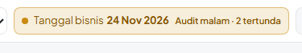
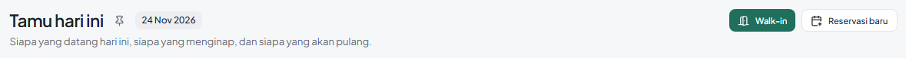

# Memahami tanggal bisnis

**Siapa yang melakukan:** semua staf. Halaman ini bukan tugas, melainkan penjelasan yang perlu dipahami sebelum bekerja.
**Kapan dilakukan:** baca sekali saat mulai memakai KamaraPMS.
**Sebelum mulai:** tidak ada.

**Tanggal bisnis** adalah tanggal operasional hotel. Semua yang dicatat di KamaraPMS memakai tanggal ini: biaya kamar, pembayaran, kedatangan hari ini, dan laporan harian. Tanggal bisnis **tidak berganti saat tengah malam**. Tanggal ini baru maju satu hari ketika **audit malam** (proses tutup hari) selesai dijalankan.

Contohnya, tanggal bisnis 24 Nov 2026. Seorang tamu check-out pukul 01.30 dini hari tanggal 25 menurut kalender. Pembayarannya tetap tercatat pada 24 Nov 2026, karena hari itu belum ditutup.

## Langkah-langkah

1. Lihat **Tanggal bisnis** di bilah atas, di sebelah kanan nama properti.

   

   Kalau peran Anda boleh menjalankan audit malam, di sebelah tanggal juga tampil keadaan audit malam:

   | Tulisan | Artinya |
   |---|---|
   | **Audit malam nanti** | Belum waktunya menutup hari. Hari baru bisa ditutup mulai jam yang diatur di properti (**Jam paling awal audit malam**). |
   | **Audit malam · memeriksa** | KamaraPMS sedang memeriksa apa saja yang masih harus diselesaikan. |
   | **Audit malam · 2 tertunda** | Ada hal yang harus diselesaikan dulu sebelum hari bisa ditutup, dalam contoh ini dua. Klik tanggalnya untuk membuka **Audit malam** dan melihat daftarnya. |
   | **Audit malam siap** | Hari bisa ditutup sekarang. |
   | **Audit malam terlambat** | Audit malam tertinggal lebih dari satu hari. Semua staf juga melihat pita peringatan di atas halaman. |

2. Di halaman **Tamu hari ini**, tanggal di samping judul juga tanggal bisnis. Kedatangan, tamu menginap, dan keberangkatan "hari ini" dihitung dari tanggal ini.

   

## Hasilnya

Anda tahu tanggal mana yang akan dipakai untuk setiap catatan, dan kapan tanggal itu berganti.

## Perlu diperhatikan

- **Hanya audit malam yang memajukan tanggal bisnis.** Tidak ada tombol untuk mengganti tanggal secara manual. Lihat [Audit malam](../11-audit-malam/menjalankan-audit-malam.md).
- **Hari yang sudah ditutup tidak bisa diubah.** Kalau Anda mencoba mencatat sesuatu ke hari yang sudah ditutup, muncul pesan "Hari bisnis sudah ditutup." dengan saran "Catat pada hari bisnis yang sedang terbuka." Koreksi dicatat pada hari yang sedang terbuka.
- **"Tanggal bisnis sudah berganti: muat ulang lalu coba lagi."** muncul kalau audit malam selesai saat layar Anda masih terbuka dengan tanggal lama. Tekan `F5` untuk memuat ulang halaman, lalu ulangi pekerjaan Anda.
- **Waktu lokal.** Di layar lebar, kalau tanggal kalender di hotel sudah berbeda dengan tanggal bisnis, di samping tanggal bisnis tampil juga "lokal" dengan tanggal dan jam saat ini. Arahkan kursor ke tanggal bisnis untuk melihat jam hotel dan jam server. Keterangan jam server di situ masih berbahasa Inggris: **Server time** (jam server).
- Jam-jam yang ditampilkan (misalnya jam check-in) memakai **zona waktu hotel**, bukan zona waktu komputer Anda.

## Terkait

- [Masuk dan mengenal layar](login-dan-navigasi.md)
- [Menjalankan audit malam](../11-audit-malam/menjalankan-audit-malam.md)
