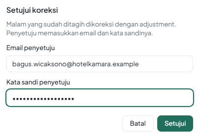

# Meminta persetujuan

**Siapa yang melakukan:** staf yang melakukan koreksi, bersama atasan yang menyetujuinya (penyetuju).
**Kapan dilakukan:** saat KamaraPMS membuka kotak persetujuan setelah Anda mengklik tombol sebuah koreksi. Contohnya menurunkan tarif tamu, membalik tagihan, memposting penyesuaian, membatalkan (void) atau mengembalikan (refund) pembayaran, dan memindahkan tagihan ke folio lain.
**Sebelum mulai:** penyetuju harus ada di dekat Anda. Penyetuju adalah orang yang perannya punya izin menyetujui jenis koreksi itu, misalnya supervisor atau manajer.

Persetujuan tidak dikirim lewat pesan atau email. Penyetuju mengetik **email dan kata sandinya sendiri** langsung di layar Anda. Dengan begitu, KamaraPMS mencatat siapa yang membuat koreksi dan siapa yang menyetujuinya.

## Langkah-langkah

1. Kerjakan koreksinya seperti biasa, lalu klik tombolnya, misalnya **Terapkan** di [Ubah tarif](../01-front-desk/mengubah-tarif-tamu-menginap.md). Kotak persetujuan muncul. Judulnya tergantung pada koreksinya, misalnya **Setujui koreksi**.
2. Serahkan keyboard kepada penyetuju. Penyetuju menghapus email Anda di **Email penyetuju**, lalu mengetik email miliknya.
3. Penyetuju mengetik kata sandinya di **Kata sandi penyetuju**.

   | Field | Wajib? | Keterangan |
   |---|---|---|
   | Email penyetuju | Ya | Terisi email Anda sendiri. Ganti dengan email penyetuju, kecuali Anda sendiri boleh menyetujui. |
   | Kata sandi penyetuju | Ya | Kata sandi penyetuju. Kata sandi ini tidak disimpan dan langsung dikosongkan setelah dipakai. |

   

4. Penyetuju mengklik **Setujui**.

## Hasilnya

Koreksi tersimpan, dan kotak persetujuan tertutup. Riwayat koreksi mencatat siapa yang membuatnya dan siapa yang menyetujuinya.

## Perlu diperhatikan

- **Kapan Anda boleh menyetujui sendiri?** Kalau peran Anda punya izin menyetujui, Anda boleh memakai email dan kata sandi Anda sendiri, kecuali aturan properti melarangnya. Aturan itu tertulis di dalam kotak persetujuan:
  - "Aturan properti ini: penyetuju harus orang lain, bukan Anda." Kolom email dikosongkan, dan orang lain harus mengisinya.
  - "Di atas {jumlah} penyetuju harus orang lain, bukan Anda." Koreksi di atas jumlah itu butuh orang lain.
  - "Sampai {jumlah} Anda boleh menyetujuinya sendiri."
- **Administrator tenant** boleh menyetujui koreksinya sendiri walaupun aturannya meminta orang lain. Hal itu dicatat.
- **Pesan yang mungkin muncul di dalam kotak:**
  - "Email atau kata sandi penyetuju salah." Ketik ulang dengan teliti.
  - "Penyetuju tidak boleh menyetujui koreksi di properti ini." Peran penyetuju tidak punya izinnya di hotel ini. Cari penyetuju lain.
  - "Aturan properti ini meminta penyetuju selain orang yang membuat perubahan." Anda memakai akun sendiri. Minta orang lain yang menyetujui.
- **Batal** atau tombol `Esc` menutup kotak tanpa menyimpan koreksi. Mengklik di luar kotak tidak menutupnya.
- Untuk penurunan tarif tamu menginap, kalimat di dalam kotak berbunyi "Malam yang sudah ditagih dikoreksi dengan adjustment…" walaupun malam yang diubah belum ditagih. Kalimat itu bisa diabaikan.
- Pengaturan aturan persetujuan per jenis koreksi dijelaskan di [Aturan persetujuan](../13-pengaturan/aturan-persetujuan.md).

## Terkait

- [Peran dan hak akses](peran-dan-hak-akses.md)
- [Mengubah tarif tamu yang sedang menginap](../01-front-desk/mengubah-tarif-tamu-menginap.md)
