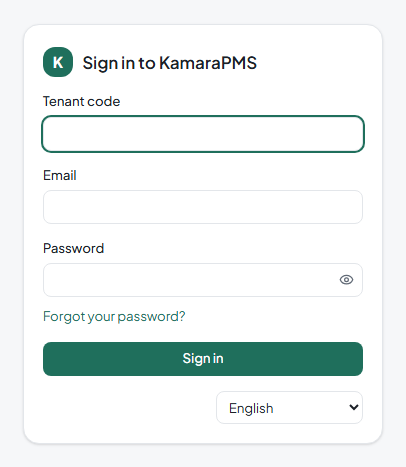
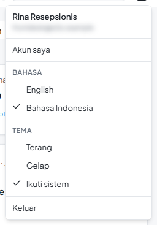
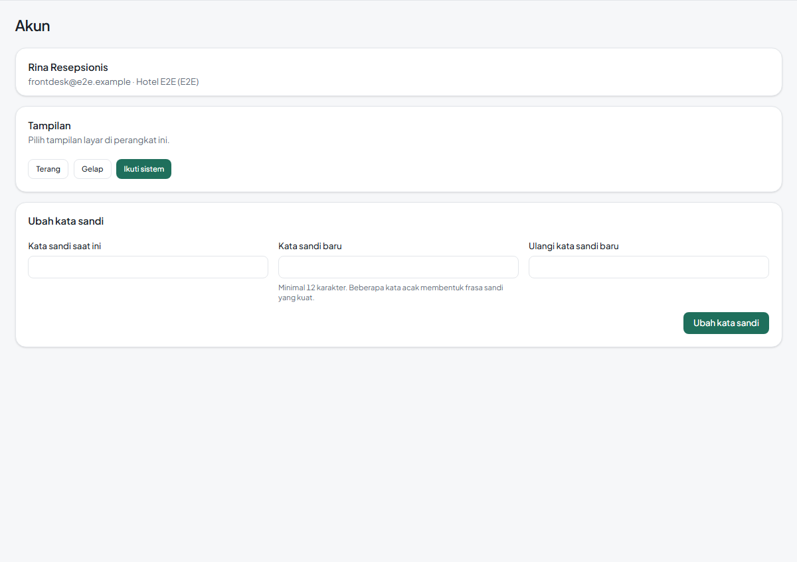

# Mengganti bahasa dan tampilan

**Siapa yang melakukan:** semua staf.
**Kapan dilakukan:** saat pertama kali memakai KamaraPMS di sebuah komputer atau browser, atau kapan pun Anda ingin mengganti bahasa atau warna layar.
**Sebelum mulai:** tidak ada yang perlu disiapkan.

> **Bahasa bawaan KamaraPMS adalah English.** Pilihan bahasa disimpan di **browser**, bukan di akun Anda. Kalau Anda pindah ke komputer lain, memakai browser lain, membuka jendela penyamaran (incognito), atau riwayat browser dihapus, layar kembali berbahasa Inggris dan Anda perlu memilih Bahasa Indonesia lagi. Hal yang sama berlaku untuk tema terang/gelap.

## Langkah-langkah

### Sebelum masuk (halaman masuk)

1. Di halaman masuk, lihat daftar pilihan bahasa di pojok kanan bawah kotak masuk. Kalau layar berbahasa Inggris, daftar itu menampilkan **English**.

   

2. Pilih **Bahasa Indonesia**. Semua tulisan langsung berganti, tanpa perlu memuat ulang halaman.

### Setelah masuk (menu akun)

3. Klik tombol bulat berisi inisial nama Anda di pojok kanan atas. Menu akun terbuka.

   

4. Di bawah **Bahasa**, klik **Bahasa Indonesia** atau **English**. Di bawah **Tema**, klik **Terang**, **Gelap**, atau **Ikuti sistem**.
   Kalau layar masih berbahasa Inggris, menu ini bernama **Account menu**, dengan bagian **Language** dan **Theme**.

### Lewat halaman Akun

5. Klik tombol inisial nama → **Akun saya**. Di kartu **Tampilan**, pilih **Terang**, **Gelap**, atau **Ikuti sistem**. Ini sama dengan pilihan **Tema** di menu akun.

   

## Hasilnya

Layar memakai bahasa dan tema yang Anda pilih. Pilihan itu tetap dipakai di browser ini, juga untuk pengguna lain yang masuk lewat browser yang sama.

## Perlu diperhatikan

- **Ikuti sistem** (bawaan) mengikuti pengaturan terang/gelap di Windows atau ponsel Anda.
- Bahasa layar juga menentukan bahasa dokumen PDF yang Anda cetak, misalnya kuitansi dan kartu registrasi. Pengecualiannya adalah paket laporan audit malam, yang selalu berbahasa Inggris.
- Ada beberapa tulisan yang tetap berbahasa Inggris atau berupa kode, walaupun bahasa sudah Indonesia. Panduan ini menuliskannya persis seperti di layar, lalu memberi artinya dalam kurung.

## Terkait

- [Masuk dan mengenal layar](login-dan-navigasi.md)
- [Mengubah kata sandi](mengubah-kata-sandi.md)
