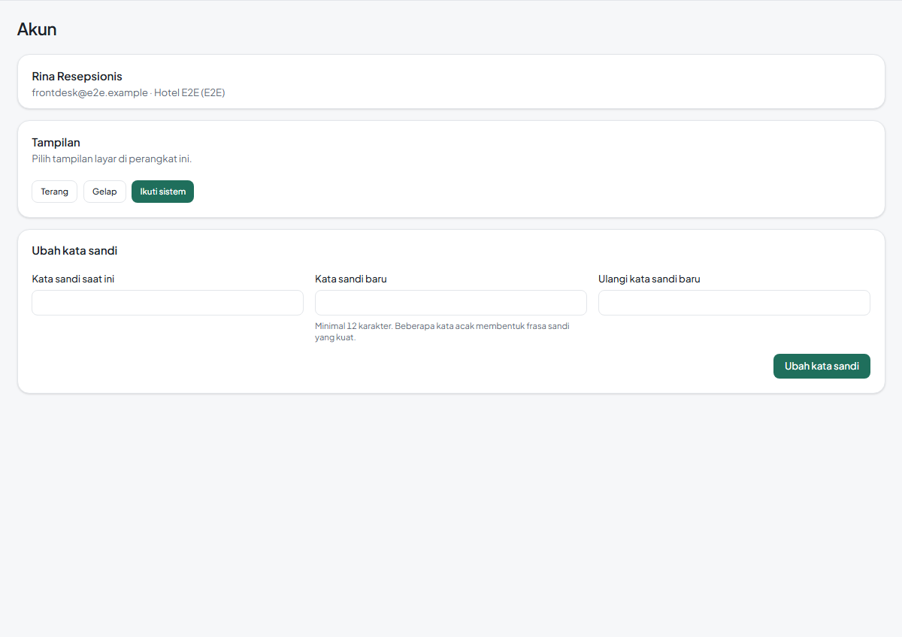

# Mengubah kata sandi

**Siapa yang melakukan:** semua staf, untuk akunnya sendiri.
**Kapan dilakukan:** setelah pertama kali masuk dengan kata sandi dari administrator, atau kapan pun Anda curiga kata sandi diketahui orang lain.
**Sebelum mulai:** Anda harus tahu kata sandi yang sekarang. Kalau lupa, minta administrator hotel mengatur kata sandi baru untuk Anda.

## Langkah-langkah

1. Klik tombol bulat berisi inisial nama Anda di pojok kanan atas → **Akun saya**.
2. Di kartu **Ubah kata sandi**, isi ketiga kolom:

   | Field | Wajib? | Keterangan |
   |---|---|---|
   | Kata sandi saat ini | Ya | Kata sandi yang Anda pakai untuk masuk sekarang. |
   | Kata sandi baru | Ya | 12 sampai 128 karakter. Beberapa kata acak, misalnya `kopi pagi sawah hijau`, membentuk kata sandi yang kuat dan mudah diingat. |
   | Ulangi kata sandi baru | Ya | Ketik ulang kata sandi baru persis sama. |

   

3. Klik **Ubah kata sandi**.

## Hasilnya

Muncul pesan "Kata sandi diubah. Sesi Anda yang lain dikeluarkan." Anda tetap masuk di browser ini, tetapi di komputer atau ponsel lain Anda harus masuk lagi dengan kata sandi baru.

## Perlu diperhatikan

- "Kata sandi tidak sama." berarti isi **Ulangi kata sandi baru** berbeda dengan **Kata sandi baru**.
- "Kata sandi saat ini salah." berarti isi **Kata sandi saat ini** keliru.
- Kalau kata sandi baru kurang dari 12 karakter, pesan di bawah kolom tampil dalam bahasa Inggris: `at least 12 characters` (minimal 12 karakter).
- Jangan memakai kata sandi yang sama dengan email pribadi atau media sosial Anda.

## Terkait

- [Masuk dan mengenal layar](login-dan-navigasi.md)
- [Mengganti bahasa dan tampilan](mengganti-bahasa-dan-tampilan.md)
