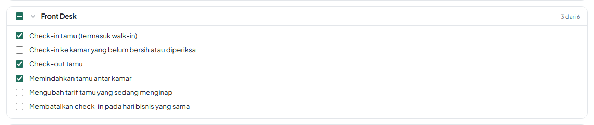
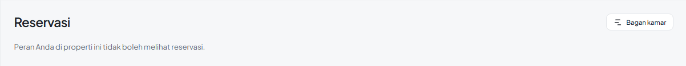

# Peran dan hak akses

**Siapa yang melakukan:** semua staf perlu memahaminya. Hanya administrator hotel (**Administrator tenant**) yang bisa membuat peran dan memberikannya.
**Kapan dilakukan:** administrator menyusun peran saat setup awal, lalu setiap kali ada jabatan baru atau tugas yang berubah. Staf membaca halaman ini kalau sebuah menu atau tombol yang disebut di panduan tidak ada di layarnya.
**Sebelum mulai:** daftar jabatan di hotel Anda dan siapa mengerjakan apa.

## Cara kerja hak akses

- **Izin** adalah satu kegiatan yang boleh dilakukan, misalnya "Check-out tamu" atau "Memposting tagihan".
- **Peran** adalah kumpulan izin yang diberi nama, misalnya *Resepsionis*.
- **Pengguna** mendapat **satu peran untuk setiap properti** (hotel) tempat ia bekerja. Di hotel A seseorang bisa menjadi resepsionis, sementara di hotel B ia menjadi supervisor.
- **Administrator tenant** boleh melakukan semuanya di semua properti, termasuk mengelola pengguna, peran, dan properti.

> **KamaraPMS tidak menyediakan peran siap pakai.** Setiap hotel membuat perannya sendiri, sesuai pembagian kerjanya. Peran di halaman ini hanyalah **contoh** sebagai titik awal.

## Contoh peran dan izin yang disarankan

Nama izin di bawah ini ditulis persis seperti di layar **Peran**. Nama tebal yang diikuti titik dua adalah kelompok izinnya.

| Contoh peran | Izin yang disarankan |
|---|---|
| **Resepsionis** | **Reservasi:** Melihat reservasi dan ketersediaan · Membuat dan mengonfirmasi reservasi · Mengubah reservasi dan menetapkan kamar · Membatalkan reservasi **Tamu:** Melihat profil tamu · Membuat dan mengubah profil tamu **Front Desk:** Check-in tamu (termasuk walk-in) · Check-out tamu · Memindahkan tamu antar kamar · Mengubah tarif tamu yang sedang menginap **Tagihan:** Melihat folio · Memposting tagihan · Menerima pembayaran dan deposit · Membuka dan menutup shift kasir sendiri… |
| **Supervisor front office** | Semua izin Resepsionis, ditambah: Check-in ke kamar yang belum bersih atau diperiksa · Membatalkan check-in pada hari bisnis yang sama · Memposting penyesuaian · Membalik posting hari yang sama… · Membatalkan pembayaran hari yang sama (void) · Mengembalikan pembayaran (refund) · Menyetujui koreksi… · Menandai kedatangan sebagai tidak datang · Melihat dan mengekspor laporan |
| **Manajer front office** | Melihat reservasi dan ketersediaan · Mengubah tarif per malam secara manual · Menyetujui perubahan tarif per malam… · Memesan kamar komplimen… · Menyetujui kamar komplimen… · Menyetujui koreksi… · Melihat dan mengekspor laporan |
| **Petugas housekeeping** | Mengubah status kebersihan kamar · Melaporkan masalah perawatan dan melihat permintaannya · Mencatat barang temuan dan melihat daftar barang temuan |
| **Supervisor housekeeping** | Izin petugas housekeeping, ditambah: Menandai kamar sudah diperiksa (supervisor) · Membuat daftar pembersihan harian dan menugaskannya… · Membuat dan melepas blokir kamar… |
| **Night auditor** | Izin Resepsionis, ditambah: Menjalankan audit malam dan memposting biaya kamar · Menandai kedatangan sebagai tidak datang · Melihat arsip paket audit malam |

Izin untuk akuntansi, POS, persediaan, banquet, dan aset tetap dijelaskan di bagian panduan masing-masing.

## Langkah-langkah

Langkah ini untuk administrator.

1. Buka **Pengaturan → Peran**.
2. Klik **Peran baru**.
3. Isi **Nama** dan **Deskripsi**. Buka kelompok izin dengan mengklik namanya, lalu centang izin yang diperlukan. Centang di samping nama kelompok memilih atau mengosongkan semua izin di kelompok itu. Angka di kanan, misalnya **3 dari 6**, menunjukkan jumlah izin yang dicentang.

   | Field | Wajib? | Keterangan |
   |---|---|---|
   | Nama | Ya | Nama jabatan, misalnya `Resepsionis`. |
   | Deskripsi | Tidak | Penjelasan singkat, misalnya `Reservasi, check-in, check-out, dan pembayaran tamu`. |
   | Izin | Ya | Centang izin yang dibutuhkan jabatan ini. |

   

4. Klik **Buat peran** di bilah bawah. Untuk membuang perubahan, klik **Batal**.
5. Berikan peran itu kepada pengguna: buka **Pengaturan → Pengguna**, pilih pengguna, lalu di **Akses properti** pilih properti dan perannya. Lihat [Pengguna](../13-pengaturan/pengguna.md).

## Hasilnya

Pengguna dengan peran itu hanya melihat menu dan tombol yang diizinkan. Perubahan pada peran berlaku bagi semua pemegangnya pada permintaan berikutnya, tanpa perlu keluar dan masuk lagi.

## Perlu diperhatikan

- **Kalau menu tidak muncul**, peran Anda tidak memuat izinnya. Halaman yang dibuka lewat alamat langsung akan menampilkan kalimat seperti "Peran Anda di properti ini tidak boleh melihat reservasi.", atau langsung kembali ke **Hari Ini**.

  

- **Kalau tombol menolak dengan pesan "Peran Anda tidak mengizinkan tindakan ini."**, minta izin ke administrator, atau minta rekan yang berwenang mengerjakannya.
- **Beberapa tindakan butuh persetujuan orang kedua**, misalnya menurunkan tarif atau membalik tagihan. Izin "Menyetujui…" diberikan kepada atasan. Lihat [Meminta persetujuan](meminta-persetujuan.md).
- Tiga kelompok izin namanya masih berbahasa Inggris di layar: **Inventory** (persediaan), **Banquet** (acara dan jamuan), dan **Fixed assets** (aset tetap).
- Menonaktifkan pengguna langsung mengeluarkannya dari semua perangkat.

## Terkait

- [Peran](../13-pengaturan/peran.md)
- [Pengguna](../13-pengaturan/pengguna.md)
- [Meminta persetujuan](meminta-persetujuan.md)
