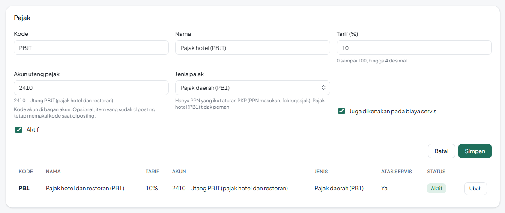
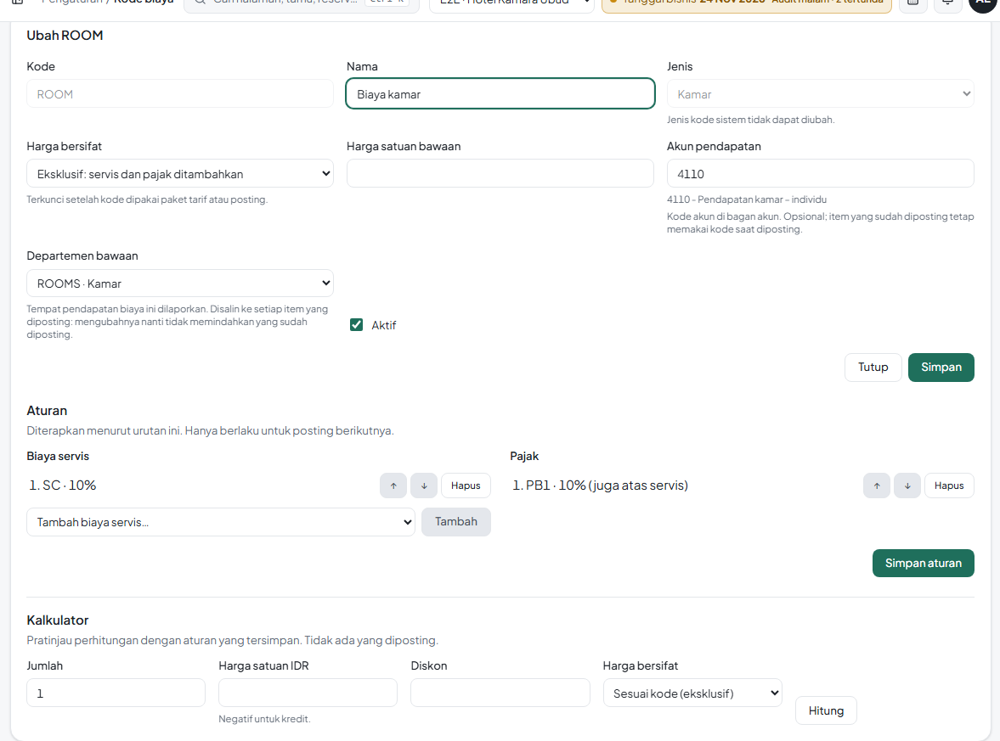
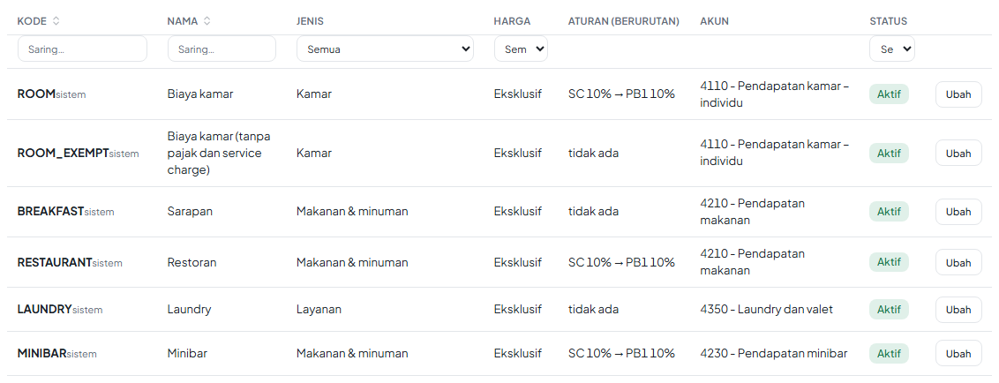

# Setup awal hotel

**Siapa yang melakukan:** administrator hotel (pengguna dengan centang **Administrator tenant**). Pemegang izin pengaturan tagihan juga bisa mengerjakan bagian pajak dan kode biaya.
**Kapan dilakukan:** sekali, sebelum hotel mulai menerima tamu di KamaraPMS. Sebagian pengaturan bisa diubah nanti, tetapi beberapa terkunci begitu transaksi pertama tercatat (lihat **Perlu diperhatikan**).
**Sebelum mulai:**
- Akun KamaraPMS untuk hotel Anda sudah dibuat. Anda punya **kode tenant** dan akun administrator.
- Siapkan data hotel: nama resmi, alamat, NPWP, jam check-in/check-out, daftar tipe kamar dan nomor kamar, harga kamar, tarif pajak daerah (PB1) dan service charge.

Halaman ini adalah daftar urutan kerja. Setiap langkah besar punya halaman sendiri di bagian **Pengaturan**. Langkah pajak (langkah 5) dijelaskan lengkap di sini karena paling sering terlewat.

## Langkah-langkah

1. **Buat properti.** Buka **Pengaturan → Properti** → **Properti baru**. Isi kartu **Identitas**, **Waktu dan uang**, **Kebijakan**, **Hari bisnis**, dan **Nama bawaan**, lalu klik **Buat properti**. Rinciannya ada di [Properti](../13-pengaturan/properti.md).

   | Field | Wajib? | Keterangan |
   |---|---|---|
   | Kode | Ya | Kode singkat, misalnya `UBUD`. Tidak bisa diubah setelah disimpan. |
   | Nama | Ya | Nama hotel yang tercetak di dokumen, misalnya `Hotel Kamara Ubud`. |
   | Zona waktu | Ya | Waktu lokal hotel. Untuk Bali, pilih `Asia/Makassar`. |
   | Mata uang / Desimal mata uang | Ya | Untuk rupiah: `IDR` dengan desimal `0`. Terkunci setelah catatan keuangan pertama. |
   | Tanggal bisnis pembukaan | Ya | Hari pertama hotel memakai KamaraPMS. Hanya bisa hari ini atau kemarin. |
   | Bahasa nama bawaan | Ya | Bahasa nama akun, departemen, dan kode biaya yang dibuat otomatis. Pilih **Indonesia** supaya nama kode biaya di folio tamu berbahasa Indonesia. |

2. **Buat tipe kamar dan kamar.** Lihat [Tipe kamar dan kamar](../13-pengaturan/tipe-kamar-dan-kamar.md).
3. **Buat paket tarif dan harga.** Lihat [Paket tarif dan grid tarif](../13-pengaturan/paket-tarif-dan-grid-tarif.md).
4. **Buat peran dan pengguna.** Setiap hotel menentukan perannya sendiri. Lihat [Peran dan hak akses](peran-dan-hak-akses.md), [Peran](../13-pengaturan/peran.md), dan [Pengguna](../13-pengaturan/pengguna.md).
5. **Buat pajak dan biaya servis, lalu pasang ke kode biaya.** Langkah ini wajib.

   > ⚠️ Penting: kode biaya bawaan (misalnya **ROOM** untuk biaya kamar, **RESTAURANT**, **MINIBAR**) **belum punya pajak maupun service charge**. Kalau langkah ini dilewati, semua tagihan tamu keluar **tanpa pajak dan tanpa service charge**. Tagihan yang sudah diposting tidak ikut berubah setelah pajak dipasang: pajak hanya berlaku untuk posting berikutnya.

   a. Buka **Pengaturan → Pajak & biaya layanan**. Di kartu **Pajak**, klik **Pajak baru**, lalu isi:

   | Field | Wajib? | Keterangan |
   |---|---|---|
   | Kode | Ya | Kode singkat, misalnya `PB1` atau `PBJT`. Tidak bisa diubah setelah disimpan. |
   | Nama | Ya | Misalnya `Pajak hotel (PB1)`. |
   | Tarif (%) | Ya | Persen, misalnya `10`. |
   | Akun utang pajak | Tidak | Akun di bagan akun tempat pajak dicatat, misalnya `2410`. Kalau dikosongkan, layar memperingatkan: "Tanpa akun: jumlah masuk ke akun utang pajak sampai Anda memilih satu." |
   | Jenis pajak | Ya | **Pajak daerah (PB1)** untuk pajak hotel dan restoran. **PPN** hanya kalau hotel Anda PKP. |
   | Juga dikenakan pada biaya servis | Tidak | Centang kalau pajak juga dihitung dari service charge. Ini yang umum untuk PB1. |
   | Aktif | Tidak | Biarkan tercentang. |

   

   Klik **Simpan**. Dengan cara yang sama, di kartu **Biaya servis** klik **Biaya servis baru**, lalu isi misalnya kode `SC`, nama `Service charge`, dan **Tarif (%)** `10`.

   b. Buka **Pengaturan → Kode biaya**. Pada baris **ROOM**, klik **Ubah**.

   c. Di bagian **Aturan**, pilih biaya servis di **Tambah biaya servis…** lalu klik **Tambah**. Pilih pajak di **Tambah pajak…** lalu klik **Tambah**. Klik **Simpan aturan**. Muncul pesan "Aturan tersimpan.".

   

   Ulangi langkah b dan c untuk setiap kode biaya yang dikenai pajak, misalnya **RESTAURANT** dan **MINIBAR**. Jangan pasang pajak pada **ROOM_EXEMPT**: kode itu memang untuk kamar tanpa pajak dan service charge.

   d. Kembali ke daftar **Kode biaya**. Kolom **Aturan (berurutan)** menampilkan aturan tiap kode, misalnya `SC 10% → PB1 10%`. Kode yang masih menampilkan `tidak ada` belum dikenai pajak.

   

6. **Periksa hasilnya.** Buat satu reservasi percobaan (lihat [Membuat reservasi](../01-front-desk/membuat-reservasi.md)). Kolom **Perkiraan (termasuk service dan pajak)** harus lebih besar dari harga kamar saja.

## Hasilnya

Hotel siap dipakai: properti punya hari bisnis yang terbuka, kamar bisa dijual, staf bisa masuk dengan perannya masing-masing, dan setiap biaya kamar dihitung dengan service charge dan pajak.

## Perlu diperhatikan

- **Urutan aturan menentukan hitungan.** Biaya servis dihitung dulu, baru pajak. Kalau pajak bertanda **(juga atas servis)**, pajak dihitung dari harga ditambah service charge. Ubah urutan dengan tombol **↑** dan **↓**.
- **Bagian Aturan hanya muncul saat mengubah kode yang sudah ada.** Untuk kode biaya baru, klik **Simpan** dulu, lalu klik **Ubah** pada kode itu.
- **Kalkulator** di bawah bagian Aturan menunjukkan hitungan sebuah harga tanpa memposting apa pun. Pakai untuk memeriksa sebelum hotel buka.
- **Yang terkunci setelah transaksi pertama:**
  - **Mata uang** dan **Desimal mata uang** properti.
  - **Pelepasan deposit**.
  - **Harga bersifat** (Eksklusif/Inklusif) sebuah kode biaya, setelah kode itu dipakai paket tarif atau posting.

  Kalau salah pilih mata uang, hotel harus memulai properti baru.
- **Mengubah tarif pajak** di kemudian hari berlaku untuk posting berikutnya. Layar lalu menyebutkan berapa tamu menginap yang ditagih dengan tarif baru mulai sekarang.

## Terkait

- [Memahami tanggal bisnis](memahami-tanggal-bisnis.md)
- [Peran dan hak akses](peran-dan-hak-akses.md)
- [Properti](../13-pengaturan/properti.md)
- [Pajak dan kode biaya](../13-pengaturan/pajak-dan-kode-biaya.md)
