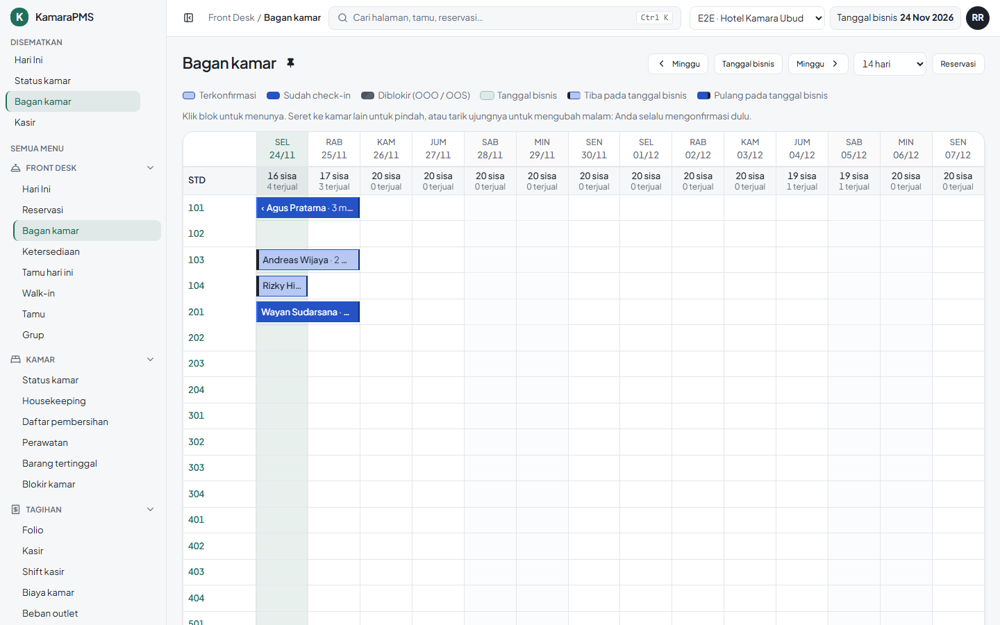
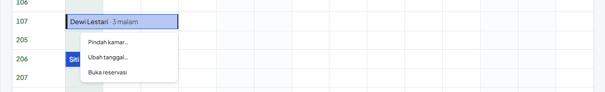
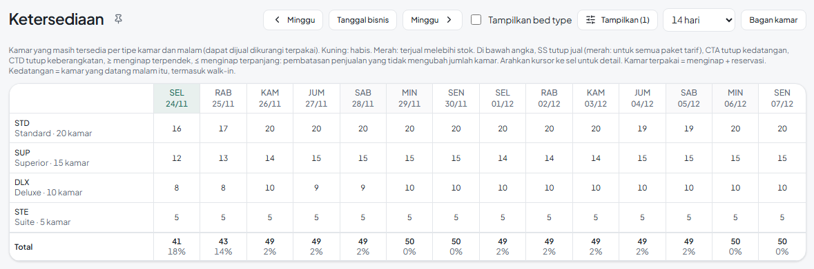

# Bagan kamar dan ketersediaan

**Siapa yang melakukan:** resepsionis, staf reservasi, dan manajer.
**Kapan dilakukan:** saat Anda perlu melihat siapa menempati kamar mana pada tanggal tertentu, memindahkan pemesanan antar kamar, atau mengecek berapa kamar yang masih bisa dijual.
**Sebelum mulai:** peran Anda harus boleh melihat reservasi. Untuk memindahkan atau mengubah tanggal, peran Anda juga harus boleh mengubah reservasi atau memindahkan tamu.

**Bagan kamar** (tape chart) menampilkan setiap kamar sebagai satu baris dan setiap malam sebagai satu kolom. **Ketersediaan** menampilkan jumlah kamar yang masih bisa dijual per tipe kamar dan per malam.

## Langkah-langkah

### Membaca bagan kamar

1. Buka **Front Desk → Bagan kamar**. Bagan dimulai dari tanggal bisnis hari ini. Kolom tanggal bisnis diberi warna.

   

2. Baca batang-batangnya dengan bantuan keterangan di atas bagan:

   | Tanda | Artinya |
   |---|---|
   | **Terkonfirmasi** (batang biru muda) | Pemesanan yang belum check-in. |
   | **Sudah check-in** (batang biru tua) | Tamu sedang menginap. |
   | **Diblokir (OOO / OOS)** | Kamar diblokir. `OOO` (out of order) berarti kamar rusak, `OOS` (out of service) berarti kamar sementara tidak dipakai. |
   | **Tanggal bisnis** | Kolom tanggal bisnis hari ini. |
   | **Tiba pada tanggal bisnis** (tepi kiri tebal) | Tamu yang datang hari ini. |
   | **Pulang pada tanggal bisnis** (tepi kanan tebal) | Tamu yang pulang hari ini. |

   Di baris tipe kamar (misalnya **STD**), setiap kolom menampilkan **sisa** dan **terjual** untuk malam itu. Pemesanan yang belum punya nomor kamar dikumpulkan di bawah kamar-kamar tipenya, di baris **Belum ditetapkan**.

   Untuk berpindah tanggal, gunakan tombol **Minggu** (mundur atau maju tujuh hari) dan **Tanggal bisnis** (kembali ke hari ini). Pilih **14 hari** atau **28 hari** untuk lebar tampilan.

### Memindahkan atau mengubah pemesanan

3. Klik batang pemesanan. Menu muncul dengan pilihan **Pindah kamar…**, **Ubah tanggal…**, dan **Buka reservasi**.

   

4. Klik **Pindah kamar…**. Di jendela **Pindah ke kamar lain**, pilih kamar di **Pindah ke kamar**. Untuk tamu yang sedang menginap, isi juga **Alasan pindah**. Klik **Konfirmasi pindah**.
5. Untuk mengubah tanggal, klik **Ubah tanggal…**, ubah **Datang** atau **Pulang**, lalu klik **Konfirmasi tanggal**. Jendela ini juga menampilkan perkiraan harga malam tambahan.

   Dengan mouse, Anda juga bisa menyeret batang ke baris kamar lain untuk memindahkannya, atau menarik ujung kanan batang untuk mengubah tanggal pulang. Jendela konfirmasi selalu muncul dulu: tidak ada yang tersimpan tanpa konfirmasi.

### Melihat ketersediaan

6. Buka **Front Desk → Ketersediaan**. Tabel menampilkan jumlah kamar yang masih bisa dijual untuk setiap tipe kamar per malam, dan baris **Total** dengan persentase okupansi.

   

7. Untuk menampilkan angka lain, klik **Tampilkan (1)**, lalu centang angka yang diinginkan, misalnya **Kedatangan**, **Menginap**, atau **Okupansi**. Arahkan kursor ke sebuah sel untuk melihat rinciannya.

## Hasilnya

Anda tahu kamar mana yang terisi dan kosong, serta berapa kamar yang masih bisa dijual. Pemindahan atau perubahan tanggal yang dikonfirmasi langsung tersimpan. Muncul pesan "Dipindah ke kamar …" atau "Tanggal diubah: … malam".

## Perlu diperhatikan

- **Bagan kamar tidak bisa dipakai untuk membuat reservasi baru.** Kotak kosong tidak bisa diklik. Gunakan [Membuat reservasi](membuat-reservasi.md).
- **Halaman Ketersediaan hanya untuk dilihat.** Tidak ada sel yang bisa diklik.
- **Warna di Ketersediaan:** kuning berarti habis (0). Merah berarti terjual melebihi jumlah kamar (overbooking).
- **Tanda di bawah angka Ketersediaan** adalah pembatasan penjualan:
  - `SS` (stop sell): tutup jual.
  - `CTA` (closed to arrival): tidak menerima kedatangan.
  - `CTD` (closed to departure): tidak menerima keberangkatan.
  - `≥`: minimal lama menginap.
  - `≤`: maksimal lama menginap.
- **Tombol Minggu** berarti satu minggu, bukan hari Minggu.
- **Tampilkan bed type** (artinya: tampilkan jenis tempat tidur) menambah baris per jenis tempat tidur di bawah setiap tipe kamar.
- **Memindahkan ke tipe kamar lain** adalah naik kelas (upgrade), dan butuh izin sendiri. Di daftar kamar, pilihan itu ditandai `(upgrade)`. Harga malam-malamnya tidak berubah.
- Saat menyeret, kamar yang tidak bisa dipakai diarsir abu-abu. Arahkan kursor ke kamar itu untuk melihat alasannya, misalnya "Terisi pada malam itu.".
- Tanggal datang tamu yang sedang menginap tidak bisa diubah.
- Menyeret hanya bisa dilakukan dengan mouse. Di tablet atau ponsel, ketuk batangnya untuk membuka menu.

## Terkait

- [Pindah kamar](pindah-kamar.md)
- [Perpanjang atau persingkat](perpanjang-atau-persingkat.md)
- [Menetapkan kamar](menetapkan-kamar.md)
