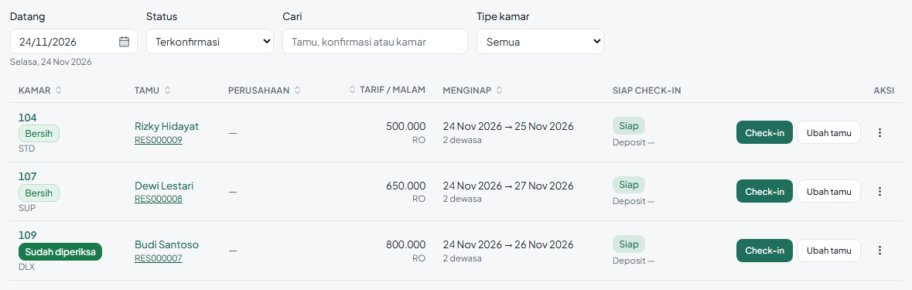
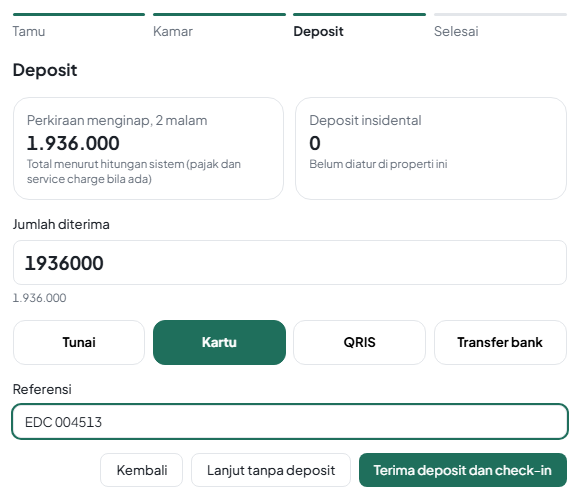
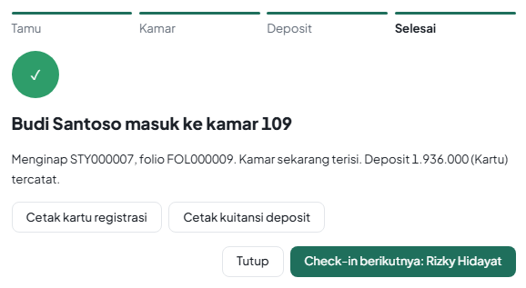

# Check-in

> 🎬 Video tutorial: menyusul

**Siapa yang melakukan:** resepsionis.
**Kapan dilakukan:** saat tamu yang punya reservasi tiba di hotel pada tanggal kedatangannya.
**Sebelum mulai:**
- Minta kartu identitas tamu (KTP atau paspor).
- Sebaiknya kamar sudah ditetapkan dan berstatus **Bersih** atau **Sudah diperiksa**. Lihat [Menetapkan kamar](menetapkan-kamar.md).
- Kalau tamu membayar deposit tunai, Anda perlu shift kasir yang terbuka.

Tamu tanpa reservasi dicatat lewat [Walk-in](walk-in.md).

## Langkah-langkah

1. Buka **Front Desk → Tamu hari ini**. Tab **Kedatangan** menampilkan reservasi yang tiba pada tanggal bisnis hari ini. Kolom **Siap check-in** menunjukkan apakah semuanya siap: **Siap**, atau kendalanya, misalnya **Kamar belum siap**.

   

2. Klik **Check-in** pada baris tamu. Panel check-in terbuka di sisi kanan, dengan empat langkah: **Tamu**, **Kamar**, **Deposit**, **Selesai**.
3. **Tamu.** Periksa data tamu, yang sudah terisi dari profilnya. Lengkapi identitasnya, lalu klik **Lanjut** atau tekan `Enter`.

   | Field | Wajib? | Keterangan |
   |---|---|---|
   | Nama depan / Nama belakang | Nama belakang wajib | Sesuaikan dengan kartu identitas. |
   | Jenis identitas | Tidak, tetapi disarankan | Misalnya `KTP` atau `PASSPORT`. |
   | Nomor identitas | Tidak, tetapi disarankan | Nomor KTP atau paspor. Untuk tamu asing, nomor paspor wajib dilaporkan ke imigrasi. |
   | Telepon | Tidak, tetapi disarankan | Nomor ponsel tamu. |
   | Email | Tidak | Untuk mengirim konfirmasi. |
   | Kewarganegaraan | Tidak | Kode negara dua huruf, misalnya `ID` untuk Indonesia. |

4. **Kamar.** Periksa nomor kamar. Kalau kamar belum ditetapkan, pilih di **Kamar**: kamar yang siap tampil paling atas. Periksa **Dewasa** dan **Anak**, lalu klik **Lanjut**.
5. **Deposit.** KamaraPMS mengusulkan jumlah deposit dari **Perkiraan menginap** (sudah termasuk pajak dan service charge) ditambah **Deposit insidental**, lalu dikurangi deposit yang sudah dibayar. Ubah **Jumlah diterima** kalau perlu. Pilih metodenya: **Tunai**, **Kartu**, **QRIS**, atau **Transfer bank**. Untuk selain tunai, isi **Referensi**, misalnya `EDC 004513`.

   

6. Klik **Terima deposit dan check-in**. Kalau tamu tidak membayar deposit, klik **Lanjut tanpa deposit**.
7. **Selesai.** Muncul tulisan "Budi Santoso masuk ke kamar 109" (nama tamu dan nomor kamarnya). Klik **Cetak kartu registrasi** untuk dicetak dan ditandatangani tamu. Kalau ada deposit, klik **Cetak kuitansi deposit**. Klik **Tutup**, atau langsung lanjutkan ke tamu berikutnya dengan **Check-in berikutnya: …**.

   

## Hasilnya

- Muncul pesan "Check-in selesai: menginap STY…, kamar …". Tamu pindah dari tab **Kedatangan** ke tab **Menginap**.
- Kamar berstatus terisi. Folio tamu dibuat, dan deposit tercatat di sana.
- Biaya kamar diposting setiap malam oleh audit malam, bukan saat check-in.

## Perlu diperhatikan

- **Tidak ada yang tersimpan sampai langkah terakhir**, kecuali perubahan data tamu di langkah **Tamu**. Kalau panel ditutup di tengah jalan, tamu belum check-in.
- **Tombol Kembali** dan tombol `Esc` membawa Anda ke langkah sebelumnya tanpa menghapus isian.
- **Kamar belum siap.** Kalau kamar masih **Kotor**, langkah **Kamar** menampilkan "Kamar 109 berstatus Kotor; dibutuhkan kamar yang bersih atau sudah diperiksa." (dengan nomor dan status kamarnya). Pilih kamar lain, atau minta housekeeping membersihkannya. Pengguna yang berwenang bisa mencentang **Tetap check-in** dengan alasan.
- **Saran di langkah Tamu** tidak menghalangi check-in, tetapi sebaiknya dipenuhi: "Identitas belum dicatat. Disarankan untuk kartu registrasi." dan "Nomor ponsel belum dicatat. Disarankan." Untuk tamu asing tanpa nomor identitas, muncul peringatan merah "Nomor paspor wajib dilaporkan ke imigrasi (APOA)."
- **Deposit tidak wajib** kalau tagihan dibayar perusahaan, atau kalau deposit yang sudah dibayar sudah cukup. Layar memberi tahu hal itu.
- **Deposit sudah diterima tetapi check-in gagal?** Uangnya aman di reservasi. Klik **Coba check-in lagi**. Uangnya tidak akan tercatat dua kali.
- **Tombol Check-in tidak ada** di baris tamu kalau tanggal kedatangannya bukan tanggal bisnis hari ini (**Bukan hari ini**), atau kalau peran Anda tidak boleh check-in.
- **Rombongan:** check-in grup dilakukan dari halaman grupnya.
- **Memilih tipe kamar lain** di langkah **Kamar** berarti naik kelas (upgrade), dan butuh izin khusus.

## Terkait

- [Menetapkan kamar](menetapkan-kamar.md)
- [Menerima deposit](menerima-deposit.md)
- [Walk-in](walk-in.md)
- [Membatalkan check-in](membatalkan-check-in.md)
- [Check-out](check-out.md)
