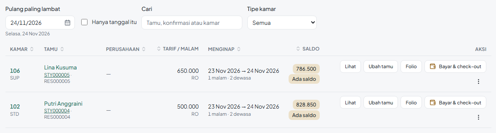
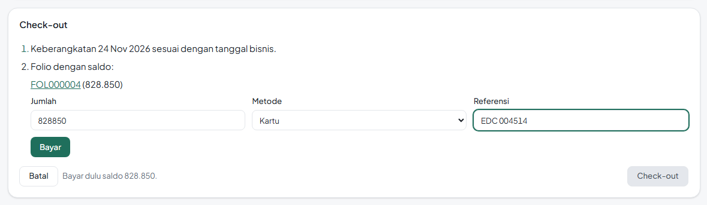
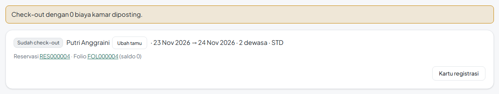

# Check-out

> 🎬 Video tutorial: menyusul

**Siapa yang melakukan:** resepsionis atau kasir.
**Kapan dilakukan:** saat tamu meninggalkan hotel, biasanya sebelum jam check-out hotel.
**Sebelum mulai:**
- Tanyakan apakah ada pemakaian minibar, laundry, atau restoran yang belum dicatat. Kalau ada, posting dulu ke folio.
- Siapkan mesin EDC atau QRIS kalau tamu membayar nontunai. Untuk tunai, Anda perlu shift kasir yang terbuka.

## Langkah-langkah

1. Buka **Front Desk → Tamu hari ini**, lalu klik tab **Keberangkatan**. Daftar ini berisi tamu yang dijadwalkan pulang paling lambat hari ini, termasuk tamu yang terlambat check-out. Kolom **Saldo** dan keterangan di bawahnya menunjukkan apa yang masih harus diselesaikan, misalnya **Ada saldo**.

   

2. Pada baris tamu, klik **Bayar & check-out**. Kalau tagihannya sudah lunas, tombolnya bernama **Check-out**. Halaman **Menginap** tamu terbuka dengan kotak **Check-out**.
3. Periksa daftar di kotak **Check-out**:
   - Keberangkatan **sesuai dengan tanggal bisnis**, atau peringatan bahwa tamu pulang lebih awal.
   - **Folio dengan saldo:** nomor folio dan jumlah yang harus dibayar. Biaya kamar yang akan diposting saat check-out sudah ikut dihitung, dan disebut di bawah nomor folionya, misalnya "Termasuk biaya kamar 605.000 yang diposting saat check-out.". Jumlah ini sama dengan yang ditagih saat check-out.

   Isi formulir pembayaran:

   | Field | Wajib? | Keterangan |
   |---|---|---|
   | Jumlah | Ya | Sudah terisi sebesar saldo. Ubah kalau tamu membayar sebagian. |
   | Metode | Ya | **Tunai**, **Kartu**, **Transfer bank**, **Lainnya**, atau **QRIS**. |
   | Referensi | Tidak | Nomor struk EDC atau transaksi, misalnya `EDC 004514`. |

   

4. Klik **Bayar**. Muncul tulisan "Pembayaran diposting. Periksa folio di bawah, lalu check-out."
5. Klik **Check-out**. Tombol ini baru bisa diklik setelah semua folio tamu bersaldo nol.

   

## Hasilnya

- Muncul pesan "Check-out dengan 0 biaya kamar diposting.". Angkanya adalah jumlah biaya kamar yang ikut diposting saat check-out.
- Status menginap menjadi **Sudah check-out**, dan semua folio tamu ditutup.
- Kamar otomatis berstatus **Kotor**, dan muncul di daftar kerja housekeeping.
- Tamu hilang dari tab **Keberangkatan** dan **Menginap**.

## Perlu diperhatikan

- **Semua folio harus nol.** Check-out tidak bisa dilakukan selama tamu masih berutang. Di samping tombol **Check-out** tertulis alasannya, misalnya "Bayar dulu saldo 828.850.".
- **Tamu kelebihan bayar (saldo kredit).** Contohnya deposit lebih besar dari tagihan. Muncul "Kembalikan … ke tamu dulu.". Klik **Buka folio**, lakukan refund, lalu kembali ke check-out.
- **Tagihan perusahaan.** Folio yang ditagihkan ke perusahaan juga harus nol sebelum check-out. Selesaikan di folio itu, misalnya dengan transfer ke piutang perusahaan. Tombol **Check-out** tetap bisa diklik, tetapi check-out ditolak dengan pesan "Semua folio menginap harus bersaldo nol untuk check-out.".
- **Tamu pulang lebih awal.** Kalau masa menginap berakhir sebelum tanggal keberangkatan yang dipesan, kotak **Check-out** menyebut tanggal masa menginap berakhir. Centang **Konfirmasi keberangkatan lebih awal**. Malam-malam setelahnya tidak ditagih:
  - Tamu yang sudah menginap sejak sebelum hari ini dan pulang pada siang hari tidak ditagih untuk malam ini. Yang dibayar cukup saldo folionya.
  - Tamu yang tiba hari ini tetap ditagih untuk malam ini, karena masa menginapnya paling sedikit satu malam. Untuk tamu satu malam, itu memang tanggal pesanannya, jadi kotak **Check-out** tidak meminta konfirmasi.
  - Check-out setelah tengah malam, sebelum audit malam, menagih malam tanggal bisnis yang sedang berjalan, karena malam itu sudah terpakai.

  Jumlah yang diminta kotak **Check-out** selalu sama dengan yang ditagih saat check-out, apa pun peran Anda.
- **Pembayaran tunai** butuh shift kasir yang terbuka. Lihat [Menerima deposit](menerima-deposit.md) untuk cara membuka shift dari layar ini.
- **Koneksi terputus saat membayar?** Layar menampilkan "Koneksi terputus. Pembayaran mungkin sudah tercatat. Tekan Bayar lagi, tidak akan tercatat dua kali."
- **Mencetak tagihan (folio) untuk tamu:** sebelum membayar, klik nomor folio di kotak **Check-out**, lalu klik **Cetak tagihan** di halaman folio. Setelah check-out, tombol yang sama bernama **Cetak invoice**.
- Untuk melihat semua tamu yang pulang pada tanggal tertentu saja, centang **Hanya tanggal itu** di filter tab **Keberangkatan**. Tamu yang terlambat check-out diberi tanda **terlambat**.

## Terkait

- [Menerima deposit](menerima-deposit.md)
- [Perpanjang atau persingkat](perpanjang-atau-persingkat.md)
- [Check-in](check-in.md)
