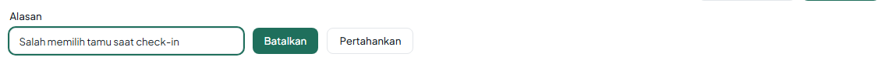
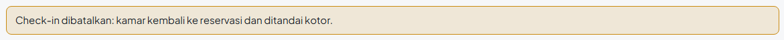

# Membatalkan check-in

**Siapa yang melakukan:** supervisor front office, atau pengguna lain yang perannya boleh membatalkan check-in.
**Kapan dilakukan:** saat check-in ternyata keliru, misalnya salah memilih tamu atau reservasi, dan harus dibatalkan pada hari yang sama.
**Sebelum mulai:**
- Pembatalan check-in hanya bisa dilakukan:
  - pada **tanggal bisnis yang sama** dengan tanggal check-in;
  - **sebelum tamu pindah kamar**;
  - selama **belum ada biaya** yang diposting ke folio tamu.
- Kalau tamu ternyata tidak jadi menginap dan sudah membayar deposit, siapkan pengembalian uangnya.

## Langkah-langkah

1. Buka halaman **Menginap** tamu: di **Front Desk → Tamu hari ini**, tab **Menginap**, klik **Lihat** pada baris tamu.
2. Klik **Batalkan check-in**, lalu isi **Alasan**.

   | Field | Wajib? | Keterangan |
   |---|---|---|
   | Alasan | Ya | Misalnya `Salah memilih tamu saat check-in`. Maksimal 500 karakter. |

   

3. Klik **Batalkan**. Klik **Pertahankan** kalau tidak jadi.

   > ⚠️ Penting: tamu langsung keluar dari daftar **Menginap**, dan kamarnya ditandai **Kotor**. Kalau check-in yang dibatalkan sebenarnya benar, Anda harus check-in ulang tamu itu.

## Hasilnya

Muncul pesan "Check-in dibatalkan: kamar kembali ke reservasi dan ditandai kotor."

- Reservasi kembali berstatus **Dipesan** dan muncul lagi di tab **Kedatangan**.
- Kamar berstatus **Kotor**, karena mungkin sudah dimasuki tamu.
- Deposit yang sudah dibayar tidak hilang: folio tamu kembali menjadi folio deposit reservasi.

## Perlu diperhatikan

- **Tombol Batalkan check-in tidak muncul** kalau:
  - peran Anda tidak punya izin itu;
  - check-in dilakukan sebelum tanggal bisnis hari ini;
  - tamu sudah pindah kamar.
- **"Folio menginap ini sudah berisi biaya: check-in tidak bisa dibatalkan."** Sekali sebuah biaya diposting ke folio tamu, check-in tidak bisa dibatalkan lagi, walaupun biaya itu sudah dibalik. Selesaikan tamu itu dengan [Check-out](check-out.md), dan minta supervisor mengoreksi folionya.
- **Folio perusahaan berisi pembayaran.** Layar menampilkan daftar folionya: "Folio perusahaan ini berisi uang, void atau refund dulu:". Batalkan (void) atau refund pembayaran itu dulu.
- **Setelah audit malam, check-in tidak bisa dibatalkan lagi.** Begitu tanggal bisnis berganti, tombol **Batalkan check-in** hilang. Kalau tombol itu diklik dari layar yang masih terbuka sejak sebelum audit malam, KamaraPMS menolak dengan pesan "Check-in hanya bisa dibatalkan pada hari yang sama dan sebelum pindah kamar.". Biaya kamar malam itu juga sudah diposting audit malam. Jalan keluarnya tergantung pada kesalahannya:
  - **Tamunya benar, tetapi kamarnya salah:** gunakan [Pindah kamar](pindah-kamar.md).
  - **Data tamunya salah**, misalnya salah ejaan atau nomor identitas keliru: perbaiki lewat **Ubah tamu**.
  - **Tamu ternyata tidak menginap**, atau reservasi yang di-check-in salah:
    1. Minta supervisor mengoreksi biaya kamar yang tidak semestinya dengan penyesuaian di folio (butuh persetujuan). Lihat [Reverse dan penyesuaian](../03-kasir-dan-pembayaran/reverse-dan-penyesuaian.md).
    2. Kembalikan deposit tamu kalau ada. Lihat [Void dan refund](../03-kasir-dan-pembayaran/void-dan-refund.md).
    3. Lakukan [Check-out](check-out.md) setelah saldo folio nol. Kalau tanggal keberangkatannya masih setelah hari ini, centang **Konfirmasi keberangkatan lebih awal**.
    4. Kalau tamu yang benar memang datang, check-in reservasi yang benar seperti biasa.

## Terkait

- [Check-in](check-in.md)
- [Check-out](check-out.md)
- [Meminta persetujuan](../00-memulai/meminta-persetujuan.md)
