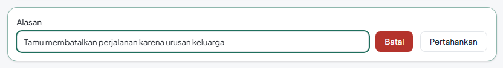
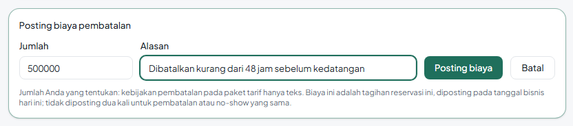

# Membatalkan reservasi dan tamu tidak datang

**Siapa yang melakukan:**
- Membatalkan: resepsionis atau staf reservasi.
- Menandai tamu tidak datang (no-show): supervisor atau night auditor, yaitu pengguna yang berwenang.

**Kapan dilakukan:**
- Membatalkan: saat tamu membatalkan pesanannya sebelum datang.
- No-show: saat tamu tidak datang pada tanggal kedatangannya, biasanya malam hari sebelum audit malam.

**Sebelum mulai:**
- Pastikan pembatalan benar dari tamu atau pemesan, dan catat alasannya.
- Periksa kebijakan pembatalan hotel, untuk menentukan apakah ada biaya pembatalan.

## Langkah-langkah

### Membatalkan reservasi

1. Buka reservasinya.
2. Klik **Batalkan reservasi** (tombol merah di bagian atas).
3. Isi **Alasan**, misalnya `Tamu membatalkan perjalanan karena urusan keluarga`.

   | Field | Wajib? | Keterangan |
   |---|---|---|
   | Alasan | Ya | Alasan pembatalan. Tersimpan di riwayat reservasi. Maksimal 500 karakter. |

   

4. Klik tombol merah **Batal** untuk membatalkan reservasi. Klik **Pertahankan** kalau ternyata tidak jadi membatalkan.

   > ⚠️ Penting: tombol merah **Batal** di kotak ini **membatalkan reservasi**, bukan menutup kotak. Untuk menutup kotak tanpa membatalkan, klik **Pertahankan**.

5. Status reservasi menjadi **Dibatalkan**, dan kamarnya dilepas untuk dijual lagi.

### Memposting biaya pembatalan (kalau ada)

6. Di reservasi yang sudah dibatalkan, klik **Posting biaya pembatalan**. Isi **Jumlah** dan **Alasan**, lalu klik **Posting biaya**.

   | Field | Wajib? | Keterangan |
   |---|---|---|
   | Jumlah | Ya | Besar biaya, misalnya `500000`. Anda sendiri yang menentukan jumlahnya: kebijakan pembatalan di paket tarif tidak dihitung otomatis. |
   | Alasan | Ya | Misalnya `Dibatalkan kurang dari 48 jam sebelum kedatangan`. |

   

### Menandai tamu tidak datang (no-show)

7. Buka reservasi tamu yang tidak datang. Di kartu kamar, klik **Tidak datang**.
8. Isi **Alasan (opsional)** kalau perlu, lalu klik **Tandai no-show**. Status kamar menjadi **Tidak datang**.
9. Kalau hotel mengenakan biaya no-show, klik **Posting biaya no-show** di kartu kamar, lalu isi **Jumlah** dan **Alasan** seperti pada langkah 6.

## Hasilnya

- Reservasi yang dibatalkan berstatus **Dibatalkan** dan tidak lagi menahan kamar. Di ringkasan sisi kanan tertulis "Dibatalkan:" diikuti alasannya.
- Biaya pembatalan atau no-show masuk ke folio reservasi pada tanggal bisnis hari ini. Muncul pesan "Biaya 500000 diposting ke folio FOL…" dengan jumlah dan nomor folionya.

## Perlu diperhatikan

- **Masih ada deposit?** Setelah membatalkan, kalau folio masih memegang uang, muncul pesan "Folio masih menahan {jumlah}: refund deposit atau posting biaya.". Posting biaya pembatalannya, lalu kembalikan sisanya (refund) dari halaman folio.
- **Mengaktifkan kembali reservasi yang batal:** klik **Aktifkan kembali** (hanya bagi yang berwenang). Kamar dijual ulang, jadi bisa ditolak kalau kamar tipe itu sudah habis atau tanggal kedatangannya sudah lewat ("Ada kamar yang tiba sebelum tanggal bisnis."). Nomor kamar yang dulu ditetapkan tidak ikut kembali.
- **Membatalkan satu kamar saja:** tombol **Batalkan kamar** di kartu kamar membatalkan kamar itu saja. Kalau itu kamar terakhir yang masih aktif, seluruh reservasi ikut batal.
- **Reservasi yang sudah check-in tidak bisa dibatalkan:** "Ada kamar yang sudah check-in atau sudah check-out." Untuk check-in yang salah, lihat [Membatalkan check-in](membatalkan-check-in.md).
- **Tombol Tidak datang** hanya muncul untuk pengguna yang berwenang menandai no-show, dan hanya mulai tanggal kedatangan tamu. Sebelum itu: "Kamar ini belum waktunya tiba."
- **Biaya hanya bisa diposting sekali** untuk satu pembatalan atau no-show: "Biaya ini sudah diposting untuk pembatalan atau no-show ini.". Kalau jumlahnya salah, koreksi biaya itu di folio. Jangan memposting ulang.
- Kedatangan yang tidak check-in sampai audit malam ikut diperiksa oleh audit malam. Lihat [Audit malam](../11-audit-malam/menjalankan-audit-malam.md).

## Terkait

- [Menerima deposit](menerima-deposit.md)
- [Mengonfirmasi dan mengubah reservasi](mengonfirmasi-dan-mengubah-reservasi.md)
- [Menjalankan audit malam](../11-audit-malam/menjalankan-audit-malam.md)
