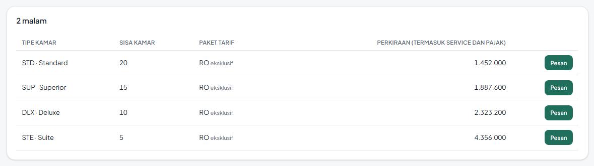
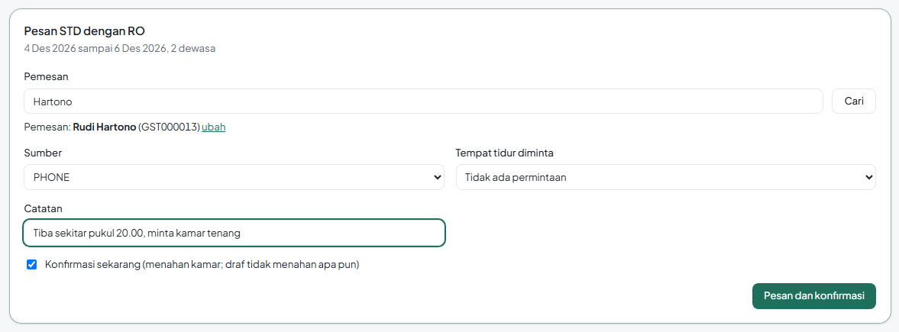
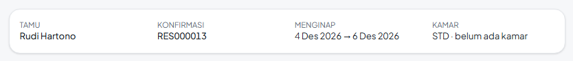

# Membuat reservasi

> 🎬 Video tutorial: menyusul

**Siapa yang melakukan:** resepsionis atau staf reservasi.
**Kapan dilakukan:** saat tamu memesan kamar lewat telepon, email, pesan singkat, atau datang langsung untuk menginap di hari lain.
**Sebelum mulai:**
- Pastikan data tamu sudah ada di **Tamu**. Formulir reservasi tidak bisa membuat tamu baru. Kalau tamunya belum terdaftar, buat dulu lewat [Mengelola data tamu](mengelola-data-tamu.md).
- Catat tanggal datang, tanggal pulang, jumlah tamu, dan tipe kamar yang diminta.

## Langkah-langkah

1. Buka **Front Desk → Reservasi**, lalu klik **Reservasi baru**. Tombol **Reservasi baru** juga ada di halaman **Hari Ini** dan **Tamu hari ini**.
2. Isi tanggal dan jumlah tamu:

   | Field | Wajib? | Keterangan |
   |---|---|---|
   | Datang | Ya | Tanggal kedatangan. Paling awal tanggal bisnis hari ini. |
   | Pulang | Ya | Tanggal keberangkatan, harus setelah **Datang**. |
   | Dewasa | Ya | Minimal 1. |
   | Anak | Tidak | Kosongkan atau isi `0` kalau tidak ada anak. |

3. Klik **Cari**. Muncul daftar tipe kamar dengan **Sisa kamar**, **Paket tarif**, dan **Perkiraan (termasuk service dan pajak)** untuk seluruh malam.

   

4. Klik **Pesan** pada baris tipe kamar dan paket tarif yang dipilih tamu. Formulir pemesanan muncul di bawahnya.
5. Di **Pemesan**, ketik nama, email, telepon, atau kode tamu, misalnya `Hartono`, lalu klik **Cari**. Klik nama tamu yang benar. Di bawah kolom muncul **Pemesan: Rudi Hartono (GST000013)**.
6. Lengkapi formulirnya:

   | Field | Wajib? | Keterangan |
   |---|---|---|
   | Pemesan | Ya, untuk reservasi yang dikonfirmasi | Tamu yang memesan. Tanpa pemesan, reservasi hanya bisa disimpan sebagai draf. |
   | Sumber | Ya | Dari mana pesanan datang. Pilihan tampil sebagai kode bahasa Inggris: `PHONE` (telepon), `EMAIL` (email), `WALK_IN` (datang langsung), `WEBSITE` (situs web), `OTA` (agen perjalanan online), `AGENT` (agen), `OTHER` (lainnya). |
   | Tempat tidur diminta | Tidak | Muncul kalau tipe kamar punya beberapa jenis tempat tidur, misalnya twin atau king. |
   | Catatan | Tidak | Catatan untuk staf, misalnya `Tiba sekitar pukul 20.00, minta kamar tenang`. |
   | Grup / Perusahaan yang ditagih | Tidak | Muncul kalau hotel punya grup atau perusahaan. Lihat bagian Perusahaan dan grup. |
   | Konfirmasi sekarang | – | Biarkan tercentang supaya kamar langsung ditahan. Kosongkan centang untuk menyimpan draf. |

   

7. Klik **Pesan dan konfirmasi**. Kalau centang **Konfirmasi sekarang** dikosongkan, tombolnya bernama **Simpan draf**.
8. Halaman reservasi yang baru terbuka. Nomor konfirmasinya (misalnya `RES000013`) tampil di judul dan di kartu atas. Sampaikan nomor ini kepada tamu.

   

## Hasilnya

Reservasi berstatus **Dipesan** dan menahan satu kamar dari tipe yang dipilih untuk tanggal itu. Nomor kamarnya belum ditentukan: **belum ada kamar**. Anda bisa menetapkannya sekarang atau nanti, lihat [Menetapkan kamar](menetapkan-kamar.md).

## Perlu diperhatikan

- **Draf tidak menahan kamar.** Reservasi **Draf** tidak mengurangi sisa kamar. Kalau kamar tipe itu habis sebelum draf dikonfirmasi, konfirmasinya ditolak. Lihat [Mengonfirmasi dan mengubah reservasi](mengonfirmasi-dan-mengubah-reservasi.md).
- **Tombol Pesan tidak bisa diklik?** Arahkan kursor ke tombol untuk melihat alasannya:
  - Tidak ada kamar tipe ini yang tersisa pada tanggal itu.
  - Rombongan terlalu besar untuk tipe kamar itu.
  - Ada malam yang belum punya harga di grid tarif.
  - Menginap itu melanggar pembatasan penjualan, misalnya minimal menginap 2 malam.
- **Mengubah harga per malam** hanya bisa dilakukan pengguna yang perannya punya izin mengubah tarif secara manual. Tombolnya **Ubah tarif** di formulir pemesanan. Kalau perannya tidak bisa menyetujui sendiri, akan diminta persetujuan. Lihat [Meminta persetujuan](../00-memulai/meminta-persetujuan.md).
- **Kamar gratis** (paket komplimen atau pemakaian hotel) hanya muncul bagi yang berwenang, dan wajib diisi **Alasan**.
- **Konfirmasi lewat email** dikirim otomatis kalau server email hotel sudah diatur dan pemesan punya alamat email. Kalau belum, kartu **E-mail** di halaman reservasi memberi tahu bahwa email belum diatur. Untuk mencetak konfirmasi, klik **Konfirmasi (PDF)**.
- Pita **Kamar tersisa dalam … malam sejak kedatangan** di bawah formulir pencarian hanya saran. Yang menentukan adalah hasil pencarian.
- Satu reservasi di layar ini berisi satu kamar. Untuk tamu rombongan, gunakan fitur **Grup**.

## Terkait

- [Mengonfirmasi dan mengubah reservasi](mengonfirmasi-dan-mengubah-reservasi.md)
- [Menetapkan kamar](menetapkan-kamar.md)
- [Menerima deposit](menerima-deposit.md)
- [Mengelola data tamu](mengelola-data-tamu.md)
