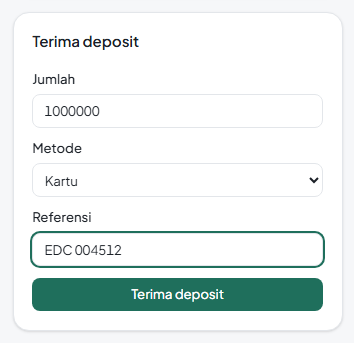
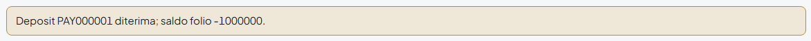
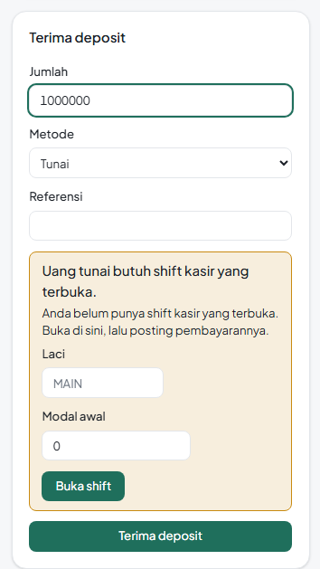

# Menerima deposit

**Siapa yang melakukan:** resepsionis atau kasir.
**Kapan dilakukan:** saat tamu membayar uang muka untuk reservasi yang belum check-in, misalnya lewat transfer bank seminggu sebelum datang.
**Sebelum mulai:**
- Reservasi berstatus **Draf** atau **Dipesan**.
- Untuk deposit **tunai**, Anda harus punya shift kasir yang terbuka. Lihat **Perlu diperhatikan**.
- Untuk kartu, QRIS, atau transfer, siapkan nomor referensinya, misalnya nomor struk EDC atau nomor transaksi bank.

Deposit yang diterima saat check-in dicatat di langkah **Deposit** pada [Check-in](check-in.md), bukan di halaman ini.

## Langkah-langkah

1. Buka reservasinya. Kartu **Terima deposit** ada di sisi kanan halaman.
2. Isi **Jumlah**, misalnya `1000000`. Tulis angka saja, tanpa titik dan tanpa "Rp".
3. Pilih **Metode**.
4. Isi **Referensi**.

   | Field | Wajib? | Keterangan |
   |---|---|---|
   | Jumlah | Ya | Jumlah uang yang diterima. |
   | Metode | Ya | **Tunai**, **Kartu**, **Transfer bank**, **Lainnya**, atau **QRIS**. Pilihan awalnya **Tunai**. |
   | Referensi | Tidak | Nomor bukti, misalnya `EDC 004512`. Sangat disarankan untuk kartu, QRIS, dan transfer, supaya mudah dicocokkan dengan bank. |

   

5. Klik **Terima deposit**. Di atas halaman muncul pesan, misalnya "Deposit PAY000001 diterima; saldo folio -1000000."

   

## Hasilnya

- Deposit tercatat di folio reservasi. Folio ini otomatis dibuat saat deposit pertama, dan tampil di kartu **Pembayaran dan folio**. Kalau folio reservasi itu sudah ditutup, misalnya oleh rekan Anda pada saat yang sama, deposit dicatat di folio reservasi yang baru, dan folio yang ditutup tidak berubah.
- Saldo folio menjadi minus. Artinya hotel memegang uang tamu, yang nanti dipakai untuk membayar tagihannya.
- Di daftar **Kedatangan**, kolom **Siap check-in** menampilkan **Deposit** dengan jumlahnya.

## Perlu diperhatikan

- **Deposit tunai butuh shift kasir yang terbuka.** Kalau Anda memilih **Tunai** dan belum punya shift, muncul kotak "Uang tunai butuh shift kasir yang terbuka.". Isi **Laci** (misalnya `MAIN`) dan **Modal awal** (uang di laci saat mulai), klik **Buka shift**, lalu klik **Terima deposit**. Kalau peran Anda tidak bisa membuka shift, minta kasir yang menerima uangnya. Lihat bagian Kasir.

  

- **Saldo di pesan ditulis tanpa titik ribuan.** Contohnya `-1000000` berarti minus satu juta rupiah.
- **Salah mencatat deposit?** Deposit yang sudah tersimpan tidak bisa dihapus. Koreksinya dengan membatalkan pembayaran (void) di hari yang sama, atau dengan refund, dari halaman folio. Keduanya butuh izin dan persetujuan.
- **Kuitansi deposit** untuk tamu: di kartu **Pembayaran dan folio**, klik nomor folionya. Di baris deposit pada folio, klik **Kuitansi**.
- Reservasi yang dibatalkan tidak bisa menerima deposit baru: "Deposit butuh reservasi berstatus draf atau terkonfirmasi."
- Deposit selalu dicatat pada tanggal bisnis hari ini.

## Terkait

- [Membuat reservasi](membuat-reservasi.md)
- [Check-in](check-in.md)
- [Membatalkan reservasi dan tamu tidak datang](membatalkan-reservasi-dan-no-show.md)
