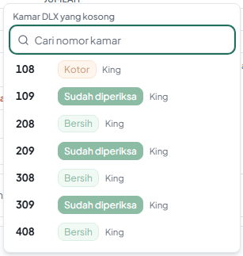
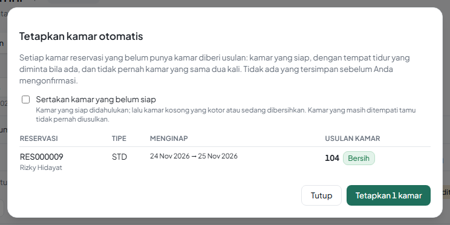

# Menetapkan kamar

**Siapa yang melakukan:** resepsionis atau staf reservasi.
**Kapan dilakukan:** setelah reservasi dikonfirmasi. Paling lambat sebelum tamu check-in, biasanya pagi hari untuk kedatangan hari itu.
**Sebelum mulai:**
- Reservasi harus berstatus **Dipesan**. Draf harus dikonfirmasi dulu.
- Lihat **Status kamar** kalau ingin memberi tamu kamar yang sudah bersih.

Reservasi menahan satu kamar dari **tipe** yang dipesan (misalnya Deluxe), belum nomor kamarnya. Menetapkan kamar berarti memilih nomor kamarnya, misalnya `208`.

## Langkah-langkah

### Satu reservasi, dari halaman reservasi

1. Buka reservasinya, misalnya lewat **Front Desk → Reservasi** lalu klik barisnya.
2. Di kartu kamar, klik **Tetapkan kamar**.
3. Klik **Kamar kosong**. Daftar kamar kosong untuk tipe itu muncul, lengkap dengan status kebersihannya. Ketik nomor kamar di **Cari nomor kamar** untuk menyaring daftar.

   | Field | Wajib? | Keterangan |
   |---|---|---|
   | Tipe kamar | Ya | Tipe yang dipesan ditandai **(dipesan)**. Tipe lain ditandai **(naik kelas)** dan hanya boleh dipilih oleh yang berwenang menaikkan kelas kamar. |
   | Kamar | Ya | Pilih dari daftar **Kamar kosong**. Tanda **✓** berarti tempat tidurnya sesuai permintaan tamu. |

   

4. Klik nomor kamarnya. Kamar langsung ditetapkan, tanpa tombol simpan.
5. Kartu kamar sekarang menampilkan **kamar 208** (nomor yang Anda pilih). Untuk membatalkan, klik **Lepas kamar**.

### Semua kedatangan hari ini sekaligus

6. Buka **Front Desk → Tamu hari ini → Kedatangan**. Kalau ada kedatangan yang belum punya kamar, di atas tabel muncul tulisan "1 kamar belum ditetapkan kamarnya", dengan angka sesuai jumlahnya.
7. Klik **Tetapkan otomatis**. Jendela **Tetapkan kamar otomatis** mengusulkan satu kamar untuk setiap reservasi: kamar yang siap, dengan tempat tidur yang diminta bila ada. Belum ada yang tersimpan.

   

8. Periksa usulannya, lalu klik **Tetapkan 1 kamar** (angkanya mengikuti jumlah kamar). Setiap baris menampilkan **✓ Ditetapkan** atau **Gagal:** dengan alasannya. Klik **Tutup**.

## Hasilnya

Reservasi punya nomor kamar. Di daftar **Kedatangan**, kolom **Kamar** menampilkan nomor dan status kebersihannya. Tanda **Siap** di kolom **Siap check-in** berarti kamar sudah bisa dipakai.

## Perlu diperhatikan

- **Tetapkan otomatis** juga ada di daftar **Reservasi**: klik **⋯** pada baris reservasi → **Tetapkan kamar** → **Tetapkan otomatis**. Di halaman satu reservasi tidak ada tombol tetapkan otomatis.
- Di jendela **Tetapkan kamar otomatis**, centang **Sertakan kamar yang belum siap** untuk ikut mengusulkan kamar kosong yang masih kotor atau sedang dibersihkan. Kamar yang masih ditempati tamu tidak pernah diusulkan.
- Di daftar **Kedatangan**, tombol **Pilih kamar** di kolom **Kamar** juga menetapkan kamar langsung dari tabel.
- **"Kamar itu sudah diambil. Daftar kamar kosong sudah dimuat ulang: pilih yang lain."** berarti rekan Anda baru saja memakai kamar itu. Pilih kamar lain.
- **"Kamar hanya bisa ditetapkan pada reservasi yang terkonfirmasi."** berarti reservasinya masih **Draf**. Konfirmasi dulu.
- **Naik kelas (upgrade):** kalau Anda memilih tipe yang ditandai **(naik kelas)** tetapi peran Anda tidak punya izin "Menetapkan kamar yang lebih tinggi (naik kelas)", penetapannya ditolak dengan pesan "Peran Anda tidak mengizinkan tindakan ini.". Minta supervisor.
- Untuk mengganti tipe kamar reservasi, klik **Lepas kamar** dulu, lalu ubah tipenya lewat **Ubah reservasi**.

## Terkait

- [Mengonfirmasi dan mengubah reservasi](mengonfirmasi-dan-mengubah-reservasi.md)
- [Check-in](check-in.md)
- [Bagan kamar dan ketersediaan](bagan-kamar-dan-ketersediaan.md)
