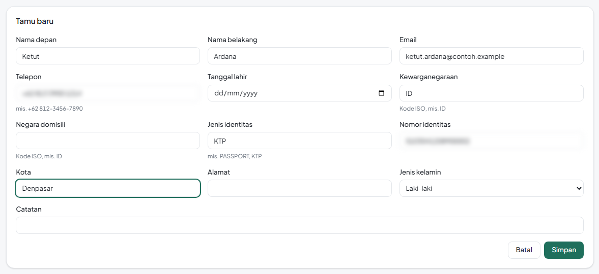
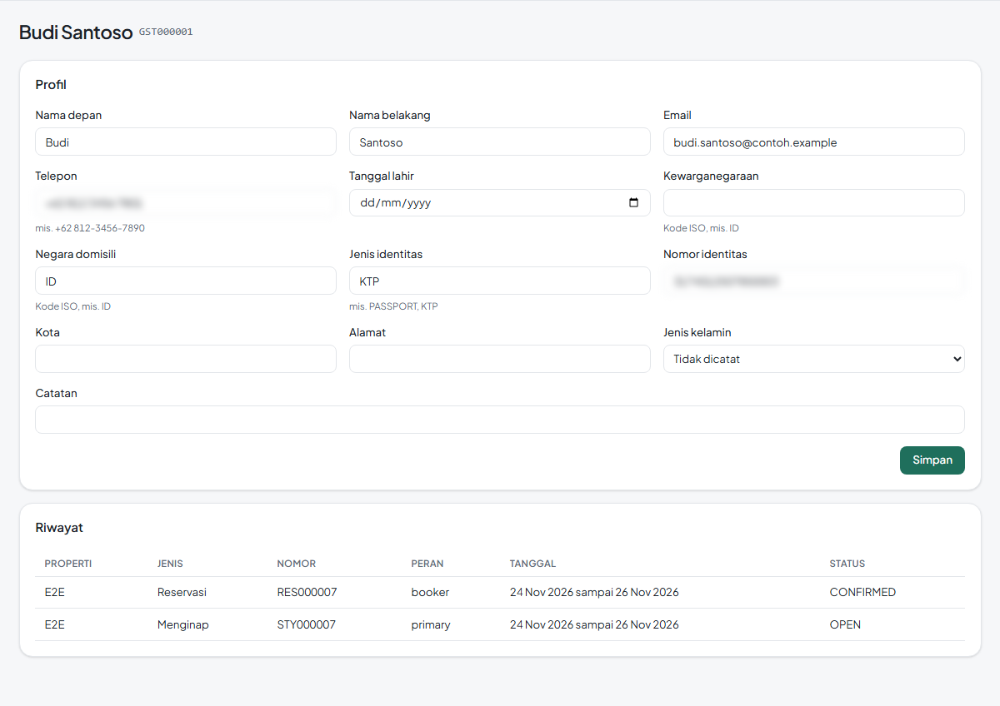

# Mengelola data tamu

**Siapa yang melakukan:** resepsionis atau staf reservasi. Untuk mengubah data tamu, peran Anda harus boleh membuat dan mengubah profil tamu.
**Kapan dilakukan:**
- Sebelum membuat reservasi untuk tamu baru.
- Saat melengkapi identitas tamu walk-in.
- Saat tamu memberi tahu perubahan nomor telepon atau email.

**Sebelum mulai:** cari dulu apakah tamu sudah terdaftar, supaya profilnya tidak dobel.

## Langkah-langkah

### Mencari tamu

1. Buka **Front Desk → Tamu**. Daftar tamu langsung tampil. Ketik nama, email, telepon, nomor identitas, atau kode tamu di **Cari**, lalu tekan `Enter` atau klik **Cari**.

### Membuat tamu baru

2. Klik **Tamu baru**. Formulir **Tamu baru** terbuka.
3. Isi data tamu:

   | Field | Wajib? | Keterangan |
   |---|---|---|
   | Nama depan | Tidak | Misalnya `Ketut`. |
   | Nama belakang | Ya | Misalnya `Ardana`. Untuk tamu yang hanya punya satu nama, tulis namanya di sini. |
   | Email | Tidak | Dipakai untuk mengirim konfirmasi reservasi. |
   | Telepon | Tidak | Contoh format: `+62 812-3456-7890`. |
   | Tanggal lahir | Tidak | |
   | Kewarganegaraan | Tidak | Kode negara dua huruf, misalnya `ID`. |
   | Negara domisili | Tidak | Kode negara dua huruf. |
   | Jenis identitas | Tidak* | Diketik bebas, misalnya `KTP` atau `PASSPORT`. |
   | Nomor identitas | Tidak* | Nomor KTP atau paspor. |
   | Kota / Alamat | Tidak | Misalnya `Denpasar`. |
   | Jenis kelamin | Tidak | **Laki-laki**, **Perempuan**, **Lainnya**, **Memilih tidak menyebutkan**, atau **Tidak dicatat**. |
   | Catatan | Tidak | Catatan tentang tamu, misalnya alergi atau preferensi. |

   \* **Jenis identitas** dan **Nomor identitas** harus diisi berdua, atau dikosongkan berdua.

   

4. Klik **Simpan**.
5. Di atas daftar muncul kotak "Dibuat GST…" dengan kode tamu yang baru. Kalau ada profil yang mirip, kotak itu juga menampilkan **Ini mungkin duplikat:** dan daftar profilnya.

### Melihat dan mengubah profil

6. Klik baris tamu di daftar. Halaman tamu menampilkan kartu **Profil** dan kartu **Riwayat**, yang berisi semua reservasi dan masa menginapnya. Ubah data di kartu **Profil**, lalu klik **Simpan**. Muncul "Tersimpan.".

   

## Hasilnya

Tamu punya profil dengan kode sendiri yang diawali `GST`, misalnya `GST000001`. Profil ini bisa dipilih sebagai pemesan reservasi, saat check-in, atau saat walk-in.

## Perlu diperhatikan

- **Peringatan duplikat** tidak menghentikan penyimpanan: profil baru tetap dibuat. Alasannya tampil dalam bahasa Inggris di dalam kurung:
  - `same email` (email sama)
  - `same phone` (telepon sama)
  - `same id document` (identitas sama)
  - `same name and birth date` (nama dan tanggal lahir sama)

  KamaraPMS belum punya fitur menggabungkan dua profil. Kalau profilnya ternyata dobel, pakai profil yang lama untuk reservasi berikutnya.
- **Mengosongkan kolom lalu menekan Simpan** menghapus isi kolom itu dari profil.
- **Pesan `id_type and id_number go together`** (bahasa Inggris, artinya jenis dan nomor identitas harus diisi bersama) muncul kalau hanya salah satunya diisi.
- **"Format tidak valid."** di bawah kolom berarti isiannya tidak sesuai format, misalnya kewarganegaraan lebih dari dua huruf atau telepon berisi huruf.
- **Kolom Peran dan Status di kartu Riwayat** masih tampil sebagai kode bahasa Inggris:
  - Peran: `booker` (pemesan), `occupant` (penghuni kamar), `primary` (tamu utama), `accompanying` (tamu pendamping).
  - Status: `CONFIRMED` (dipesan), `CANCELLED` (dibatalkan), `DRAFT` (draf), `OPEN` (sedang menginap), `CHECKED_OUT` (sudah check-out).
- **Profil hanya bisa dibaca** kalau Anda tidak berwenang mengubahnya. Layar menampilkan "Anda dapat melihat profil ini tetapi tidak mengubahnya: mengubah membutuhkan guest.write di properti tempat tamu pernah menginap atau memesan." (`guest.write` adalah izin "Membuat dan mengubah profil tamu").
- Data tamu juga bisa diubah dari **Tamu hari ini** (tombol **Ubah tamu**) dan dari halaman reservasi atau halaman **Menginap**.

## Terkait

- [Membuat reservasi](membuat-reservasi.md)
- [Check-in](check-in.md)
- [Walk-in](walk-in.md)
