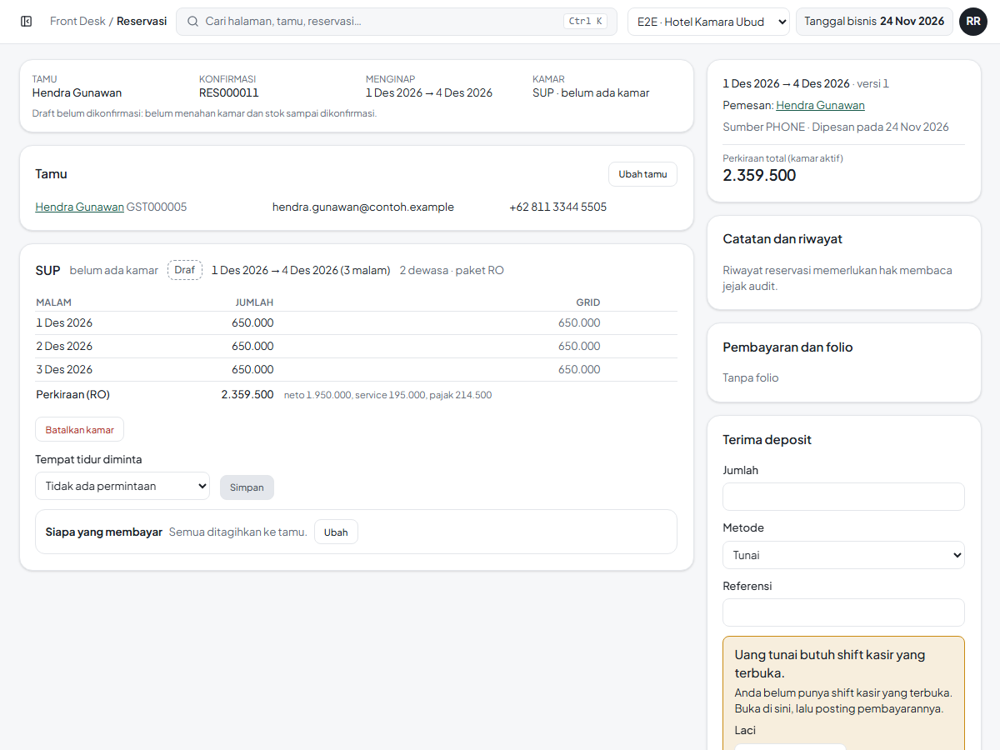
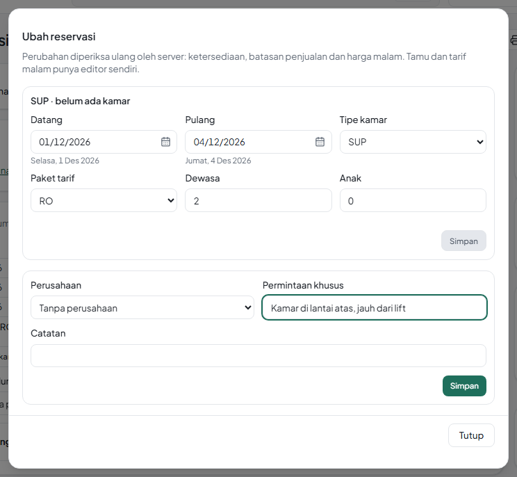

# Mengonfirmasi dan mengubah reservasi

**Siapa yang melakukan:** resepsionis atau staf reservasi.
**Kapan dilakukan:**
- Mengonfirmasi: saat pesanan yang tadinya disimpan sebagai **Draf** sudah pasti, misalnya setelah tamu membalas email.
- Mengubah: saat tamu mengganti tanggal, tipe kamar, jumlah tamu, atau menambahkan permintaan khusus.

**Sebelum mulai:** siapkan nomor konfirmasi atau nama tamu.

## Langkah-langkah

### Mengonfirmasi draf

1. Buka **Front Desk → Reservasi**. Klik tombol saringan **Draf** di atas daftar untuk menampilkan semua draf.
2. Klik baris reservasi yang ingin dikonfirmasi. Halaman reservasi terbuka. Di kartu atas tertulis "Draft belum dikonfirmasi: belum menahan kamar dan stok sampai dikonfirmasi."

   

3. Klik **Konfirmasi** di bagian atas halaman.
4. Status reservasi berubah menjadi **Dipesan**, dan kamar ditahan.

### Mengubah reservasi

5. Di halaman reservasi, klik **Ubah reservasi**. Jendela **Ubah reservasi** terbuka. Jendela ini punya dua bagian: bagian kamar di atas, dan bagian reservasi di bawah.

   | Field | Wajib? | Keterangan |
   |---|---|---|
   | Datang / Pulang | Ya | Tanggal baru. Ketersediaan dan harga diperiksa ulang. |
   | Tipe kamar | Ya | Tidak bisa diganti selama nomor kamar sudah ditetapkan. Klik **Lepas kamar** dulu di halaman reservasi. |
   | Paket tarif | Ya | Paket harga, misalnya `RO` (room only, kamar saja). |
   | Dewasa / Anak | Ya | Jumlah tamu di kamar. |
   | Perusahaan | Tidak | Perusahaan pemesan, kalau ada. |
   | Permintaan khusus | Tidak | Permintaan tamu, misalnya `Kamar di lantai atas, jauh dari lift`. Tampil di kartu **Catatan dan riwayat**. |
   | Catatan | Tidak | Catatan untuk staf. |

   

6. Klik **Simpan** di bagian yang Anda ubah. Setiap bagian punya tombol **Simpan** sendiri. Setelah selesai, klik **Tutup**.

### Draf yang tersimpan tanpa pemesan

Draf tanpa pemesan tidak bisa dikonfirmasi, dan pemesannya tidak bisa ditambahkan dari halaman reservasi. Buat ulang reservasinya:

7. Buat reservasi baru untuk tanggal, tipe kamar, dan paket tarif yang sama, kali ini dengan **Pemesan**. Lihat [Membuat reservasi](membuat-reservasi.md). Catat nomor konfirmasinya.
8. Buka draf yang lama, klik **Batalkan reservasi**, lalu isi **Alasan**, misalnya `Dibuat ulang dengan pemesan: RES000020` (nomor reservasi yang baru). Klik tombol merah **Batal**. Draf tidak menahan kamar, jadi pembatalan ini tidak mengubah sisa kamar.

## Hasilnya

- Reservasi yang dikonfirmasi berstatus **Dipesan** dan menahan kamar. Kalau server email hotel sudah diatur dan pemesan punya email, konfirmasi dikirim otomatis.
- Perubahan tanggal atau tipe kamar langsung tampil di halaman reservasi, dengan harga per malam yang dihitung ulang.

## Perlu diperhatikan

- **Konfirmasi ditolak** kalau:
  - Reservasi belum punya pemesan: "Pemesan wajib diisi: tamu atau perusahaan." Walaupun pesannya menyebut perusahaan, yang dihitung hanya **tamu** pemesan: mengisi **Perusahaan** di **Ubah reservasi** tidak cukup. Ikuti langkah 7 dan 8.
  - Kamar tipe itu sudah habis pada beberapa malam: "Tipe kamar tidak tersedia pada beberapa malam."
  - Menginap itu melanggar pembatasan penjualan. Pengguna yang berwenang bisa melewatinya dengan alasan dan persetujuan.
- **Selalu pilih Pemesan saat membuat draf.** Halaman reservasi tidak punya kolom untuk menambahkan pemesan belakangan. Kalau telanjur, ikuti langkah 7 dan 8.
- **Tamu dan tarif per malam tidak diubah di jendela ini.** Untuk data tamu, gunakan **Ubah tamu** di kartu **Tamu**. Untuk harga, gunakan **Ubah tarif** di kartu kamar (hanya bagi yang berwenang).
- **Sumber** pesanan dan **Catatan** juga bisa diubah di kartu **Rincian** di sisi kanan halaman.
- **"Data diubah orang lain: muat ulang lalu coba lagi."** berarti rekan Anda mengubah reservasi yang sama di saat yang sama. Halaman dimuat ulang. Ulangi perubahan Anda.
- Reservasi yang sudah check-in tidak bisa diubah lewat jendela ini. Gunakan [Perpanjang atau persingkat](perpanjang-atau-persingkat.md) atau [Pindah kamar](pindah-kamar.md).
- Tombol **Konfirmasi (PDF)** membuka surat konfirmasi untuk dicetak atau dikirim ke tamu. Tombol ini tidak muncul untuk draf.

## Terkait

- [Membuat reservasi](membuat-reservasi.md)
- [Menetapkan kamar](menetapkan-kamar.md)
- [Membatalkan reservasi dan tamu tidak datang](membatalkan-reservasi-dan-no-show.md)
