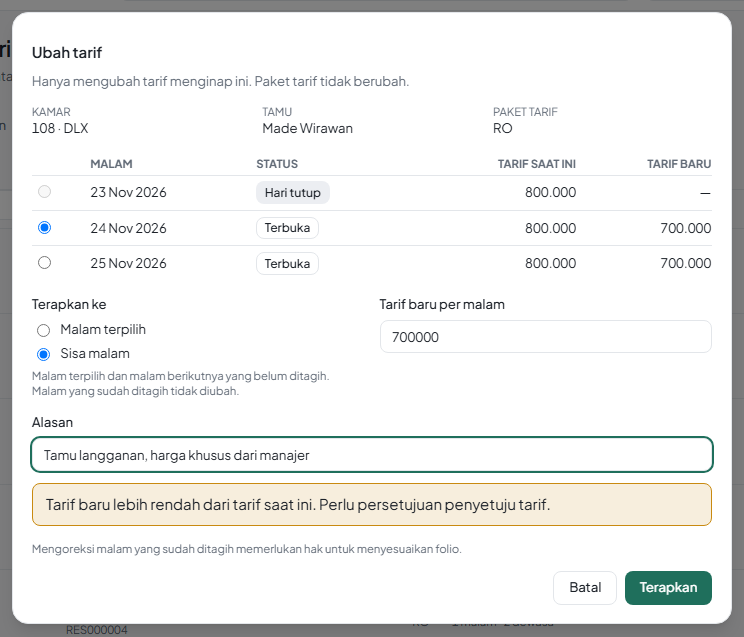

# Mengubah tarif tamu yang sedang menginap

**Siapa yang melakukan:** resepsionis yang perannya boleh mengubah tarif tamu menginap. Untuk menurunkan tarif, dibutuhkan persetujuan atasan yang berwenang.
**Kapan dilakukan:** saat harga kamar tamu yang sudah check-in harus diubah, misalnya karena harga khusus dari manajer atau kompensasi keluhan.
**Sebelum mulai:**
- Pastikan perubahan harga sudah disetujui sesuai kebijakan hotel.
- Siapkan alasannya.
- Untuk menurunkan tarif, pastikan penyetuju (misalnya manajer front office) ada di dekat Anda.

Perubahan ini hanya berlaku untuk tamu itu. Paket tarif dan harga untuk tamu lain tidak berubah.

## Langkah-langkah

1. Buka **Front Desk → Tamu hari ini**, lalu klik tab **Menginap**.
2. Pada baris tamu, klik **⋮** (Aksi lainnya) → **Ubah tarif**. Jendela **Ubah tarif** terbuka dan menampilkan setiap malam menginap, dengan statusnya:
   - **Terbuka**: belum ditagih.
   - **Sudah diposting**: sudah ditagih.
   - **Hari tutup**: hari yang sudah ditutup audit malam.
3. Pilih malam pertama yang ingin diubah, lalu isi kolom-kolomnya:

   | Field | Wajib? | Keterangan |
   |---|---|---|
   | Malam | Ya | Klik bulatan di kiri baris malam. |
   | Terapkan ke | Ya | **Malam terpilih** untuk satu malam saja. **Sisa malam** untuk malam itu dan malam-malam berikutnya yang belum ditagih. |
   | Tarif baru per malam | Ya | Harga baru, angka saja, misalnya `700000`. |
   | Alasan | Ya | Misalnya `Tamu langganan, harga khusus dari manajer`. |

   

4. Kolom **Tarif baru** di tabel menunjukkan hasilnya. Klik **Terapkan**.
5. Kalau tarif baru lebih rendah, kotak **Setujui koreksi** muncul. Penyetuju mengisi **Email penyetuju** dan **Kata sandi penyetuju**, lalu klik **Setujui**. Lihat [Meminta persetujuan](../00-memulai/meminta-persetujuan.md).

## Hasilnya

Muncul pesan "Tarif diubah.". Kolom **Tarif / malam** di daftar **Menginap** menampilkan harga baru. Malam-malam berikutnya ditagih dengan harga baru oleh audit malam.

## Perlu diperhatikan

- **Menaikkan tarif** pada malam yang belum ditagih tidak butuh persetujuan. **Menurunkan tarif** butuh persetujuan pengguna yang boleh menyetujui perubahan tarif, kecuali peran Anda sendiri boleh menyetujuinya. Layar memberi tahu: "Tarif baru lebih rendah dari tarif saat ini. Perlu persetujuan penyetuju tarif."
- **Malam yang sudah ditagih** hanya bisa dipilih pengguna yang berwenang memposting penyesuaian. Tagihannya tidak diubah: selisihnya diposting sebagai penyesuaian (adjustment) di folio hari ini, dan selalu butuh persetujuan.
- **Sisa malam** tidak mengubah malam yang sudah ditagih.
- **"Tidak ada malam yang berubah."** berarti tarif baru sama dengan tarif lama.
- Mengubah tarif juga bisa dilakukan dari halaman reservasi tamu: tombol **Ubah tarif** di kartu kamar.

## Terkait

- [Meminta persetujuan](../00-memulai/meminta-persetujuan.md)
- [Pindah kamar](pindah-kamar.md)
- [Perpanjang atau persingkat](perpanjang-atau-persingkat.md)
