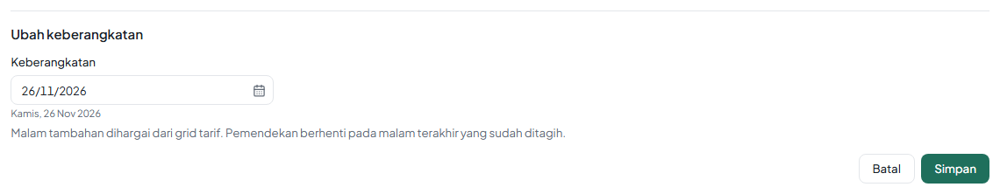
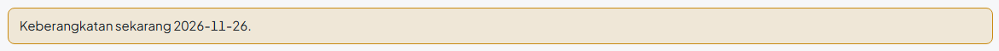

# Memperpanjang atau mempersingkat menginap

**Siapa yang melakukan:** resepsionis yang perannya boleh mengubah reservasi.
**Kapan dilakukan:** saat tamu yang sedang menginap ingin tinggal lebih lama, atau pulang lebih cepat tetapi bukan hari ini.
**Sebelum mulai:** tanyakan tanggal keberangkatan yang baru.

Tamu yang pulang **hari ini** sebelum tanggal keberangkatannya cukup di-check-out. Lihat [Check-out](check-out.md).

## Langkah-langkah

1. Buka halaman **Menginap** tamu. Caranya: di **Front Desk → Tamu hari ini**, tab **Menginap**, klik **Lihat** pada baris tamu. Cara lainnya: klik **⋮** → **Perpanjang**, yang langsung membuka langkah 3.
2. Klik **Perpanjang / persingkat**. Kotak **Ubah keberangkatan** terbuka.
3. Isi tanggal baru di **Keberangkatan**.

   | Field | Wajib? | Keterangan |
   |---|---|---|
   | Keberangkatan | Ya | Tanggal pulang yang baru. Paling cepat besok. |

   

4. Klik **Simpan**. Muncul pesan "Keberangkatan sekarang …" dengan tanggal yang baru. Tanggalnya ditulis dengan urutan tahun-bulan-tanggal, misalnya `2026-11-26` untuk 26 November 2026.

   

## Hasilnya

- Tanggal keberangkatan berubah, dan kartu **Malam** menampilkan malam-malam yang baru.
- Malam tambahan diberi harga dari grid tarif. Malam yang dilepas tidak ditagih.

## Perlu diperhatikan

- **Kamar harus kosong untuk malam tambahan.** Kalau kamar itu sudah dipesan tamu lain, muncul "Kamar tidak kosong untuk malam tambahan: pindahkan tamu ke kamar lain.". Pindahkan tamu dulu (lihat [Pindah kamar](pindah-kamar.md)), lalu perpanjang.
- **Tidak bisa mempersingkat melewati malam yang sudah ditagih.** Pemendekan berhenti pada malam terakhir yang sudah ditagih audit malam.
- **Harga khusus untuk malam tambahan** hanya bisa diatur pengguna yang berwenang mengubah tarif, dan bisa butuh persetujuan.
- **Pembatasan penjualan**, misalnya tutup jual pada tanggal tertentu, bisa menolak perpanjangan. Pengguna yang berwenang bisa melewatinya dengan alasan dan persetujuan.
- Perpanjangan juga bisa dilakukan di **Bagan kamar**: tarik ujung kanan batang tamu. Lihat [Bagan kamar dan ketersediaan](bagan-kamar-dan-ketersediaan.md).

## Terkait

- [Pindah kamar](pindah-kamar.md)
- [Check-out](check-out.md)
- [Mengubah tarif tamu yang sedang menginap](mengubah-tarif-tamu-menginap.md)
