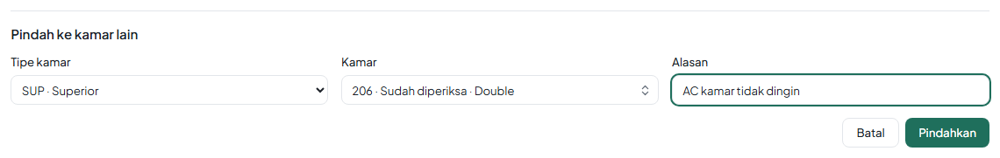
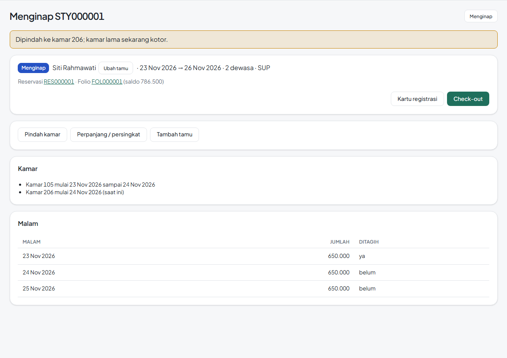

# Pindah kamar

**Siapa yang melakukan:** resepsionis yang perannya boleh memindahkan tamu antar kamar.
**Kapan dilakukan:** saat tamu yang sedang menginap harus pindah, misalnya karena AC rusak, kamar bising, atau tamu meminta tipe lain.
**Sebelum mulai:**
- Pastikan kamar tujuan kosong dan bersih. Lihat **Kamar → Status kamar**.
- Kalau ada kerusakan di kamar lama, laporkan juga ke bagian perawatan.

## Langkah-langkah

1. Buka **Front Desk → Tamu hari ini**, lalu klik tab **Menginap**.
2. Pada baris tamu, klik **⋮** (Aksi lainnya) → **Pindah kamar**. Halaman **Menginap** tamu itu terbuka, dengan kotak **Pindah ke kamar lain** sudah terbuka. Cara lainnya: buka halaman **Menginap** tamu, lalu klik **Pindah kamar**.
3. Isi kotak **Pindah ke kamar lain**:

   | Field | Wajib? | Keterangan |
   |---|---|---|
   | Tipe kamar | Ya | Sama dengan tipe sekarang, atau tipe lain kalau tamu pindah tipe. |
   | Kamar | Ya | Kamar yang kosong dari hari ini sampai tanggal keberangkatan tamu. Kamar yang belum siap ditandai **(belum siap)**. |
   | Alasan | Ya | Misalnya `AC kamar tidak dingin`. Tersimpan di riwayat. |

   

4. Klik **Pindahkan**.

## Hasilnya

- Di halaman **Menginap** muncul pesan "Dipindah ke kamar 206; kamar lama sekarang kotor." (dengan nomor kamar barunya).
- Kartu **Kamar** mencatat kedua kamar, misalnya "Kamar 105 mulai 23 Nov 2026 sampai 24 Nov 2026" dan "Kamar 206 mulai 24 Nov 2026 (saat ini)".
- Kamar lama otomatis berstatus **Kotor**, supaya dibersihkan housekeeping.
- Biaya kamar malam ini dan seterusnya mengikuti kamar baru.

## Perlu diperhatikan

- **Harga tidak berubah otomatis** walaupun tamu pindah ke tipe yang lebih mahal. Kalau harganya perlu disesuaikan, lihat [Mengubah tarif tamu yang sedang menginap](mengubah-tarif-tamu-menginap.md).
- **Kamar tujuan belum siap.** Muncul "Kamar … berstatus Kotor." Pilih kamar lain, atau minta housekeeping membersihkannya dulu. Pengguna yang berwenang bisa mencentang **Tetap gunakan** dengan alasan. Tombol **Pindahkan** tetap bisa diklik walaupun kamar belum siap, tetapi pemindahan ditolak: "Kamar belum siap untuk check-in."
- **"Tidak ada kamar kosong tipe ini sampai …"** berarti tidak ada kamar tipe itu yang kosong untuk sisa masa menginap tamu. Pilih tipe lain.
- **Pindah kamar juga bisa dari Bagan kamar**, dengan menyeret batang tamu ke baris kamar lain. Lihat [Bagan kamar dan ketersediaan](bagan-kamar-dan-ketersediaan.md).
- Setelah pindah kamar, check-in tamu itu tidak bisa dibatalkan lagi.

## Terkait

- [Bagan kamar dan ketersediaan](bagan-kamar-dan-ketersediaan.md)
- [Mengubah tarif tamu yang sedang menginap](mengubah-tarif-tamu-menginap.md)
- [Membatalkan check-in](membatalkan-check-in.md)
