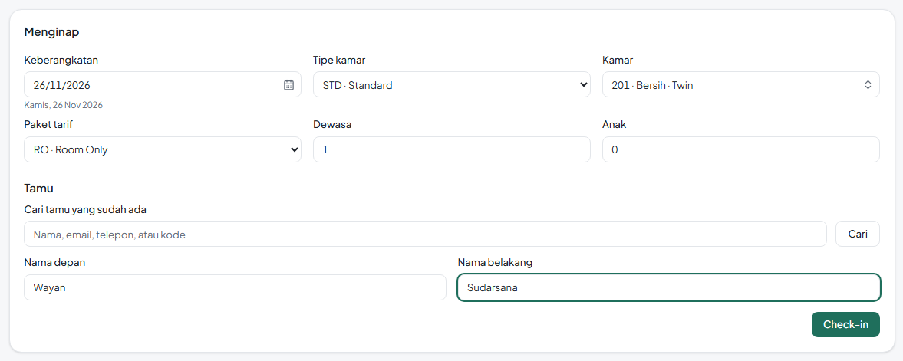
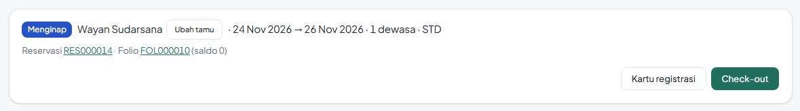

# Walk-in

> 🎬 Video tutorial: menyusul

**Siapa yang melakukan:** resepsionis. Perannya harus boleh check-in dan membuat reservasi.
**Kapan dilakukan:** saat tamu datang langsung tanpa reservasi dan ingin menginap mulai malam ini.
**Sebelum mulai:**
- Tanyakan sampai tanggal berapa tamu menginap, berapa orang, dan tipe kamar yang diinginkan.
- Minta kartu identitas tamu.
- Kalau tamu sudah pernah menginap, cari namanya dulu supaya profilnya tidak dobel.

## Langkah-langkah

1. Buka **Front Desk → Walk-in**. Tombol **Walk-in** juga ada di halaman **Hari Ini** dan **Tamu hari ini**.
2. Isi **Keberangkatan**. Tanggal kedatangan selalu tanggal bisnis hari ini, jadi tidak perlu diisi.
3. Pilih **Tipe kamar**, lalu pilih **Kamar**. Daftar kamar menampilkan nomor, status kebersihan, dan jenis tempat tidur, misalnya `201 · Bersih · Twin`. Kamar yang belum siap ditandai **(belum siap)**.
4. Periksa **Paket tarif**, **Dewasa**, dan **Anak**.
5. Isi data tamu:
   - **Tamu lama:** ketik nama, email, telepon, atau kode di **Cari tamu yang sudah ada**, klik **Cari**, lalu klik namanya.
   - **Tamu baru:** isi **Nama depan** dan **Nama belakang**.

   | Field | Wajib? | Keterangan |
   |---|---|---|
   | Keberangkatan | Ya | Paling cepat besok. |
   | Tipe kamar | Ya | Misalnya `STD · Standard`. |
   | Kamar | Ya | Nomor kamar yang kosong untuk seluruh masa menginap. |
   | Paket tarif | Ya | Paket harga, misalnya `RO · Room Only` (kamar saja). |
   | Dewasa / Anak | Ya | Jumlah tamu. |
   | Nama depan / Nama belakang | Nama belakang wajib, untuk tamu baru | Sesuaikan dengan kartu identitas. |

   

6. Klik **Check-in**. Halaman **Menginap** untuk tamu itu terbuka.

   

7. Lengkapi pekerjaan di halaman **Menginap**:
   - Klik **Ubah tamu** untuk mencatat jenis dan nomor identitas, telepon, dan email.
   - Klik nomor folio (misalnya `FOL000010`) untuk menerima deposit atau pembayaran.
   - Klik **Kartu registrasi** untuk mencetak kartu registrasi.

## Hasilnya

Tamu tercatat menginap di kamar yang dipilih. KamaraPMS membuat reservasi (dengan sumber `WALK_IN`), masa menginap, dan folio tamu sekaligus. Tamu muncul di tab **Menginap** pada **Tamu hari ini**.

## Perlu diperhatikan

- **Walk-in tidak punya langkah deposit**, tidak seperti check-in biasa. Terima deposit lewat folio tamu: lihat bagian Kasir dan pembayaran.
- **Formulir walk-in hanya mencatat nama tamu.** Identitas, telepon, dan email dilengkapi dengan **Ubah tamu** di halaman **Menginap** (langkah 7).
- **Kamar belum siap:** muncul "Kamar 201 berstatus Kotor." (dengan nomor dan statusnya). Pilih kamar lain. Pengguna yang berwenang bisa mencentang **Tetap gunakan** dengan alasan.
- **Mengubah harga** (tombol **Ubah tarif**) dan **paket kamar gratis** hanya muncul bagi yang berwenang, dan bisa meminta persetujuan. Lihat [Meminta persetujuan](../00-memulai/meminta-persetujuan.md).
- **"Tidak ada kamar kosong tipe ini pada tanggal tersebut."** berarti tipe itu penuh untuk masa menginap yang diminta. Tawarkan tipe lain, atau lebih sedikit malam.
- Kalau peran Anda tidak punya kedua izin (check-in dan membuat reservasi), halaman ini hanya menampilkan "Peran Anda di properti ini tidak mengizinkan walk-in (dibutuhkan izin check-in dan membuat reservasi)."

## Terkait

- [Check-in](check-in.md)
- [Mengelola data tamu](mengelola-data-tamu.md)
- [Check-out](check-out.md)
