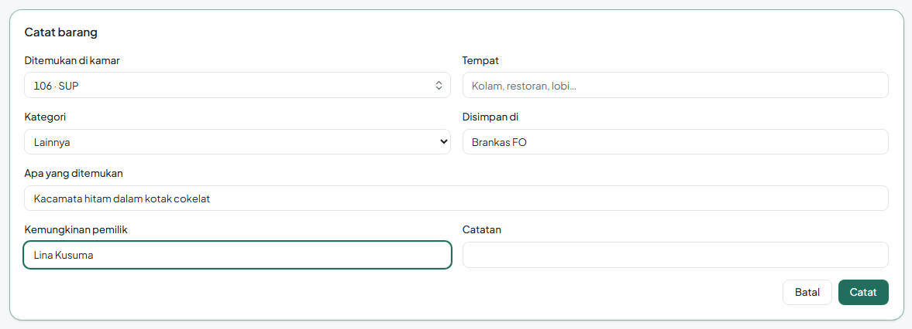
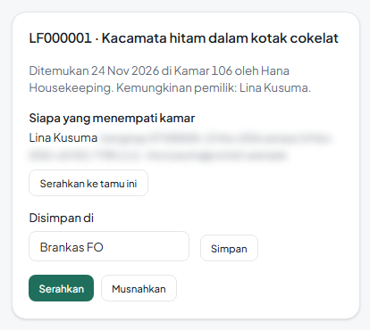

# Mencatat dan menyerahkan barang tertinggal

**Siapa yang melakukan:**
- Siapa pun yang perannya boleh mencatat barang temuan, misalnya petugas kebersihan atau resepsionis, mencatat barangnya.
- Supervisor atau manajer jaga yang perannya boleh mengelola barang temuan menyerahkan atau memusnahkannya.

**Kapan dilakukan:** begitu barang ditemukan, dan saat pemiliknya datang mengambil.
**Sebelum mulai:** simpan barangnya di tempat yang aman, misalnya laci kantor housekeeping atau brankas, dan catat di mana barang itu ditemukan.

## Langkah-langkah

### Mencatat barang

1. Buka **Kamar → Barang tertinggal**, lalu klik **Catat barang**.
2. Isi formulir **Catat barang**.

   | Field | Wajib? | Keterangan |
   |---|---|---|
   | Ditemukan di kamar | Ya, atau isi Tempat | Nomor kamar. Pilih **Bukan di kamar (sebutkan tempatnya)** kalau ditemukan di area umum. |
   | Tempat | Kalau bukan kamar | Misalnya `Restoran` atau `Kolam renang`. |
   | Kategori | Ya | **Elektronik**, **Pakaian**, **Dokumen**, **Perhiasan**, **Tas**, atau **Lainnya**. |
   | Disimpan di | Tidak | Tempat penyimpanan, misalnya `Brankas FO`. |
   | Apa yang ditemukan | Ya | Ciri-cirinya, misalnya `Kacamata hitam dalam kotak cokelat`. |
   | Kemungkinan pemilik | Tidak | Nama tamu yang diduga pemiliknya. |
   | Catatan | Tidak | Keterangan lain. |

   

3. Klik **Catat**. Muncul pesan "Barang dicatat.". Barang mendapat nomor seperti `LF000001`, berstatus **Disimpan**, dan tanggal temuannya adalah tanggal bisnis hari ini.

### Menyerahkan barang kepada pemiliknya

4. Cari barangnya. Isi **Cari** dengan nomor, nama barang, tempat, atau nama pemilik, lalu klik **Cari**. Klik nomor barang untuk membuka rinciannya.
5. Kalau barang ditemukan di kamar, bagian **Siapa yang menempati kamar** menampilkan tamu yang menginap di kamar itu sekitar tanggal temuan. Bandingkan dengan orang yang datang mengambil.

   

6. Klik **Serahkan**, atau klik **Serahkan ke tamu ini** pada nama tamunya agar nama pengambil terisi otomatis.
7. Isi formulir penyerahan, lalu klik **Konfirmasi penyerahan**. Muncul pesan "Diserahkan.".

   | Field | Wajib? | Keterangan |
   |---|---|---|
   | Diambil oleh | Ya | Nama orang yang mengambil. |
   | Apa yang diperiksa (ID, pemesanan, isi) | Tidak | Bukti yang Anda periksa, misalnya `KTP dicocokkan, isi kotak disebutkan dengan benar`. |
   | Catatan | Tidak | Keterangan lain, misalnya `Diambil oleh kakak tamu, dengan surat kuasa`. |

## Hasilnya

- Barang berstatus **Dikembalikan**, dengan nama pengambil dan tanggalnya: "Diserahkan kepada … pada …".
- Daftar bawaan hanya menampilkan barang yang masih **Disimpan**. Pilih **Semua**, **Dikembalikan**, atau **Dimusnahkan** di **Tampilkan** untuk melihat yang lain.

## Perlu diperhatikan

- **Memusnahkan barang** yang tidak pernah diambil: buka rinciannya, klik **Musnahkan**, isi **Alasan** (misalnya `Tidak diambil setelah 90 hari, disumbangkan`), lalu klik **Konfirmasi pemusnahan**.

  > ⚠️ Penting: penyerahan dan pemusnahan tidak bisa dibatalkan. Periksa bukti kepemilikan sebelum menyerahkan barang.

- **Tempat penyimpanan bisa diubah** selama barang masih **Disimpan**: isi **Disimpan di** di rinciannya, lalu klik **Simpan**.
- **Pencatat tanpa izin mengelola** hanya bisa mencatat dan melihat daftar. Tombol **Serahkan** dan **Musnahkan** tidak tampil.
- **Siapa yang menempati kamar** hanya tampil bagi peran yang boleh melihat reservasi. Daftarnya berisi tamu yang menginap pada tanggal temuan, atau yang pulang paling lama 3 hari sebelumnya.
- **"Barang ini sudah diserahkan atau dibuang."** berarti rekan Anda sudah menyerahkan atau memusnahkan barang itu. Muat ulang halaman.

## Terkait

- [Mengelola data tamu](../01-front-desk/mengelola-data-tamu.md)
- [Check-out](../01-front-desk/check-out.md)
