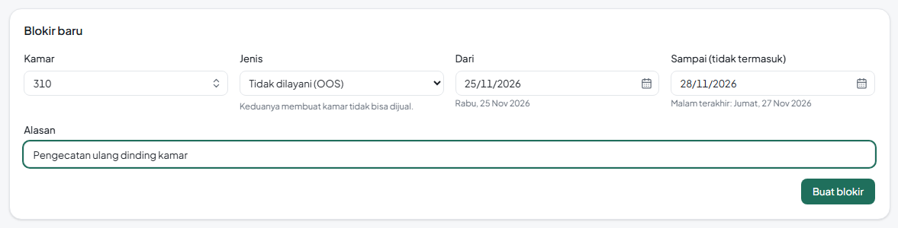
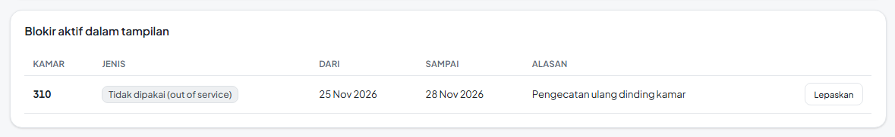

# Memblokir kamar (OOO dan OOS)

**Siapa yang melakukan:** supervisor housekeeping, kepala teknisi, atau manajer yang perannya boleh membuat dan melepas blokir kamar.
**Kapan dilakukan:** saat kamar tidak boleh dijual untuk beberapa malam, misalnya karena rusak, sedang direnovasi, atau sengaja tidak dipakai.
**Sebelum mulai:** siapkan nomor kamar, tanggal mulai, tanggal kamar bisa dijual lagi, dan alasannya.

Ada dua jenis blokir:

- **Rusak (OOO)**, singkatan dari *out of order* (rusak): kamar tidak bisa dipakai karena kerusakan, misalnya AC mati atau kebocoran.
- **Tidak dilayani (OOS)**, singkatan dari *out of service* (tidak dilayani): kamar sebenarnya layak, tetapi sengaja tidak dijual, misalnya untuk pengecatan atau dipakai sebagai gudang sementara.

Keduanya sama-sama membuat kamar tidak bisa dijual. Bedanya hanya label, untuk laporan dan untuk staf.

## Langkah-langkah

1. Buka **Kamar → Blokir kamar**. Kalender menampilkan semua kamar untuk 14 hari, dimulai dari tanggal bisnis. Geser dengan **‹ Minggu** dan **Minggu →**, kembali dengan **Tanggal bisnis**, atau pilih **28 hari** untuk rentang yang lebih panjang.
2. Isi formulir **Blokir baru**. Cara cepatnya: klik sel kosong di kalender pada baris kamar dan tanggal mulainya. Formulir terisi dengan kamar itu dan tanggal tersebut.

   | Field | Wajib? | Keterangan |
   |---|---|---|
   | Kamar | Ya | Nomor kamar, misalnya `310`. |
   | Jenis | Ya | **Rusak (OOO)** atau **Tidak dilayani (OOS)**. |
   | Dari | Ya | Malam pertama kamar tidak dijual. Tidak boleh sebelum tanggal bisnis. |
   | Sampai (tidak termasuk) | Ya | Tanggal kamar bisa dijual lagi. Di bawahnya tertulis **Malam terakhir**, yaitu sehari sebelumnya. |
   | Alasan | Ya | Misalnya `Pengecatan ulang dinding kamar`. Maksimal 500 karakter. |

   

3. Klik **Buat blokir**. Formulir kosong kembali, dan blokir muncul sebagai batang **OOO** atau **OOS** di kalender serta di tabel **Blokir aktif dalam tampilan**. Di tabel itu, jenisnya ditulis **Rusak (out of order)** atau **Tidak dipakai (out of service)**.

   

### Melepas blokir

4. Di tabel **Blokir aktif dalam tampilan**, klik **Lepaskan** pada baris blokir.
5. Isi **Alasan**, misalnya `Perbaikan selesai lebih cepat`, lalu klik **Lepaskan blokir**. Klik **Pertahankan blokir** kalau tidak jadi.

## Hasilnya

- Kamar tidak ditawarkan untuk malam-malam itu: tidak muncul saat menetapkan kamar atau check-in, dan sisa kamar tipe itu berkurang.
- Di **Status kamar**, kamar tampil bergaris abu-abu sebagai **Diblokir**. Di daftar **Housekeeping**, kamar mendapat tanda seperti `OOO sampai 28 Nov 2026`.
- Kamar yang diblokir tidak dimasukkan ke daftar pembersihan harian.

## Perlu diperhatikan

- **Blokir ditolak** kalau:
  - ada tamu yang menginap di kamar itu, atau reservasi terkonfirmasi yang sudah ditetapkan ke kamar itu, pada malam-malam tersebut. Di bawah pesan "Kamar sudah punya blokir aktif pada tanggal ini." tercantum penyebabnya, misalnya "Tamu menginap …". Pindahkan tamu atau lepas kamarnya dari reservasi dulu.
  - kamar sudah punya blokir lain pada tanggal yang sama. Pesannya juga "Kamar sudah punya blokir aktif pada tanggal ini.".
  - tipe kamar itu akan kekurangan kamar: "Perubahan ini membuat tipe kamar terjual melebihi stok pada beberapa malam.". Artinya reservasi yang belum mendapat nomor kamar sudah memakai semua kamar tipe itu. Pilih tanggal lain, atau pindahkan reservasinya ke tipe lain.
  - kamarnya tidak aktif: "Kamar yang tidak aktif tidak bisa diblokir.".
- **Tanggal blokir tidak bisa diubah.** Untuk memperpanjang atau memperpendek, lepaskan blokirnya, lalu buat blokir baru.
- **Kamar rusak yang dilaporkan lewat Perawatan** bisa langsung diblokir dari permintaan perawatannya. Blokir itu juga muncul di halaman ini. Lihat [Laporan perawatan](laporan-perawatan.md).
- Pengguna tanpa izin blokir bisa membuka halaman ini, tetapi hanya melihat kamar yang sedang diblokir.
- Status kebersihan kamar yang diblokir tetap bisa diubah.

## Terkait

- [Laporan perawatan](laporan-perawatan.md)
- [Status kamar](status-kamar.md)
- [Pindah kamar](../01-front-desk/pindah-kamar.md)
