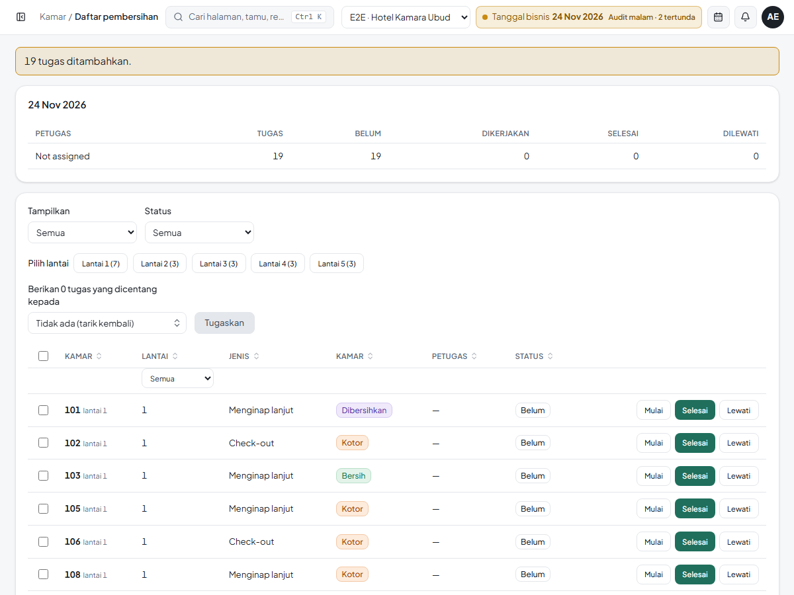
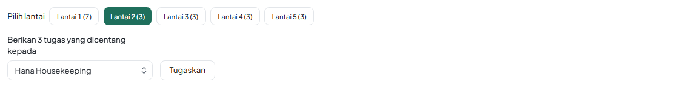
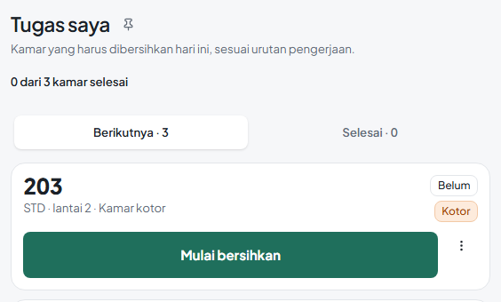

# Daftar pembersihan dan Tugas saya

**Siapa yang melakukan:**
- Supervisor housekeeping membuat daftar pembersihan harian dan membagi kamar ke petugas.
- Petugas kebersihan mengerjakan kamarnya di **Tugas saya**, biasanya dari ponsel.

**Kapan dilakukan:** setiap pagi, setelah audit malam membuka tanggal bisnis yang baru. Daftar boleh dibuat ulang pada siang hari untuk menambahkan kamar yang baru kotor.
**Sebelum mulai:**
- Supervisor butuh izin membuat daftar pembersihan dan menugaskannya.
- Petugas butuh izin mengubah status kebersihan. Hanya pengguna dengan izin ini yang bisa dipilih sebagai petugas.

## Langkah-langkah

### Supervisor: membuat dan membagi daftar

1. Buka **Kamar → Daftar pembersihan**. Kartu teratas berjudul tanggal bisnis hari ini.
2. Klik **Buat daftar hari ini**. KamaraPMS membuat satu tugas untuk setiap kamar yang perlu dibersihkan, dan muncul pesan seperti "19 tugas ditambahkan.". Jenis tugasnya:

   | Jenis | Kamar yang mendapatkannya |
   |---|---|
   | **Check-out** | Kamar terisi yang tamunya pulang hari ini atau sudah lewat tanggal pulangnya. |
   | **Menginap lanjut** | Kamar terisi yang tamunya masih menginap. |
   | **Kedatangan** | Kamar kosong yang kotor dan akan ditempati tamu yang tiba hari ini. Prioritasnya **Tinggi**. |
   | **Kamar kotor** | Kamar kosong lain yang **Kotor** atau **Dibersihkan**. |

   Kamar yang diblokir tidak dimasukkan. Kamar yang diberi prioritas tinggi di catatannya juga menjadi tugas **Tinggi**.

   

3. Centang tugas yang akan diberikan kepada satu petugas. Cara cepatnya: klik tombol **Lantai 2 (3)** di **Pilih lantai** untuk mencentang semua tugas terbuka di lantai itu.
4. Di **Berikan … tugas yang dicentang kepada**, pilih nama petugas, lalu klik **Tugaskan**. Muncul pesan "3 tugas ditugaskan.".

   

5. Ulangi langkah 3 dan 4 untuk petugas lain. Untuk menarik kembali tugas, centang tugasnya, pilih **Tidak ada (tarik kembali)**, lalu klik **Tugaskan**.

Kartu beban kerja di atas daftar (berjudul tanggal bisnis) menunjukkan jumlah tugas setiap petugas: **Belum**, **Dikerjakan**, **Selesai**, dan **Dilewati**. Tugas yang belum dibagi tercantum di baris `Not assigned` (belum ditugaskan).

### Petugas: mengerjakan kamar

6. Buka **Kamar → Tugas saya**. Kartu kamar Anda tersusun sesuai urutan pengerjaan: prioritas tinggi lebih dulu, lalu menurut lantai dan nomor kamar. Kartu bertanda **Tamu tiba hari ini** sebaiknya dikerjakan lebih dulu.
7. Saat masuk ke kamar, klik **Mulai bersihkan**. Kamar menjadi **Dibersihkan**.

   

8. Setelah selesai, klik **Selesai: siap diperiksa**. Kamar menjadi **Bersih** dan kartunya pindah ke tab **Selesai**.
9. Kalau kamar tidak bisa dibersihkan, misalnya tamu memasang tanda jangan diganggu, klik **⋯** → **Lewati**. Isi **Alasan** atau klik **Jangan diganggu**, lalu klik **Lewati**.

   > ⚠️ Penting: kamar yang dilewati tidak bisa Anda buka lagi hari itu. Kalau tamu kemudian minta dibersihkan, supervisor harus menambahkan tugas baru untuk kamar itu.

### Supervisor: memeriksa kamar

10. Periksa kamar yang sudah **Bersih**, lalu klik **Periksa** di **Kamar → Housekeeping**, atau **Diperiksa** di bilah ubah massal **Status kamar**. Lihat [Mengubah status kebersihan](mengubah-status-kebersihan.md).

## Hasilnya

- Setiap petugas melihat kamarnya sendiri di **Tugas saya**, dengan kemajuan "{selesai} dari {total} kamar selesai".
- Status kamar berubah otomatis: **Kotor** → **Dibersihkan** saat tugas dimulai, lalu **Bersih** saat tugas selesai. Tugas tidak pernah menjadikan kamar **Sudah diperiksa**: itu tetap langkah supervisor.

## Perlu diperhatikan

- **Membuat daftar berkali-kali aman.** Setiap kamar paling banyak mendapat satu tugas buatan sistem per hari. Menjalankan **Buat daftar hari ini** lagi hanya menambahkan kamar yang baru. Tugas yang jenisnya berubah, misalnya tamu yang ternyata pulang hari ini, disesuaikan selama belum dimulai. Pesannya: "{created} dibuat · {retyped} disesuaikan.".
- **Tambah tugas manual:** klik **Tambah tugas**, pilih **Kamar**, **Jenis** (misalnya **Bersih mendalam**), **Prioritas**, **Tugaskan ke**, dan **Catatan**, lalu klik **Tambah**. Resepsionis juga bisa mengirim tugas dari panel kamar dengan **Kirim housekeeping**, kalau perannya boleh.
- **Petugas tanpa izin menugaskan** tidak melihat tombol **Buat daftar hari ini**, **Tambah tugas**, dan formulir penugasan.
- **Supervisor di Tugas saya** bisa beralih antara **Saya** dan **Semua petugas**, melihat beban kerja per orang, lalu mencentang kartu dan membaginya dengan **Tugaskan ke…**.
- **"Tidak ada tugas untuk Anda hari ini."** berarti supervisor belum memberi Anda kamar. Klik **Lihat semua kamar kotor** untuk melihat kamar yang kotor.
- **Melewati kamar tidak mengubah statusnya.** Kamar tetap **Kotor** sampai ada yang membersihkannya.
- Halaman **Tugas saya** dimuat ulang sendiri setiap menit.

## Terkait

- [Mengubah status kebersihan](mengubah-status-kebersihan.md)
- [Status kamar](status-kamar.md)
- [Menjalankan audit malam](../11-audit-malam/menjalankan-audit-malam.md)
