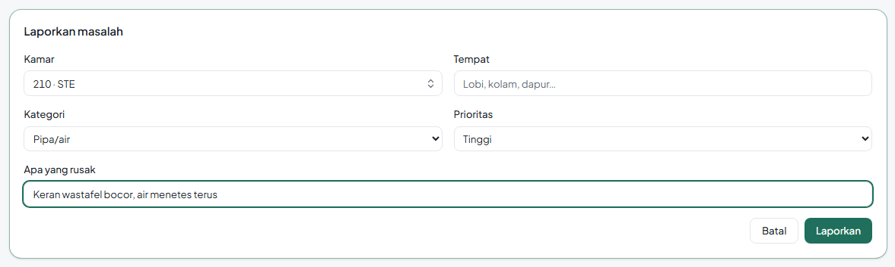
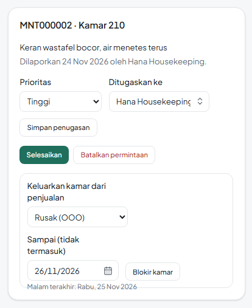
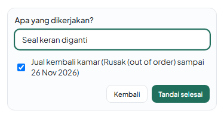

# Melaporkan dan menangani kerusakan (perawatan)

**Siapa yang melakukan:**
- Siapa pun yang perannya boleh melapor, misalnya petugas kebersihan atau resepsionis, mencatat kerusakan.
- Teknisi atau kepala teknisi (engineering) menugaskan, mengerjakan, dan menyelesaikannya.

**Kapan dilakukan:** begitu kerusakan ditemukan, di kamar atau di area umum, dan sampai perbaikannya selesai.
**Sebelum mulai:** catat nomor kamar atau tempatnya, dan apa yang rusak.

## Langkah-langkah

### Melaporkan masalah

1. Buka **Kamar → Perawatan**, lalu klik **Laporkan masalah**. Cara lain: di **Kamar → Housekeeping**, klik **⋯** → **Laporkan masalah** pada baris kamar. Formulir terbuka dengan kamar sudah terisi.
2. Isi formulir **Laporkan masalah**.

   | Field | Wajib? | Keterangan |
   |---|---|---|
   | Kamar | Ya, atau isi Tempat | Nomor kamar. Pilih **Bukan kamar (sebutkan tempatnya)** untuk area umum. |
   | Tempat | Kalau bukan kamar | Misalnya `Lobi`, `Kolam renang`, atau `Dapur`. |
   | Kategori | Ya | **Pipa/air**, **Listrik**, **AC**, **Perabot**, **Peralatan**, atau **Lainnya**. |
   | Prioritas | Ya | **Rendah**, **Normal**, **Tinggi**, atau **Mendesak**. |
   | Aset | Tidak | Hanya muncul kalau hotel memakai modul aset tetap. Pilih asetnya, misalnya unit AC, agar perbaikan tercatat di riwayat aset itu. |
   | Apa yang rusak | Ya | Misalnya `Keran wastafel bocor, air menetes terus`. |

   

3. Klik **Laporkan**. Muncul pesan "Permintaan MNT000002 dilaporkan.". Permintaan berstatus **Terbuka**.

### Menangani permintaan (teknisi)

4. Di daftar **Perawatan**, klik nomor permintaan. Rinciannya terbuka di bawah daftar.
5. Pilih teknisi di **Ditugaskan ke**, lalu klik **Simpan penugasan**. Prioritas bisa diubah di bagian yang sama.
6. Saat mulai bekerja, klik **Mulai dikerjakan**. Status menjadi **Sedang dikerjakan**.
7. Kalau kamar tidak boleh dijual selama perbaikan, isi bagian **Keluarkan kamar dari penjualan**: pilih **Rusak (OOO)** atau **Tidak dilayani (OOS)**, isi **Sampai (tidak termasuk)**, lalu klik **Blokir kamar**. Muncul pesan "Kamar dikeluarkan dari penjualan.". Blokir dimulai hari ini.

   

8. Setelah selesai, klik **Selesaikan**. Isi **Apa yang dikerjakan?**, misalnya `Seal keran diganti`. Kalau kamar diblokir untuk permintaan ini, biarkan **Jual kembali kamar** tercentang agar blokirnya ikut dilepas. Klik **Tandai selesai**.

   

## Hasilnya

- Permintaan berstatus **Selesai ditangani**, dengan catatan pekerjaannya.
- Kalau **Jual kembali kamar** dicentang, blokir kamarnya dilepas dan kamar bisa dijual lagi.

## Perlu diperhatikan

- **Urutan status:** **Terbuka** → **Sedang dikerjakan** → **Selesai ditangani**. Permintaan yang selesai bisa dibuka lagi dengan **Buka kembali**, misalnya kalau kerusakannya muncul lagi.
- **Membatalkan permintaan:** klik **Batalkan permintaan**, isi **Mengapa dibatalkan?** (wajib), lalu klik **Batalkan permintaan** sekali lagi. Permintaan yang dibatalkan tidak bisa dibuka kembali. Buat permintaan baru kalau masih perlu.
- **Pelapor tanpa izin menangani** hanya bisa melapor dan melihat daftar. Tombol **Mulai dikerjakan**, **Selesaikan**, dan blokir kamar tidak tampil.
- **Blokir dari permintaan perawatan** hanya tersedia untuk permintaan tentang kamar, dan bagi pengguna yang juga boleh memblokir kamar. Tamu yang menginap di kamar itu harus dipindahkan dulu. Lihat [Blokir kamar (OOO/OOS)](blokir-kamar-ooo-oos.md).
- Daftar menampilkan permintaan **Terbuka dan sedang dikerjakan**. Pilih **Semua**, **Selesai ditangani**, atau **Dibatalkan** di **Tampilkan** untuk melihat yang lain.

## Terkait

- [Blokir kamar (OOO/OOS)](blokir-kamar-ooo-oos.md)
- [Mengubah status kebersihan](mengubah-status-kebersihan.md)
- [Pindah kamar](../01-front-desk/pindah-kamar.md)
