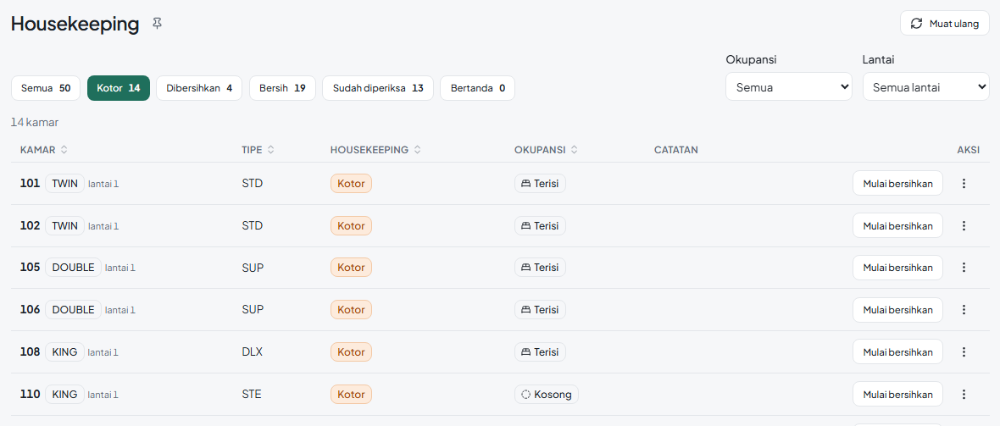
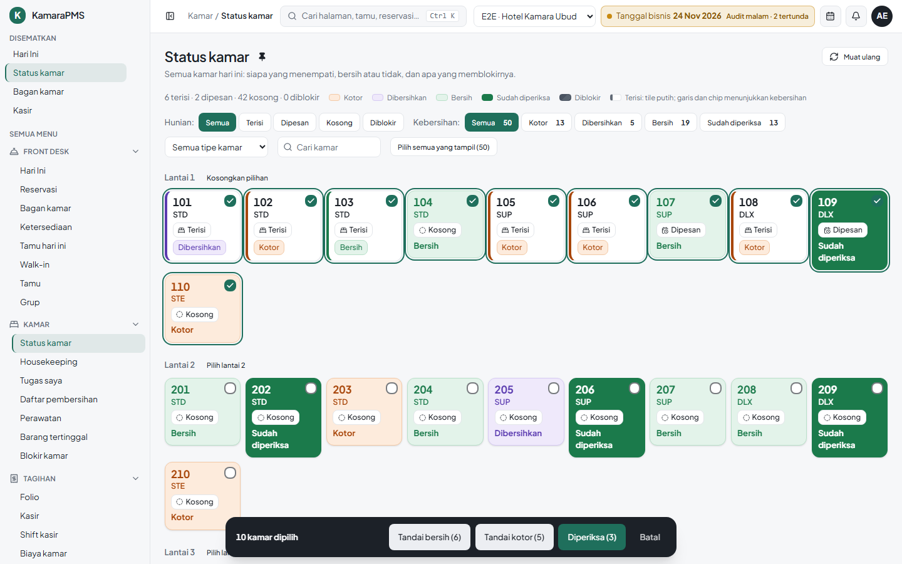

# Mengubah status kebersihan kamar

> 🎬 Video tutorial: menyusul

**Siapa yang melakukan:** petugas kebersihan (room attendant) dan supervisor housekeeping.
**Kapan dilakukan:** saat mulai membersihkan kamar, saat selesai, dan saat supervisor sudah memeriksanya.
**Sebelum mulai:**
- Peran Anda harus boleh mengubah status kebersihan. Menandai **Sudah diperiksa** butuh izin pemeriksaan (biasanya hanya supervisor).
- Hari bisnis harus terbuka. Setelah audit malam ditutup, perubahan dicatat pada tanggal bisnis berikutnya.

Kalau hotel Anda memakai daftar pembersihan harian, petugas cukup bekerja dari **Tugas saya**. Status kamar ikut berubah saat tugas dimulai dan diselesaikan. Lihat [Daftar pembersihan dan Tugas saya](daftar-pembersihan-dan-tugas-saya.md).

## Urutan status kebersihan

| Dari | Bisa diubah menjadi |
|---|---|
| **Kotor** | **Dibersihkan** atau **Bersih** |
| **Dibersihkan** | **Bersih** atau **Kotor** |
| **Bersih** | **Sudah diperiksa** atau **Kotor** |
| **Sudah diperiksa** | **Kotor** saja |

Perubahan lain ditolak dengan pesan "Status housekeeping tidak bisa diubah ke status itu.". Contohnya, kamar **Kotor** tidak bisa langsung menjadi **Sudah diperiksa**: tandai **Bersih** dulu.

## Langkah-langkah

### Mengubah satu kamar

1. Buka **Kamar → Housekeeping**. Daftar ini menampilkan semua kamar dengan status kebersihannya.
2. Saring daftar kalau perlu. Klik tombol status di atas daftar, misalnya **Kotor**, untuk melihat kamar yang kotor saja. Klik tombol yang sama sekali lagi untuk mematikan saringan. Anda juga bisa menyaring menurut **Okupansi** dan **Lantai**.
3. Pada baris kamar, klik tombol langkah berikutnya:
   - kamar **Kotor**: **Mulai bersihkan** (kamar menjadi **Dibersihkan**);
   - kamar **Dibersihkan**: **Tandai bersih**;
   - kamar **Bersih**: **Periksa** (kamar menjadi **Sudah diperiksa**; hanya untuk yang berwenang memeriksa).

   Langkah lain, misalnya **Tandai kotor**, ada di menu **⋯** di ujung baris.

   

4. Status di baris itu langsung berubah, dan daftar dimuat ulang.

### Memberi catatan pada kamar

5. Pada baris kamar, klik **⋯** → **Beri catatan**. Isi catatannya, lalu klik **Simpan**.

   | Field | Wajib? | Keterangan |
   |---|---|---|
   | Prioritas | Ya | **Normal** atau **Tinggi (di urutan pertama)**. Kamar prioritas tinggi berada di urutan pertama daftar pembersihan. |
   | Catatan | Tidak | Misalnya `Tamu alergi debu, ganti sarung bantal`. Tampil bagi semua yang membersihkan kamar itu. Maksimal 500 karakter. |
   | Jangan diganggu | Tidak | Centang kalau tamu memasang tanda jangan diganggu (DND). |
   | Tamu minta kamar dibereskan | Tidak | Centang kalau tamu meminta kamarnya dibereskan. |

   Catatan tidak mengubah status kebersihan.

### Mengubah banyak kamar sekaligus (supervisor)

6. Buka **Kamar → Status kamar**. Centang kotak di sudut setiap kamar yang ingin diubah. Anda juga bisa mengklik **Pilih lantai 1** untuk mencentang satu lantai, atau **Pilih semua yang tampil** untuk mencentang semua kamar yang lolos saringan.
7. Bilah di bawah layar menampilkan jumlah kamar yang dipilih. Klik **Tandai bersih**, **Tandai kotor**, atau **Diperiksa**. Angka di tombol menunjukkan berapa kamar terpilih yang bisa diubah ke status itu.

   

8. Kalau lebih dari 10 kamar berubah, atau kamar yang **Sudah diperiksa** akan kembali **Kotor**, KamaraPMS meminta konfirmasi, misalnya "Ubah 12 kamar menjadi bersih?". Klik **Ubah**. Klik **Batal** kalau tidak jadi.

## Hasilnya

- Status kamar berubah di semua layar: **Housekeeping**, **Status kamar**, bagan kamar, dan pilihan kamar saat check-in.
- Setelah ubah massal, muncul ringkasan, misalnya "10 kamar diubah". Kamar yang tidak bisa diubah dicantumkan di **Kamar yang dilewati** beserta alasannya, misalnya "tidak bisa dari Kotor ke Sudah diperiksa". Kamar yang dilewati tetap tercentang, jadi Anda bisa mengubahnya dengan tombol lain.

## Perlu diperhatikan

- **Ubah massal tidak semua-atau-tidak-sama-sekali.** Setiap kamar diputuskan sendiri: kamar yang bisa diubah tetap diubah walaupun kamar lain dilewati.
- **Kamar yang diblokir (OOO/OOS)** tetap bisa diubah kebersihannya. Di daftar **Housekeeping**, semua langkahnya ada di menu **⋯**.
- **Laporkan kerusakan dari daftar:** pada baris kamar, klik **⋯** → **Laporkan masalah**. Formulir perawatan terbuka dengan kamar sudah terisi. Lihat [Laporan perawatan](laporan-perawatan.md).
- **"Peran Anda tidak mengizinkan tindakan ini."** saat menandai **Sudah diperiksa** berarti peran Anda tidak boleh memeriksa kamar. Minta supervisor memeriksanya.
- Tombol perubahan juga ada di panel kamar (klik nomor kamar di mana pun): bagian **Bisa diubah menjadi** berisi tombol seperti **Tandai Bersih**.

## Terkait

- [Status kamar](status-kamar.md)
- [Daftar pembersihan dan Tugas saya](daftar-pembersihan-dan-tugas-saya.md)
- [Laporan perawatan](laporan-perawatan.md)
