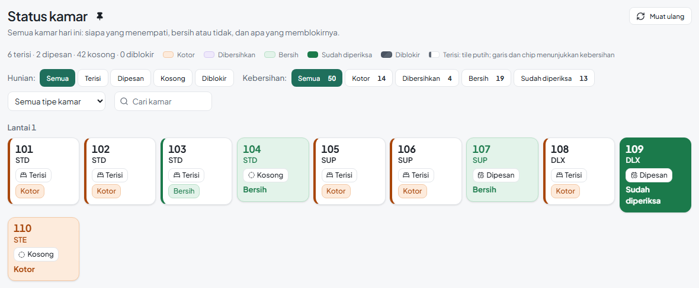
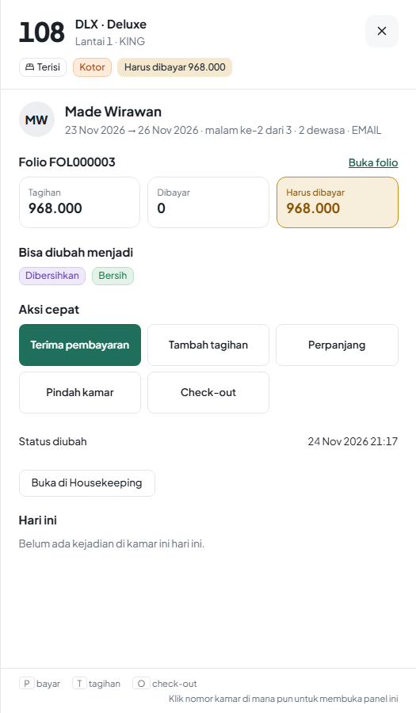

# Melihat status kamar

**Siapa yang melakukan:** resepsionis, supervisor housekeeping, atau manajer yang ingin melihat keadaan semua kamar sekaligus.
**Kapan dilakukan:** kapan saja, terutama pagi hari sebelum tamu tiba dan sore hari sebelum check-in ramai.
**Sebelum mulai:** halaman **Status kamar** hanya muncul bagi peran yang boleh melihat reservasi. Petugas kebersihan biasanya memakai halaman **Housekeeping** atau **Tugas saya**. Lihat [Mengubah status kebersihan](mengubah-status-kebersihan.md).

Setiap kamar punya dua keterangan yang berbeda:

- **Hunian**, yaitu **Terisi**, **Dipesan**, **Kosong**, atau **Diblokir**. Hunian dihitung sendiri oleh KamaraPMS dari tamu yang menginap, reservasi, dan blokir kamar. Petugas tidak mengisinya.
- **Kebersihan**, yaitu **Kotor**, **Dibersihkan**, **Bersih**, atau **Sudah diperiksa**. Kebersihan diubah oleh petugas, dan sebagian berubah otomatis (lihat **Perlu diperhatikan**).

## Langkah-langkah

1. Buka **Kamar → Status kamar**. Halaman ini menampilkan semua kamar hari ini, dikelompokkan per lantai. Baris di atas papan menghitung jumlahnya, misalnya `12 terisi · 3 dipesan · 34 kosong · 1 diblokir`.

   

2. Baca warna setiap kotak kamar:
   - Kamar **kosong** atau **dipesan** diwarnai sesuai status kebersihannya. Keterangan warnanya ada di bawah judul.
   - Kamar **terisi** berwarna putih, dengan garis di kiri dan label kecil yang menunjukkan kebersihannya.
   - Kamar **diblokir** bergaris abu-abu, dengan tulisan **Rusak (OOO)** atau **Tidak dilayani (OOS)**.
   - Ikon kecil menandai **Jangan diganggu**, **Minta dibereskan**, dan **Prioritas tinggi**.
3. Saring papan kalau perlu:

   | Saringan | Keterangan |
   |---|---|
   | Hunian | **Semua**, **Terisi**, **Dipesan**, **Kosong**, atau **Diblokir**. |
   | Kebersihan | **Semua**, **Kotor**, **Dibersihkan**, **Bersih**, atau **Sudah diperiksa**. Angka di setiap tombol menunjukkan jumlah kamarnya. |
   | Tipe kamar | Hanya satu tipe, misalnya `DLX`. |
   | Cari kamar | Nomor kamar, misalnya `305`. |

   Contoh: untuk mencari kamar yang belum siap bagi tamu yang tiba hari ini, pilih Hunian **Dipesan** dan Kebersihan **Kotor**. Klik **Hapus saringan** untuk menampilkan semua kamar lagi.
4. Klik sebuah kamar untuk membuka panel kamar di sisi kanan. Panel ini menampilkan hunian, kebersihan, blokir, tanda dari petugas, saldo tamu yang menginap, dan kejadian di kamar itu hari ini.

   

5. Klik **Muat ulang** di kanan atas untuk melihat perubahan terbaru dari rekan Anda.

## Hasilnya

Anda tahu kamar mana yang siap dijual atau ditempati, dan kamar mana yang masih harus dibersihkan, diperiksa, atau diperbaiki.

## Perlu diperhatikan

- **Kebersihan yang berubah otomatis:**
  - Setelah **check-out**, kamar menjadi **Kotor**.
  - Setelah **pindah kamar**, kamar yang lama menjadi **Kotor**.
  - Setelah **check-in dibatalkan**, kamar menjadi **Kotor**.
  - Setelah **audit malam**, semua kamar yang terisi menjadi **Kotor**, supaya kamar tamu yang menginap lanjut ikut dibersihkan. Ini berlaku kalau pengaturan properti **Audit malam menandai kamar terisi sebagai kotor (pembersihan tamu menginap)** menyala (bawaan: menyala).
- **Kamar yang boleh dipakai untuk check-in** adalah kamar **Bersih** atau **Sudah diperiksa**. Kalau pengaturan properti **Wajibkan kamar sudah diperiksa untuk check-in (jika tidak, bersih sudah cukup)** menyala, hanya kamar **Sudah diperiksa** yang boleh. Kamar lain ditandai belum siap saat check-in.
- Kalau Anda punya izin mengubah kebersihan, setiap kotak kamar punya kotak centang untuk ubah massal. Lihat [Mengubah status kebersihan](mengubah-status-kebersihan.md).
- **"Peran Anda di properti ini tidak boleh melihat status kamar."** berarti peran Anda tidak boleh melihat reservasi. Gunakan halaman **Kamar → Housekeeping**, yang bisa dibuka semua pengguna properti.
- Panel kamar juga terbuka saat Anda mengklik nomor kamar di halaman lain, misalnya di daftar tamu atau di folio.

## Terkait

- [Mengubah status kebersihan](mengubah-status-kebersihan.md)
- [Blokir kamar (OOO/OOS)](blokir-kamar-ooo-oos.md)
- [Bagan kamar dan ketersediaan](../01-front-desk/bagan-kamar-dan-ketersediaan.md)
