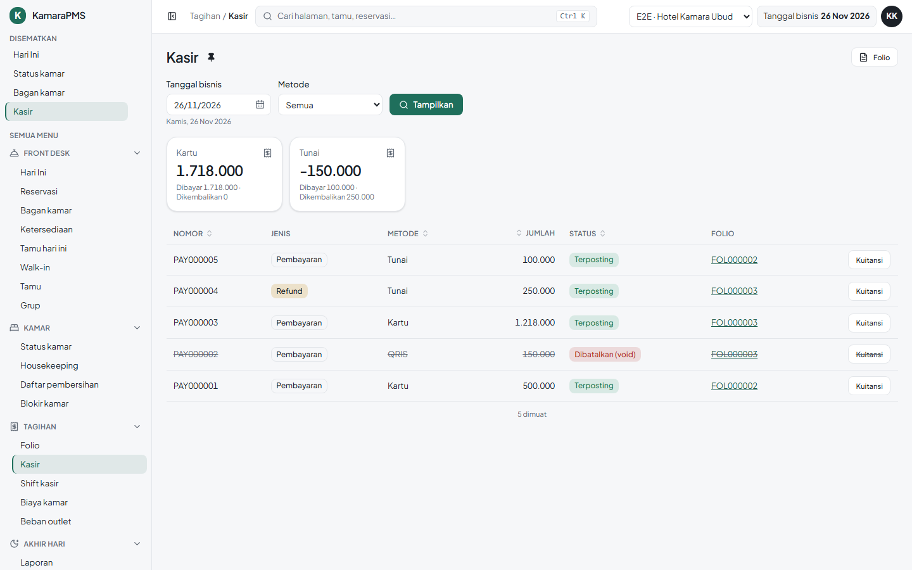
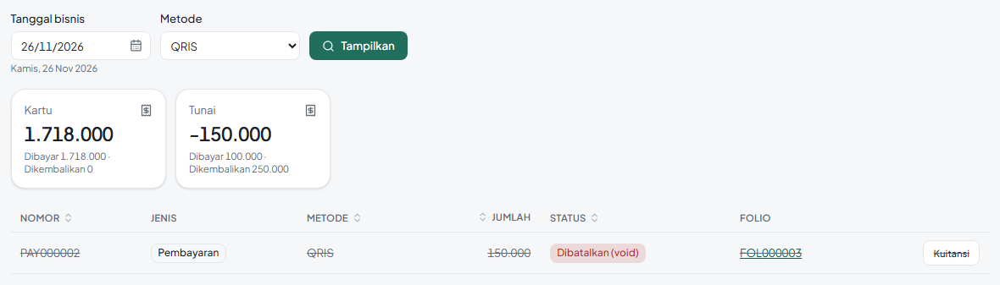

# Daftar pembayaran di Kasir

**Siapa yang melakukan:** kasir, resepsionis, supervisor front office, atau night auditor yang perannya boleh melihat folio. Menu **Tagihan → Kasir** tampil untuk peran yang memegang shift kasir.
**Kapan dilakukan:** di akhir shift atau akhir hari, untuk mencocokkan pembayaran per metode, dan kapan saja untuk mencari pembayaran atau mencetak ulang kuitansi.
**Sebelum mulai:** tidak ada persiapan khusus.

**Tagihan → Kasir** menampilkan semua pembayaran dan refund properti pada satu tanggal bisnis, dari folio mana pun: folio tamu, folio perusahaan dan grup, acara banquet, dan bill outlet POS. Halaman ini hanya untuk melihat. Pembayaran dicatat dan dikoreksi di folionya.

## Langkah-langkah

1. Buka **Tagihan → Kasir**. Halaman terbuka pada tanggal bisnis hari ini: kotak total per metode di atas, dan daftar pembayaran di bawahnya, yang terbaru paling atas.

   

2. Baca kotak totalnya. Ada satu kotak untuk setiap metode yang dipakai hari itu, misalnya **Tunai**, **Kartu**, atau **QRIS**. Angka besarnya adalah jumlah bersih: yang dibayar dikurangi yang dikembalikan. Di bawahnya tertulis "Dibayar {jumlah} · Dikembalikan {jumlah}". Pembayaran yang di-void tidak dihitung.
3. Untuk melihat hari lain atau satu metode saja, isi saringannya, lalu klik **Tampilkan**.

   | Field | Wajib? | Keterangan |
   |---|---|---|
   | Tanggal bisnis | Ya | Terisi dengan tanggal bisnis hari ini. Ubah untuk hari lain, misalnya `24/11/2026`. |
   | Metode | Tidak | **Semua**, **Tunai**, **Kartu**, **Transfer bank**, **Lainnya**, atau **QRIS**. Bawaannya **Semua**. |

   

4. Baca daftarnya. Setiap baris menunjukkan **Nomor**, **Jenis** (**Pembayaran** atau **Refund**), **Metode**, **Jumlah**, **Status**, dan **Folio**. Pembayaran yang di-void dicoret dan berstatus **Dibatalkan (void)**.
   - Klik judul kolom **Nomor**, **Metode**, **Jumlah**, atau **Status** untuk mengurutkan.
   - Daftar menampilkan 50 baris sekaligus. Klik **Muat lebih banyak** untuk baris berikutnya.
5. Untuk mencetak ulang kuitansi, klik **Kuitansi** pada barisnya. Kuitansi terbuka sebagai PDF di tab baru, siap dicetak.
6. Untuk mengoreksi pembayaran, klik nomor folio di kolom **Folio**. Folionya terbuka, dan pembayaran bisa di-void atau di-refund dari sana. Lihat [Void dan refund](void-dan-refund.md). Tombol **Folio** di kanan atas membuka **Tagihan → Folio**.

## Hasilnya

Tidak ada yang berubah. Halaman ini hanya membaca pembayaran yang sudah dicatat.

## Perlu diperhatikan

- **Tanggal bisnis, bukan tanggal kalender:** pembayaran yang diterima lewat tengah malam, sebelum audit malam, tercatat pada tanggal bisnis yang masih terbuka. Lihat [Memahami tanggal bisnis](../00-memulai/memahami-tanggal-bisnis.md).
- **Kotak total selalu menghitung semua metode** pada tanggal itu, walaupun daftar disaring per metode.
- **Piutang perusahaan** di kotak total adalah tagihan yang dipindahkan ke akun perusahaan, bukan uang yang diterima. Lihat [Transfer ke piutang perusahaan](../06-corporate-group-city-ledger/transfer-ke-piutang-perusahaan.md).
- **Saringan Metode** tidak punya pilihan untuk piutang perusahaan dan komplimen. Untuk melihatnya, pakai **Semua**.
- **Untuk mencocokkan uang di laci**, pakai laporan Z shift Anda, bukan halaman ini. Halaman ini memuat pembayaran semua kasir dan semua laci. Lihat [Shift kasir](shift-kasir.md).
- **Tombol Kuitansi** hanya muncul kalau peran Anda boleh melihat reservasi, karena kuitansi memuat nama tamu dan reservasinya.
- **"Pembayaran tidak ditemukan."** berarti tidak ada pembayaran pada hari dan metode itu. Pilih hari lain. Kalau saringan sedang dipakai, klik **Hapus saringan** untuk kembali ke hari ini dengan semua metode.
- **Bill outlet yang dikomplimenkan:**

  > 🐞 Kendala yang diketahui (KD-25): bill POS yang ditutup sebagai komplimen tampil dengan metode `cashier.COMP`, baik di kolom **Metode** maupun di kotak totalnya, bukan dengan nama metodenya. **Dampaknya:** baris dan kotak itu sulit dibaca, dan bisa disangka kesalahan. **Sementara ini:** baca `cashier.COMP` sebagai **Komplimen**. Rinciannya per outlet ada di [Laporan outlet](../04-pos/laporan-outlet.md).

## Terkait

- [Menerima pembayaran](menerima-pembayaran.md)
- [Void dan refund](void-dan-refund.md)
- [Shift kasir](shift-kasir.md)
