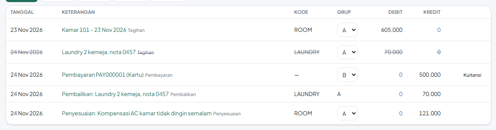
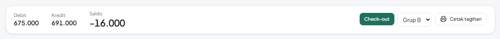

# Grup tagihan dan mencetak tagihan

**Siapa yang melakukan:** resepsionis atau kasir.
**Kapan dilakukan:** saat tamu meminta tagihannya dipisah, misalnya biaya kamar untuk kantor dan biaya pribadi dibayar sendiri, dan saat mencetak tagihan atau invoice.
**Sebelum mulai:** tanyakan biaya mana yang dipisah, dan untuk siapa setiap bagian tagihan.

Setiap folio punya empat **grup transaksi**: **Grup A**, **Grup B**, **Grup C**, dan **Grup D**. Grup hanya membagi *tampilan* tagihan saat dicetak. Saldo folio tetap satu, dan tamu tetap harus melunasi seluruh folionya. Semua baris baru masuk ke **Grup A**.

Kalau biaya benar-benar harus ditanggung pihak lain dengan saldonya sendiri, pindahkan ke folio lain. Lihat [Transfer antar folio](transfer-antar-folio.md).

## Langkah-langkah

### Membagi tagihan ke grup

1. Buka folio tamu.
2. Di kolom **Grup** pada setiap baris, pilih grupnya, misalnya **Grup B** untuk biaya pribadi tamu. Perubahan langsung tersimpan, tanpa pesan.

   

3. Untuk memeriksa isi satu grup, klik tombolnya di atas daftar, misalnya **Grup B**. Angka di tombol adalah jumlah barisnya. Klik **Semua** untuk kembali.

### Mencetak

4. Di bagian atas folio, pilih **Grup yang dicetak**: **Semua**, atau satu grup.
5. Klik **Cetak tagihan** (folio yang masih terbuka) atau **Cetak invoice** (folio yang sudah ditutup). PDF terbuka di tab baru, siap dicetak atau dikirim.

   

## Hasilnya

- Tagihan yang dicetak untuk satu grup hanya berisi baris grup itu, dengan totalnya sendiri.
- Saldo di layar folio tidak berubah, karena saldo selalu saldo seluruh folio.

## Perlu diperhatikan

- **Baris pembalik ikut grup baris aslinya.** Kalau dicoba dipindah sendiri: "Pembalikan ditampilkan bersama baris yang dibalik: pindahkan baris itu, dan pembaliknya ikut pindah.".
- **Pembayaran juga bisa dimasukkan ke grup**, misalnya pembayaran kantor di **Grup A** dan pembayaran pribadi tamu di **Grup B**, supaya setiap tagihan yang dicetak menunjukkan sisa tagihannya sendiri.
- **Kolom Grup hanya bisa diubah** di folio yang terbuka, oleh peran yang boleh memposting biaya. Di folio yang tertutup, grup tampil sebagai teks.
- **Tombol cetak tidak tampil** kalau peran Anda tidak boleh melihat reservasi.
- **Bahasa PDF** mengikuti bahasa tampilan Anda. Ganti bahasa dulu kalau tamu meminta tagihan dalam bahasa Inggris. Lihat [Mengganti bahasa dan tampilan](../00-memulai/mengganti-bahasa-dan-tampilan.md).
- **Kuitansi pembayaran** dicetak dari tombol **Kuitansi** pada baris pembayaran. Lihat [Menerima pembayaran](menerima-pembayaran.md).
- **Faktur pajak** dibuat dari folio yang sudah ditutup, dengan tautan **Faktur pajak**, oleh peran yang berwenang. Lihat [Pajak dan faktur](../08-keuangan-back-office/pajak-dan-faktur.md).

## Terkait

- [Transfer antar folio](transfer-antar-folio.md)
- [Check-out](../01-front-desk/check-out.md)
- [Menerima pembayaran](menerima-pembayaran.md)
