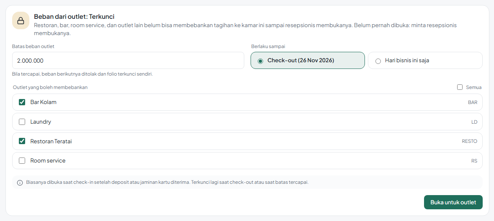
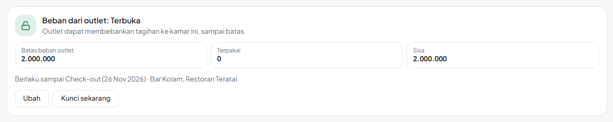

# Membuka folio untuk beban outlet

**Siapa yang melakukan:** resepsionis atau supervisor yang perannya boleh membuka folio untuk outlet.
**Kapan dilakukan:** biasanya saat check-in, setelah tamu membayar deposit atau memberi jaminan kartu. Juga kapan saja tamu ingin restoran, bar, atau room service ditagihkan ke kamarnya.
**Sebelum mulai:**
- Hotel Anda harus memakai modul POS.
- Tentukan batas beban outlet tamu ini, misalnya sesuai deposit yang diterima.

Folio tamu **terkunci** untuk outlet sampai resepsionis membukanya. Selama terkunci, kasir restoran atau bar tidak bisa memakai **Bebankan ke kamar** untuk tamu ini, dan tamu harus membayar di tempat.

## Langkah-langkah

1. Buka folio tamu. Kartu **Beban dari outlet: Terkunci** tampil di bawah ringkasan saldo, dengan alasannya, misalnya "Belum pernah dibuka: minta resepsionis membukanya.".
2. Isi formulir di kartu itu.

   | Field | Wajib? | Keterangan |
   |---|---|---|
   | Batas beban outlet | Ya | Jumlah paling banyak yang boleh dibebankan semua outlet, misalnya `2000000`. Tidak ada pilihan tanpa batas. |
   | Berlaku sampai | Ya | **Check-out** (sampai tamu check-out) atau **Hari bisnis ini saja** (terkunci lagi saat audit malam). |
   | Outlet yang boleh membebankan | Ya | Centang outletnya, misalnya **Restoran** dan **Bar**, atau **Semua**. |

   

3. Klik **Buka untuk outlet**. Kartu berubah menjadi **Beban dari outlet: Terbuka**, dengan **Batas beban outlet**, **Terpakai**, dan **Sisa**.

   

Untuk mengubah batas atau outletnya, klik **Ubah**. Untuk menutupnya lagi, klik **Kunci sekarang**.

### Memantau beban dari outlet

4. Buka **Tagihan → Beban outlet**. Halaman **Beban outlet hari ini** menampilkan semua yang dibebankan outlet ke kamar pada hari bisnis ini, termasuk yang ditolak beserta alasannya, misalnya "Ditolak: melebihi batas (sisa …)".
5. Klik **Ditolak** untuk melihat penolakan saja. Klik **Buka folio** pada baris yang ditolak untuk membuka folio tamunya, lalu ubah batas atau outletnya kalau tamu memang boleh.

## Hasilnya

- Outlet yang dicentang bisa membebankan tagihan ke kamar ini sampai batasnya. Tagihan itu masuk ke folio tamu.
- Kalau batas tercapai, beban berikutnya ditolak dan folio terkunci sendiri.

## Perlu diperhatikan

- **Folio terkunci lagi dengan sendirinya** saat tamu check-out, saat batas tercapai, dan (untuk **Hari bisnis ini saja**) saat audit malam.
- **Membuka saat check-in:** panel check-in punya pilihan yang sama, **Buka untuk outlet**. Lihat [Check-in](../01-front-desk/check-in.md).
- **"Batas tidak boleh di bawah yang sudah dibebankan outlet."** berarti batas baru lebih kecil dari yang sudah terpakai.
- **Folio yang tidak bisa dibuka:** folio yang sudah ditutup, tamu yang tidak sedang menginap, dan folio deposit reservasi.
- **Pengguna tanpa izin membuka** hanya melihat status kartu ini.

## Terkait

- [Bebankan ke kamar](../04-pos/bebankan-ke-kamar.md)
- [Check-in](../01-front-desk/check-in.md)
- [Menerima deposit](../01-front-desk/menerima-deposit.md)
