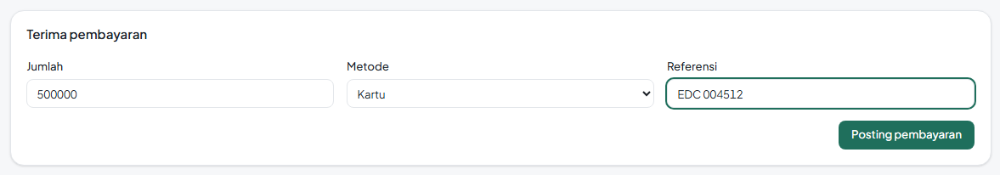
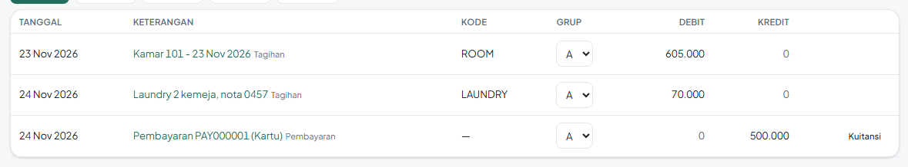

# Menerima pembayaran

> 🎬 Video tutorial: menyusul

**Siapa yang melakukan:** kasir atau resepsionis yang perannya boleh menerima pembayaran.
**Kapan dilakukan:** saat tamu membayar sebagian atau seluruh tagihannya, misalnya di tengah masa menginap atau saat check-out.
**Sebelum mulai:**
- Untuk pembayaran **tunai**, Anda harus punya shift kasir yang terbuka. Lihat [Shift kasir](shift-kasir.md).
- Untuk kartu atau QRIS, siapkan nomor bukti dari mesin EDC atau aplikasi pembayaran.

Deposit sebelum tamu tiba diterima di halaman reservasi. Lihat [Menerima deposit](../01-front-desk/menerima-deposit.md). Pembayaran saat check-out bisa langsung dilakukan di kotak check-out. Lihat [Check-out](../01-front-desk/check-out.md).

## Langkah-langkah

1. Buka folio tamu, misalnya dari panel kamar dengan **Terima pembayaran**, atau dari **Tagihan → Folio**. Lihat langkah 1 di [Memposting biaya ke folio](posting-biaya-ke-folio.md).
2. Klik tab **Pembayaran**.
3. Isi formulir **Terima pembayaran**.

   | Field | Wajib? | Keterangan |
   |---|---|---|
   | Jumlah | Ya | Jumlah yang dibayar, misalnya `500000`. Boleh kurang dari saldo (bayar sebagian). |
   | Metode | Ya | **Tunai**, **Kartu**, **Transfer bank**, **Lainnya**, atau **QRIS**. Bawaannya **Tunai**. |
   | Referensi | Tidak | Nomor bukti, misalnya nomor approval EDC `EDC 004512` atau nomor transfer bank. |

   

4. Klik **Posting pembayaran**. Muncul pesan "Pembayaran diposting.", dan saldo folio berkurang.
5. Kalau tamu meminta kuitansi, klik **Kuitansi** pada baris pembayaran. Kuitansi terbuka sebagai PDF di tab baru, siap dicetak.

   

## Hasilnya

- Pembayaran tercatat sebagai kredit di folio, dengan nomor seperti `PAY000014`.
- Pembayaran muncul di **Tagihan → Kasir**, yang merekap semua pembayaran per tanggal bisnis dan per metode. Lihat [Daftar pembayaran di Kasir](daftar-kasir.md).
- Pembayaran tunai menambah kas yang seharusnya ada di laci shift Anda.

## Perlu diperhatikan

- **"Uang tunai butuh shift kasir yang terbuka."** muncul di atas formulir kalau Anda memilih **Tunai** tanpa shift yang terbuka. Isi **Laci** dan **Modal awal** di kotak itu, klik **Buka shift**, lalu posting pembayarannya. Kalau peran Anda tidak boleh membuka shift, minta kasir yang menerima pembayaran itu.
- **"Laci … sedang dipegang …"** berarti laci yang Anda ketik dipakai kasir lain. Pakai laci lain yang disarankan di pesan itu.
- **Pembayaran yang melebihi saldo** tetap diterima, dengan peringatan "Pembayaran ini melebihi saldo: folio akan berisi kredit … yang perlu dikembalikan ke tamu.". Kelebihannya harus di-refund sebelum check-out. Lihat [Void dan refund](void-dan-refund.md).
- **Koneksi terputus saat memposting?** Muncul pesan "Koneksi terputus. Pembayaran mungkin sudah tercatat. Tekan Posting pembayaran lagi, tidak akan tercatat dua kali.". Klik **Posting pembayaran** sekali lagi tanpa mengubah isian. Pembayaran tidak akan tercatat dua kali.
- **Salah metode atau salah jumlah?** Pembayaran tidak bisa diubah. Batalkan (void) pada hari yang sama, lalu posting ulang. Lihat [Void dan refund](void-dan-refund.md).
- **Tab Transfer** memindahkan saldo ke piutang perusahaan, bukan pembayaran tamu. Lihat [Transfer ke piutang perusahaan](../06-corporate-group-city-ledger/transfer-ke-piutang-perusahaan.md).

## Terkait

- [Shift kasir](shift-kasir.md)
- [Void dan refund](void-dan-refund.md)
- [Daftar pembayaran di Kasir](daftar-kasir.md)
- [Check-out](../01-front-desk/check-out.md)
