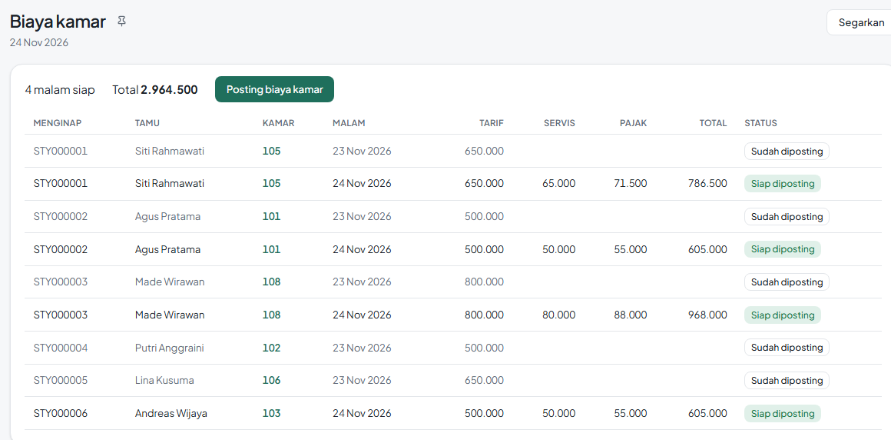

# Memposting biaya kamar

**Siapa yang melakukan:** night auditor, atau resepsionis dan kasir yang perannya boleh memposting biaya.
**Kapan dilakukan:** biasanya tidak perlu, karena audit malam memposting biaya kamar setiap malam secara otomatis. Halaman ini dipakai kalau:
- tamu meminta tagihan malam ini sebelum audit malam, misalnya tamu yang berangkat sangat pagi;
- ada malam yang **terlewat** atau **Gagal** dan perlu diposting setelah masalahnya diperbaiki.

**Sebelum mulai:** hari bisnis harus terbuka.

Biaya kamar dihitung dari tarif per malam setiap tamu yang menginap, ditambah biaya layanan dan pajak sesuai pengaturan kode biaya kamar.

## Langkah-langkah

1. Buka **Tagihan → Biaya kamar**. Di bawah judul tertulis tanggal bisnis hari ini. Tabel menampilkan setiap malam yang jatuh tempo untuk setiap tamu yang menginap.

   | Kolom | Keterangan |
   |---|---|
   | Menginap / Tamu / Kamar | Tamu dan kamarnya. |
   | Malam | Tanggal malamnya. Tanda **terlewat** berarti malam sebelum hari ini yang belum diposting. |
   | Tarif / Servis / Pajak / Total | Rincian biaya malam itu. |
   | Status | **Siap diposting**, **Terposting**, **Sudah diposting**, **Tidak berlaku**, atau **Gagal** dengan kode alasannya. |

   

2. Periksa angka di atas tabel: "{n} malam siap" dan **Total**.
3. Klik **Posting biaya kamar**.
4. Kartu **Diposting** menampilkan hasilnya, misalnya "6 malam diposting, 0 sudah diposting, 0 dengan kesalahan, 0 masih siap.".

## Hasilnya

- Biaya kamar setiap malam yang siap tercatat di folio tamunya, dengan tarif, biaya layanan, dan pajaknya.
- Audit malam tidak memposting malam itu lagi. Memposting dua kali tidak pernah menagih satu malam dua kali: malam yang sudah diposting tampil sebagai **Sudah diposting**.

## Perlu diperhatikan

- **Malam berstatus Gagal** tidak bisa diposting sampai masalahnya diperbaiki. Di bawah tabel tertulis "{n} malam tidak dapat diposting sampai masalahnya diperbaiki.". Alasannya tampil sebagai kode, misalnya:
  - `MISSING_NIGHTLY_RATE` (tarif malam itu tidak ada): periksa grid tarif. Lihat [Paket tarif dan grid tarif](../13-pengaturan/paket-tarif-dan-grid-tarif.md).
  - `NO_OPEN_FOLIO` (tidak ada folio terbuka) atau `ROUTING_TARGET_CLOSED` (folio tujuan penagihan sudah ditutup): periksa folio tamu dan instruksi penagihannya.
  - `NO_ROOM_FOR_NIGHT` (tidak ada kamar untuk malam itu): periksa kamar tamu.

  Malam yang gagal juga menahan audit malam. Lihat [Menangani penghalang](../11-audit-malam/menangani-penghalang.md).
- **"{n} malam yang diposting berada di luar masa menginap: batalkan di folio."** berarti masa menginap tamu dipersingkat setelah biaya kamarnya diposting. Minta supervisor membalik atau menyesuaikan biaya itu. Lihat [Reverse dan penyesuaian](reverse-dan-penyesuaian.md).
- **Biaya kamar tidak bisa diposting dari tab Biaya** di folio. Kode biaya kamar tidak ditawarkan di sana.
- **"Tidak ada yang jatuh tempo."** berarti semua malam sampai hari ini sudah diposting.

## Terkait

- [Menjalankan audit malam](../11-audit-malam/menjalankan-audit-malam.md)
- [Mengubah tarif tamu yang sedang menginap](../01-front-desk/mengubah-tarif-tamu-menginap.md)
- [Memposting biaya ke folio](posting-biaya-ke-folio.md)
