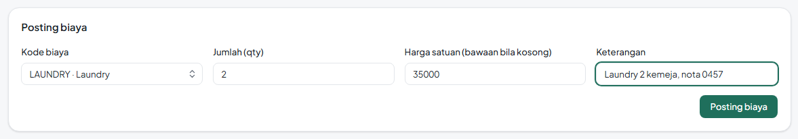
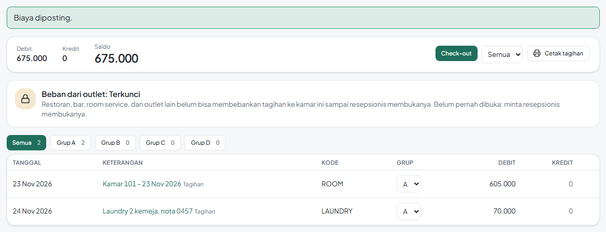

# Memposting biaya ke folio

**Siapa yang melakukan:** resepsionis atau kasir yang perannya boleh memposting biaya.
**Kapan dilakukan:** saat tamu memakai layanan yang ditagihkan ke kamarnya, misalnya laundry, minibar, atau sewa sepeda.
**Sebelum mulai:**
- Folio tamu harus masih **Terbuka**, dan hari bisnis harus terbuka.
- Siapkan bukti layanannya, misalnya nota laundry atau daftar isi minibar yang terpakai.

**Folio** adalah rekening tagihan tamu selama menginap. Semua biaya (debit) dan pembayaran (kredit) tamu tercatat di folio, dan selisihnya adalah **Saldo**.

Biaya kamar per malam tidak diposting dengan cara ini: biaya itu diposting audit malam atau halaman **Biaya kamar**. Lihat [Posting biaya kamar](posting-biaya-kamar.md). Tagihan restoran dan bar yang dibebankan ke kamar dari POS juga masuk sendiri. Lihat [Bebankan ke kamar](../04-pos/bebankan-ke-kamar.md).

## Langkah-langkah

1. Buka folio tamu. Ada beberapa cara:
   - di halaman **Menginap** tamu, klik nomor folio (misalnya `FOL000012`) di bawah nama tamu;
   - klik nomor kamar di mana pun untuk membuka panel kamar, lalu klik **Tambah tagihan**;
   - buka **Tagihan → Folio**, isi **Cari folio** dengan nomor kamar atau nama tamu, klik **Cari**, lalu klik baris folionya.
2. Klik tab **Biaya** di bawah daftar transaksi.
3. Isi formulir **Posting biaya**.

   | Field | Wajib? | Keterangan |
   |---|---|---|
   | Kode biaya | Ya | Jenis biaya, misalnya `LAUNDRY · Laundry` atau `MINIBAR · Minibar`. Kode biaya menentukan pajak, biaya layanan, dan akun pendapatannya. |
   | Jumlah (qty) | Ya | Banyaknya, misalnya `2`. Bawaannya `1`. |
   | Harga satuan (bawaan bila kosong) | Tergantung kode | Harga per satuan, misalnya `35000`. Kalau dikosongkan, harga bawaan kode biaya dipakai. Kode tanpa harga bawaan wajib diisi. |
   | Keterangan | Tidak | Keterangan yang tampil di tagihan, misalnya `Laundry 2 kemeja, nota 0457`. |

   

4. Klik **Posting biaya**. Muncul pesan "Biaya diposting." dan baris baru tampil di daftar transaksi.

   

## Hasilnya

- Biaya tercatat di folio dengan tanggal bisnis hari ini. **Debit** dan **Saldo** di bagian atas bertambah.
- Pajak dan biaya layanan dihitung otomatis sesuai pengaturan kode biaya. Klik keterangan baris untuk melihat rinciannya: harga, neto, serta setiap pajak dan biaya layanan.

## Perlu diperhatikan

- **Biaya yang salah tidak dihapus.** Folio hanya bisa ditambah. Kalau salah posting hari ini, minta supervisor membaliknya (**Reverse**). Kalau salahnya ditemukan setelah audit malam, koreksinya lewat **Penyesuaian**. Lihat [Reverse dan penyesuaian](reverse-dan-penyesuaian.md).
- **Kode biaya kamar dan kode transfer tidak tersedia di sini.** Pendapatan kamar hanya diposting oleh posting biaya kamar, dan kode `TRF` hanya dipakai oleh transfer saldo.
- **"Folio sudah ditutup."** berarti tamu sudah check-out. Biaya baru tidak bisa diposting ke folio yang tertutup.
- **Tab Biaya tidak tampil** kalau folio sudah tertutup, atau peran Anda tidak boleh memposting biaya.
- **Folio bill outlet** (dari POS) tidak diubah di halaman ini: "Folio bill outlet diubah di POS, bukan di sini.".
- Di **master folio grup**, ada isian tambahan **Biaya ini untuk**: pilih **Grup (bukan tamu tertentu)** atau kamar anggota grupnya. Lihat [Grup dan master folio](../06-corporate-group-city-ledger/grup-dan-master-folio.md).

## Terkait

- [Menerima pembayaran](menerima-pembayaran.md)
- [Reverse dan penyesuaian](reverse-dan-penyesuaian.md)
- [Grup tagihan dan cetak](grup-tagihan-dan-cetak.md)
