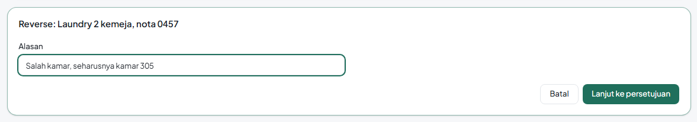
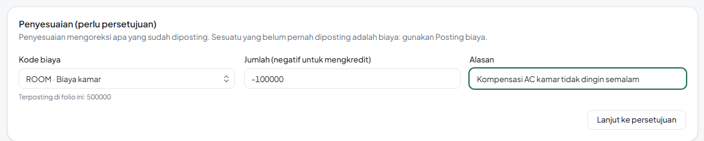

# Mengoreksi biaya: reverse dan penyesuaian

**Siapa yang melakukan:** supervisor front office atau pengguna lain yang perannya boleh mengoreksi folio. Setiap koreksi disetujui oleh orang yang berwenang menyetujui koreksi.
**Kapan dilakukan:** saat biaya di folio salah, misalnya salah kamar, salah jumlah, atau tamu komplain dan diberi potongan.
**Sebelum mulai:**
- Siapkan alasan koreksinya. Alasan wajib diisi dan tercatat di jejak audit.
- Pastikan penyetuju ada di dekat Anda: ia harus mengetik email dan kata sandinya sendiri. Lihat [Meminta persetujuan](../00-memulai/meminta-persetujuan.md).

Folio tidak pernah dihapus atau diedit. Biaya yang salah dikoreksi dengan baris baru:

| Koreksi | Dipakai untuk | Hasilnya |
|---|---|---|
| **Reverse** (membalik) | Biaya atau penyesuaian yang diposting **hari ini** (tanggal bisnis berjalan). | Baris pembalik dengan jumlah yang sama, sehingga biaya itu menjadi nol. Baris aslinya dicoret. |
| **Penyesuaian** (adjustment) | Biaya dari **hari sebelumnya**, atau koreksi sebagian, misalnya potongan harga. | Baris penyesuaian pada tanggal bisnis hari ini, dengan jumlah yang Anda tentukan. |

Pembayaran yang salah dikoreksi dengan void atau refund, bukan dengan cara ini. Lihat [Void dan refund](void-dan-refund.md).

## Langkah-langkah

### Reverse biaya hari ini

1. Buka folio tamu. Cari baris biaya yang salah.
2. Klik **Reverse** pada baris itu. Formulir **Reverse: …** terbuka di bawah daftar transaksi.
3. Isi **Alasan**, misalnya `Salah kamar, seharusnya kamar 305`, lalu klik **Lanjut ke persetujuan**.

   

4. Jendela **Setujui reversal** terbuka. Penyetuju mengisi **Email penyetuju** dan **Kata sandi penyetuju**, lalu klik **Setujui**. Muncul pesan "Item di-reverse.".

### Penyesuaian untuk biaya hari sebelumnya

5. Di folio tamu, klik tab **Penyesuaian**.
6. Isi formulir **Penyesuaian (perlu persetujuan)**.

   | Field | Wajib? | Keterangan |
   |---|---|---|
   | Kode biaya | Ya | Kode biaya yang dikoreksi. Hanya kode yang sudah pernah diposting di folio ini yang ditawarkan. Di bawahnya tertulis jumlah yang sudah terposting. |
   | Jumlah (negatif untuk mengkredit) | Ya | Untuk mengurangi tagihan, isi angka negatif, misalnya `-100000`. Angka positif menambah tagihan. Jumlah ini belum termasuk pajak dan servis kode biaya itu; keduanya dihitung ulang menurut aturan kode biayanya. Contoh: kalau kode biaya `ROOM` dikenai servis 10% dan pajak 10%, `-100000` tercatat sebagai kredit 121.000. |
   | Alasan | Ya | Misalnya `Kompensasi AC kamar tidak dingin semalam`. |

   

7. Klik **Lanjut ke persetujuan**. Di jendela **Setujui penyesuaian**, penyetuju mengisi email dan kata sandinya, lalu klik **Setujui**. Muncul pesan "Penyesuaian diposting.".

## Hasilnya

- Reverse: baris asli dicoret dan baris pembalik ditambahkan. Saldo folio berkurang sebesar biaya itu, termasuk pajak dan biaya layanannya.
- Penyesuaian: baris baru berjenis **Penyesuaian** dengan keterangan "Penyesuaian: {alasan}". Pajak dan biaya layanan ikut dihitung ulang sesuai kode biayanya.
- Nama penyetuju dan alasannya tercatat di jejak audit.

## Perlu diperhatikan

- **Tombol Reverse hanya muncul** untuk biaya dan penyesuaian yang diposting pada tanggal bisnis hari ini, yang belum dibalik. Untuk biaya kemarin, tombolnya tidak ada: pakai **Penyesuaian**.

  > 🐞 Kendala yang diketahui (KD-08): kalau layar belum dimuat ulang setelah audit malam dan Anda mencoba me-reverse biaya kemarin, pesannya berbunyi "Hanya tanda terima pada tanggal bisnis berjalan yang bisa dibatalkan.". Pesan yang sama muncul saat membatalkan pembayaran kemarin. **Dampaknya:** pesan itu menyebut tanda terima, padahal yang ditolak adalah biaya atau pembayaran dari hari sebelumnya. **Sementara ini:** muat ulang halaman folio, lalu koreksi biayanya dengan **Penyesuaian**. Untuk pembayaran, lihat [Void dan refund](void-dan-refund.md).
- **Kredit penyesuaian tidak boleh melebihi yang sudah diposting** pada kode biaya itu di folio ini: "Kredit melebihi yang sudah diposting pada kode biaya ini di folio.".
- **"Kode biaya ini belum punya posting di folio: posting biaya, bukan penyesuaian."** berarti yang Anda tambahkan sebenarnya biaya baru. Gunakan [Memposting biaya ke folio](posting-biaya-ke-folio.md).
- **Biaya kamar yang di-reverse** muncul lagi sebagai malam yang siap diposting di halaman **Biaya kamar**, jadi bisa tertagih lagi. Untuk mengurangi biaya kamar satu malam (misalnya tamu mendapat potongan atau malam gratis), gunakan **Penyesuaian**. Lihat [Posting biaya kamar](posting-biaya-kamar.md).
- **Biaya yang datang dari transfer** tidak di-reverse: "Biaya hasil transfer tidak di-reverse: kembalikan dengan Kembalikan (di folio asalnya, Tampilkan yang ditransfer).". Lihat [Transfer antar folio](transfer-antar-folio.md).
  - **Kecuali biaya dari POS** (**Bebankan ke kamar**). Baris itu tidak bisa dikembalikan dengan **Kembalikan**: tidak muncul di **Tampilkan yang ditransfer** folio tamu, dan bill outletnya sudah tertutup. Baris itu juga tidak bisa dikoreksi dengan **Penyesuaian**, karena kodenya `TRF` dan kode itu ditolak: "Kode TRF diposting oleh transfer saldo, bukan manual.". Lihat [Bebankan ke kamar](../04-pos/bebankan-ke-kamar.md).

    > 🐞 Kendala yang diketahui (KD-01): beban POS yang sudah masuk folio tamu belum bisa dibatalkan dari layar setelah bill outletnya lunas. **Dampaknya:** kalau beban salah, atau masuk ke kamar yang salah, tagihan tamu tetap memuat beban itu. **Sementara ini:** belum bisa dilakukan dari layar. Laporkan ke supervisor atau administrator sebelum tamu check-out, beserta nomor kamar, nomor bill, dan jumlahnya.
- **Penyetuju salah memasukkan kata sandi?** Jendela tetap terbuka dengan pesan "Email atau kata sandi penyetuju salah.". Ulangi.
- **"Aturan properti ini meminta penyetuju selain orang yang membuat perubahan."** berarti Anda tidak boleh menyetujui koreksi Anda sendiri. Minta orang lain. Aturan ini diatur di [Aturan persetujuan](../13-pengaturan/aturan-persetujuan.md).

## Terkait

- [Void dan refund](void-dan-refund.md)
- [Meminta persetujuan](../00-memulai/meminta-persetujuan.md)
- [Membatalkan check-in](../01-front-desk/membatalkan-check-in.md)
