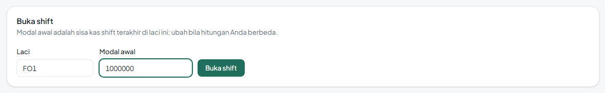
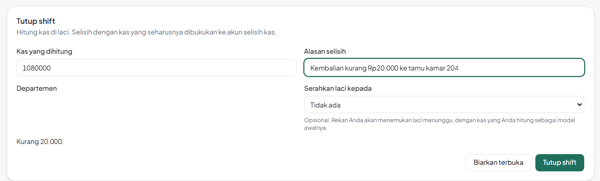
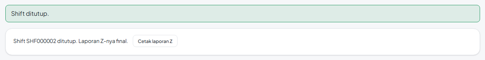

# Shift kasir

**Siapa yang melakukan:** setiap kasir atau resepsionis yang menerima uang tunai.
**Kapan dilakukan:**
- membuka shift: di awal giliran kerja, sebelum menerima uang tunai pertama;
- menutup shift: di akhir giliran, setelah menghitung uang di laci.

**Sebelum mulai:** hitung modal awal di laci, yaitu uang kembalian yang diserahkan kepada Anda.

**Shift kasir** adalah waktu seorang kasir memegang satu **laci** uang, dari modal awal sampai hitungan akhir. Semua uang tunai yang Anda terima atau keluarkan tercatat di shift Anda. Saat shift ditutup, KamaraPMS membandingkan hitungan Anda dengan kas yang seharusnya ada.

## Langkah-langkah

### Membuka shift

1. Buka **Tagihan → Shift kasir**.
2. Isi formulir **Buka shift**.

   | Field | Wajib? | Keterangan |
   |---|---|---|
   | Laci | Tidak | Kode laci, misalnya `FO1`. Kalau kosong, laci utama (`MAIN`) yang dipakai. |
   | Modal awal | Ya | Uang di laci saat Anda mulai, misalnya `1000000`. Terisi dengan sisa kas shift terakhir di laci itu. Ubah kalau hitungan Anda berbeda. |

   

3. Klik **Buka shift**. Muncul pesan "Shift dibuka.". Kartu **Shift {nomor} di laci {laci}** menampilkan rincian kas Anda.

### Selama shift

4. Terima pembayaran tunai seperti biasa. Lihat [Menerima pembayaran](menerima-pembayaran.md). Pembayaran tunai, refund tunai, dan penerimaan piutang perusahaan secara tunai tercatat di shift Anda.
5. Kalau uang keluar atau masuk laci di luar pembayaran tamu, catat di **Pindahkan kas**:

   | Field | Wajib? | Keterangan |
   |---|---|---|
   | Jenis | Ya | **Setor ke brankas** (uang lebih diserahkan ke brankas), **Kas masuk**, atau **Kas keluar** (misalnya membeli galon air). |
   | Jumlah | Ya | Misalnya `500000`. |
   | Akun | Untuk kas masuk dan kas keluar | Akun lawannya, misalnya akun beban untuk kas keluar. |
   | Departemen | Kalau akunnya meminta | Departemen yang menanggung. |
   | Alasan | Ya | Misalnya `Setoran siang ke brankas`. |

   Klik **Catat**. Muncul pesan "Perpindahan kas tercatat.".
6. Untuk melihat posisi kas sementara, klik **Laporan X (sementara)**. Laporan X tidak menutup apa pun, dan angkanya terus berubah sampai shift ditutup.

### Menutup shift

7. Hitung uang di laci. Klik **Tutup shift…**.
8. Isi **Kas yang dihitung**, misalnya `1080000`. Di bawahnya langsung tampil selisihnya: **Hitungan pas.**, **Kurang …**, atau **Lebih …**.

   | Field | Wajib? | Keterangan |
   |---|---|---|
   | Kas yang dihitung | Ya | Uang yang benar-benar ada di laci. |
   | Alasan selisih | Kalau ada selisih di atas batas | Misalnya `Kembalian kurang Rp20.000 ke tamu kamar 204`. |
   | Departemen | Tidak | Departemen untuk jurnal selisih kas. Kalau tidak ada pilihan di bawah label ini, lewati saja. |
   | Serahkan laci kepada | Tidak | Rekan yang melanjutkan laci ini. Ia akan menemukan laci menunggu, dengan hitungan Anda sebagai modal awalnya. |

   

9. Klik **Tutup shift**. Kalau selisihnya melebihi batas yang diizinkan, jendela **Setujui selisih** terbuka: atasan yang berwenang mengisi email dan kata sandinya, lalu klik **Setujui**.
10. Muncul "Shift {nomor} ditutup. Laporan Z-nya final.". Klik **Cetak laporan Z**, tanda tangani, dan serahkan bersama uangnya sesuai prosedur hotel Anda.

    

## Hasilnya

- Shift berstatus **Tutup**, dan selisih kas (kalau ada) dicatat ke akun selisih kas.
- Laporan Z bersifat final: angkanya tidak berubah lagi.
- Daftar **Shift saya** di bawah halaman menyimpan semua shift Anda, dengan tombol **Laporan X** atau **Laporan Z** untuk mencetak ulang.

## Perlu diperhatikan

- **Satu orang satu shift, satu laci satu shift.** "Anda masih punya shift terbuka: tutup dulu." berarti shift Anda yang lama belum ditutup. "Ada shift lain yang terbuka di laci ini." berarti laci itu dipegang rekan Anda: pakai kode laci lain.
- **Laci yang diserahkan kepada Anda** muncul sebagai kartu "Laci {laci} diserahkan kepada Anda". Klik **Buka dengan {jumlah}** untuk memulai shift dengan modal awal itu.
- **Kas yang seharusnya ada** = modal awal + pembayaran tunai + penerimaan perusahaan + kas masuk − refund − kas keluar − setoran ke brankas − void dari shift yang sudah tutup.
- **Batas selisih** diatur di **Pengaturan kasir** di halaman yang sama (hanya untuk yang berwenang): **Selisih tanpa persetujuan**. Nilai `0` berarti setiap selisih, sekecil apa pun, butuh persetujuan.
- **Shift yang masih terbuka bisa menahan audit malam** kalau **Shift terbuka menahan audit malam** dicentang di Pengaturan kasir (bawaan: dicentang). Tutup semua shift sebelum night auditor menjalankan audit malam. Lihat [Menjalankan audit malam](../11-audit-malam/menjalankan-audit-malam.md).
- **Uang tunai butuh shift terbuka** (bawaan: dicentang). Kalau pengaturan ini dimatikan, uang tunai bisa diterima tanpa shift, tetapi tidak dicocokkan per laci.
- **Pembayaran kartu, QRIS, dan transfer bank** tidak masuk hitungan laci.
- Supervisor yang berwenang melihat semua shift properti di daftar **Shift**, bukan hanya miliknya.

## Terkait

- [Menerima pembayaran](menerima-pembayaran.md)
- [Void dan refund](void-dan-refund.md)
- [Laporan harian](../12-laporan/laporan-harian.md)
