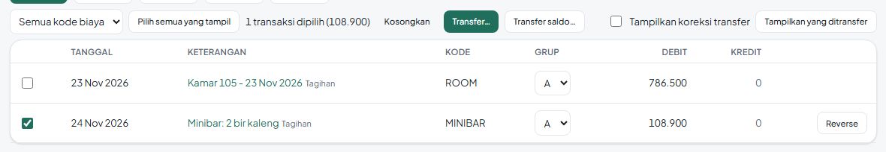
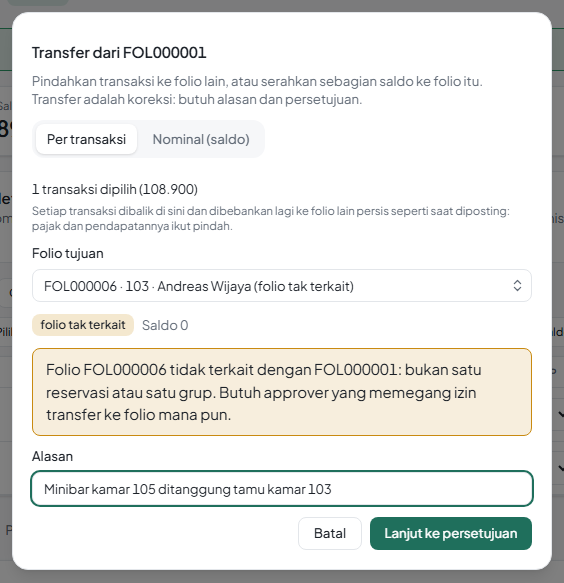

# Memindahkan transaksi antar folio

**Siapa yang melakukan:** supervisor front office atau kasir yang perannya boleh mengoreksi folio. Setiap transfer disetujui oleh orang yang berwenang.
**Kapan dilakukan:**
- Biaya diposting ke folio yang salah, misalnya ke kamar sebelah.
- Biaya tamu ditanggung orang lain, misalnya teman yang menginap di kamar lain, atau master folio grup.
- Sebagian saldo diserahkan ke folio lain, misalnya perusahaan yang menanggung kamar tetapi bukan minibar.

**Sebelum mulai:**
- Kedua folio harus **Terbuka**.
- Siapkan nomor folio, nomor kamar, atau nama tamu tujuan, beserta alasannya.

Ada tiga cara:

| Cara | Dipakai untuk |
|---|---|
| **Pindah** (satu baris) | Satu biaya ke folio lain dari reservasi yang sama, misalnya dari folio tamu ke folio perusahaan kamar itu. |
| **Transfer…** (per transaksi) | Beberapa biaya yang dicentang ke folio mana pun. Pajak dan pendapatannya ikut pindah. |
| **Transfer saldo…** (nominal) | Sebagian saldo, sebagai satu angka, ke folio lain. |

## Langkah-langkah

### Memindahkan beberapa biaya

1. Buka folio asal. Centang kotak di depan setiap biaya yang akan dipindahkan. Untuk mencentang semua biaya satu jenis, pilih kodenya di **Semua kode biaya**, lalu klik **Pilih semua kode ini**.

   

2. Klik **Transfer…**. Jendela **Transfer dari {folio}** terbuka dengan tab **Per transaksi**.
3. Isi jendela transfer.

   | Field | Wajib? | Keterangan |
   |---|---|---|
   | Folio tujuan | Ya | Ketik nomor folio, nomor kamar, atau nama tamu, lalu pilih. Setiap pilihan diberi keterangan hubungannya, misalnya **reservasi yang sama**, **grup yang sama**, atau **folio tak terkait**. |
   | Alasan | Ya | Misalnya `Minibar kamar 105 ditanggung tamu kamar 103`. |

   

4. Klik **Lanjut ke persetujuan**. Di jendela **Setujui transfer**, penyetuju mengisi email dan kata sandinya, lalu klik **Setujui**. Muncul pesan "{n} transaksi dipindahkan ke {folio}.".

### Menyerahkan sebagian saldo

5. Klik **Transfer saldo…**. Jendela transfer terbuka di tab **Nominal (saldo)**.
6. Isi **Nominal yang diserahkan**, misalnya `1500000`, pilih **Folio tujuan**, dan isi **Alasan**. Klik **Lanjut ke persetujuan**, lalu minta penyetuju menyetujuinya. Muncul pesan "{amount} diserahkan ke {folio}.".

### Mengembalikan transfer

7. Di folio **asal**, klik **Tampilkan yang ditransfer**. Daftar **Yang ditransfer dari folio ini** menunjukkan ke mana setiap transaksi pergi, dan di mana sekarang.
8. Klik **Kembalikan** pada barisnya, atau centang beberapa baris dan klik **Kembalikan {n} yang dipilih**.
9. Pilih **Kembalikan ke**: **Folio sebelumnya** atau **Folio asal pertama**. Isi **Alasan**, klik **Lanjut ke persetujuan**, lalu minta penyetuju menyetujuinya. Muncul pesan "{n} transfer dikembalikan.".

## Hasilnya

- Di folio asal, setiap biaya yang dipindahkan dibalik. Di folio tujuan, biaya yang sama persis dibebankan lagi, dengan keterangan dari folio mana biaya itu datang.
- Transfer saldo menambahkan baris kredit "Transfer ke …" di folio asal dan baris biaya "Transfer dari …" di folio tujuan.
- Baris pembalik dan salinan transfer disembunyikan supaya folio mudah dibaca. Centang **Tampilkan koreksi transfer** untuk melihatnya.

## Perlu diperhatikan

- **Hanya biaya yang bisa dipindahkan.** Pembayaran tidak ikut. Pembayaran yang salah folio di-void lalu diposting ulang di folio yang benar. Lihat [Void dan refund](void-dan-refund.md).
- **Butuh faktur pajak atas nama pembayar?** Pakai transfer per transaksi, bukan transfer saldo. Transfer saldo tidak membawa rincian pajaknya.
- **Folio tak terkait** (bukan reservasi atau grup yang sama) butuh izin tambahan untuk memindahkan ke folio mana pun, baik bagi Anda maupun bagi penyetuju. Jendela transfer memperingatkannya.
- **Nominal tidak boleh melebihi saldo folio**: "Nominal melebihi saldo folio ini (…).".
- **Satu kali transfer paling banyak 200 biaya.**
- **Pindah** (satu baris) hanya muncul kalau reservasi itu punya folio lain yang terbuka, misalnya folio perusahaan dari instruksi penagihan.
- **Biaya di folio tujuan tidak di-reverse.** Kembalikan dari folio asalnya dengan **Kembalikan**.
- **"Folio berubah selagi diproses: ulangi."** berarti rekan Anda mengubah salah satu folio pada saat yang sama. Ulangi transfernya.

## Terkait

- [Reverse dan penyesuaian](reverse-dan-penyesuaian.md)
- [Grup dan master folio](../06-corporate-group-city-ledger/grup-dan-master-folio.md)
- [Transfer ke piutang perusahaan](../06-corporate-group-city-ledger/transfer-ke-piutang-perusahaan.md)
