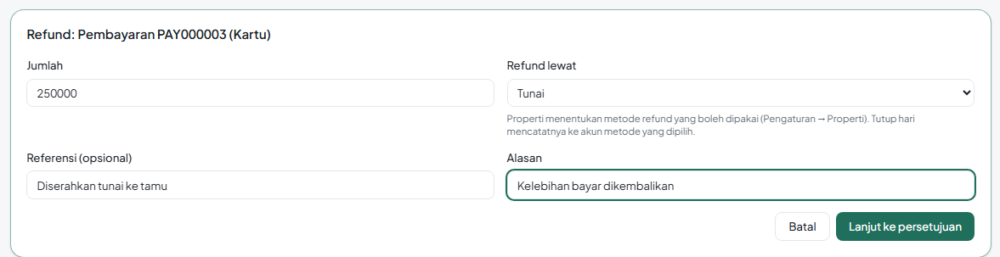
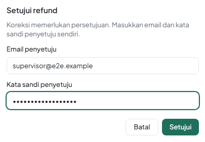

# Membatalkan (void) dan mengembalikan (refund) pembayaran

**Siapa yang melakukan:** kasir, supervisor, atau pengguna lain yang perannya boleh me-void atau me-refund pembayaran. Setiap void dan refund disetujui oleh orang yang berwenang.
**Kapan dilakukan:**
- **Void**: pembayaran salah dicatat **hari ini**, misalnya salah metode, salah jumlah, atau salah folio.
- **Refund**: uang tamu dikembalikan, misalnya deposit yang tersisa setelah check-out, atau tamu membayar lebih.

**Sebelum mulai:**
- Siapkan alasannya.
- Refund **tunai** butuh shift kasir yang terbuka, karena uangnya keluar dari laci Anda. Lihat [Shift kasir](shift-kasir.md).

| | Void | Refund |
|---|---|---|
| Kapan boleh | Hanya pembayaran yang diterima pada tanggal bisnis hari ini | Kapan saja |
| Jumlah | Seluruh pembayaran | Sebagian atau seluruhnya, paling banyak sisa pembayaran dan kredit folio |
| Artinya | Pembayaran dianggap tidak pernah terjadi | Uang benar-benar dikembalikan ke tamu |

## Langkah-langkah

### Void pembayaran hari ini

1. Buka folio tamu. Cari baris pembayaran yang salah.
2. Klik **Void** pada baris itu.
3. Isi **Alasan**, misalnya `Salah metode: tamu membayar dengan kartu, bukan tunai`, lalu klik **Lanjut ke persetujuan**.
4. Di jendela **Setujui void**, penyetuju mengisi email dan kata sandinya, lalu klik **Setujui**. Muncul pesan "Pembayaran di-void.".

### Refund

5. Klik **Refund** pada baris pembayaran yang dikembalikan.
6. Isi formulir **Refund: …**.

   | Field | Wajib? | Keterangan |
   |---|---|---|
   | Jumlah | Ya | Terisi dengan jumlah pembayaran. Ubah kalau hanya sebagian yang dikembalikan, misalnya `250000`. |
   | Refund lewat | Ya | Cara uang dikembalikan, misalnya **Tunai**. Pilihannya ditentukan di pengaturan properti. |
   | Referensi (opsional) | Tidak | Misalnya nomor transfer bank ke rekening tamu. |
   | Alasan | Ya | Misalnya `Sisa deposit setelah check-out`. |

   

7. Klik **Lanjut ke persetujuan**. Di jendela **Setujui refund**, penyetuju mengisi email dan kata sandinya, lalu klik **Setujui**. Muncul pesan "Refund diposting.".

   

8. Serahkan uangnya kepada tamu. Klik **Kuitansi** pada baris refund kalau tamu meminta bukti.

## Hasilnya

- Void: baris pembayaran dicoret, dan saldo folio naik lagi sebesar pembayaran itu. Di **Tagihan → Kasir**, statusnya menjadi **Dibatalkan (void)**.
- Refund: baris **Pengembalian dana** ditambahkan, dan saldo folio naik sebesar jumlah refund. Refund tunai mengurangi kas yang seharusnya ada di laci Anda.

## Perlu diperhatikan

- **Tombol Void hanya ada** untuk pembayaran hari ini yang belum dibatalkan. Untuk pembayaran kemarin, pakai **Refund**.
- **Pembayaran yang sudah di-refund sebagian tidak bisa di-void**: "Pembayaran yang sudah dikembalikan sebagian tidak bisa dibatalkan.".
- **Refund tidak boleh membuat folio berutang**: "Pengembalian melebihi kredit yang dipegang folio: folio akan berutang. Kembalikan paling banyak sisa setelah biaya.". Contohnya, tamu membayar deposit Rp1.000.000 dan tagihannya Rp750.000: yang boleh di-refund paling banyak Rp250.000.
- **Refund lewat** hanya menawarkan metode yang diizinkan di **Pengaturan → Properti** (**Refund dapat dikeluarkan lewat**). Bawaannya hanya **Tunai**. Lihat [Properti](../13-pengaturan/properti.md).
- **Pembayaran yang dipindahkan ke piutang perusahaan** tidak bisa di-refund. Tombol **Refund** tidak muncul untuk baris itu.
- **Void pembayaran tunai dari shift yang sudah ditutup** tercatat di shift Anda sebagai "Void dari shift yang sudah tutup", jadi kas yang seharusnya ada di laci Anda berkurang.

  > ⚠️ Penting: void dan refund tidak bisa dibatalkan. Kalau keliru, posting pembayaran baru.

## Terkait

- [Menerima pembayaran](menerima-pembayaran.md)
- [Reverse dan penyesuaian](reverse-dan-penyesuaian.md)
- [Shift kasir](shift-kasir.md)
