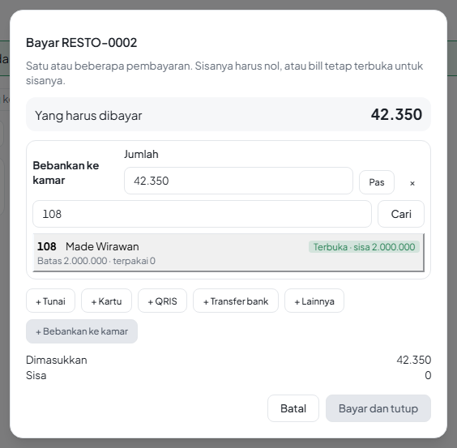

# Membebankan bill ke kamar

**Siapa yang melakukan:** kasir outlet yang perannya boleh membebankan ke kamar.
**Kapan dilakukan:** saat tamu hotel yang sedang menginap ingin tagihan restoran, bar, atau room service dimasukkan ke tagihan kamarnya.
**Sebelum mulai:**
- Folio tamu harus sudah **dibuka untuk outlet** oleh resepsionis, dengan batas dan daftar outlet yang boleh membebankan. Lihat [Membuka folio untuk outlet](../03-kasir-dan-pembayaran/membuka-folio-untuk-outlet.md).
- Outlet harus mencentang **Boleh dibebankan ke kamar**.
- Minta tamu menyebutkan nomor kamar dan namanya, dan cocokkan dengan kunci kamar atau identitasnya.

## Langkah-langkah

1. Di bill tamu, klik **Bayar**.
2. Hapus baris yang sudah ada dengan **×**, lalu klik **+ Bebankan ke kamar**.
3. Ketik nomor kamar atau nama tamu di **Nomor kamar atau nama tamu**, lalu klik **Cari**.
4. Pilih tamunya dari hasil pencarian. Setiap hasil menunjukkan apakah folio tamu itu **Terbuka · sisa …** (hijau) atau **Terkunci: …** (kuning), beserta batas dan yang sudah terpakai.

   

5. Klik **Pas** untuk membebankan seluruh tagihan, lalu klik **Bayar dan tutup**.
6. Cetak struk dan minta tamu menandatanganinya. Struk bertuliskan "Dibebankan ke kamar. Tanda tangan:".

## Hasilnya

- Bill berstatus **Lunas**, dengan baris "Dibebankan ke kamar {kamar}: {jumlah}".
- Tagihan masuk ke folio tamu, dengan tautan **Lihat rincian** ke bill-nya. Sisa batas outlet di folio berkurang.
- Bebannya tercatat di **Tagihan → Beban outlet** hari itu.

## Perlu diperhatikan

- **Beban ditolak** kalau:
  - folio terkunci: "Folio ini terkunci untuk beban outlet: minta resepsionis membukanya.";
  - outlet Anda tidak ada di daftar folio itu: "Outlet ini tidak boleh membebankan ke kamar ini.";
  - jumlahnya melebihi sisa batas: "Kamar hanya bisa menerima … lagi.". Klik **Bebankan sebesar yang bisa diterima kamar, sisanya dengan cara lain**: sebagian dibebankan ke kamar, dan sisanya dibayar tamu dengan tunai atau kartu.

  Setiap penolakan tercatat di **Tagihan → Beban outlet**, sehingga resepsionis bisa melihat dan membuka folionya kalau tamu memang boleh.
- **Folio terkunci lagi dengan sendirinya** saat batasnya tercapai, saat tamu check-out, atau (kalau dibuka untuk satu hari) saat audit malam.
- **Tamu grup** yang tagihannya diarahkan ke master folio: beban masuk ke master folio grup. Hasil pencarian menampilkan "ditagihkan ke grup …".
- **Membatalkan beban ke kamar** setelah bill lunas belum bisa dilakukan dari layar POS. Baris itu di folio tamu juga tidak bisa di-reverse, karena datang dari transfer. Kalau tamu memang tidak seharusnya ditagih, minta supervisor front office memberi **Penyesuaian** (kredit) sebesar tagihan itu di folio tamu, dengan alasan dan persetujuan. Lihat [Reverse dan penyesuaian](../03-kasir-dan-pembayaran/reverse-dan-penyesuaian.md).
- Hanya tamu yang sedang menginap yang muncul di pencarian.

## Terkait

- [Membuka folio untuk outlet](../03-kasir-dan-pembayaran/membuka-folio-untuk-outlet.md)
- [Membayar bill](membayar-bill.md)
- [Check-out](../01-front-desk/check-out.md)
