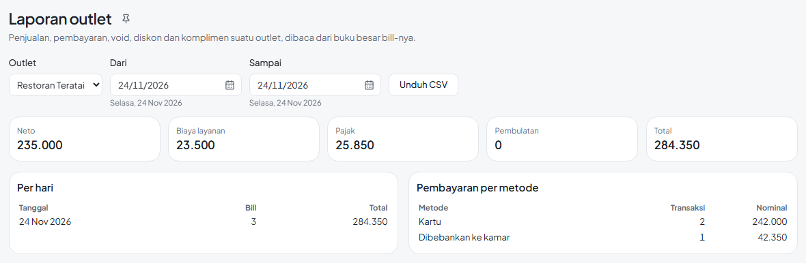

# Laporan outlet

**Siapa yang melakukan:** kasir outlet, manajer F&B, atau staf akuntansi yang perannya boleh melihat laporan outlet.
**Kapan dilakukan:** di akhir giliran atau akhir hari, untuk mencocokkan penjualan dan pembayaran, dan kapan saja untuk melihat penjualan per produk.
**Sebelum mulai:** tidak ada persiapan khusus.

## Langkah-langkah

1. Buka **POS → Laporan outlet**, atau klik **Laporan** di denah meja.
2. Pilih **Outlet**, lalu atur **Dari** dan **Sampai**. Keduanya berisi tanggal bisnis hari ini. Laporan dimuat ulang setiap kali pilihan berubah.

   | Field | Wajib? | Keterangan |
   |---|---|---|
   | Outlet | Ya | Misalnya `Restoran Teratai`. |
   | Dari / Sampai | Ya | Rentang tanggal bisnis, paling panjang 366 hari. |

3. Baca laporannya. Urutan bagiannya:
   - **Total penjualan**: **Neto**, **Biaya layanan**, **Pajak**, **Pembulatan**, dan **Total**;
   - **Per hari**;
   - **Pembayaran per metode**, termasuk **Dibebankan ke kamar**, **Ke perusahaan**, dan **Komplimen**;
   - **Bill terbuka dengan item terjual**;
   - **Per produk**;
   - **Laci dibuka tanpa penjualan**;
   - **Void**, **Diskon**, dan **Komplimen**, masing-masing dengan alasan, pelaku, dan penyetujunya.

   

4. Untuk mengolahnya di spreadsheet, klik **Unduh CSV**. Isinya satu baris per hari.

## Hasilnya

Anda melihat penjualan dan pembayaran outlet untuk rentang tanggal itu, dibaca dari pembukuan bill outlet.

## Perlu diperhatikan

- **Bill terbuka dengan item terjual** belum masuk penjualan di atas sampai dibayar. Kalau angkanya lebih dari nol di akhir hari, selesaikan bill-bill itu sebelum audit malam.
- **Laci dibuka tanpa penjualan** mencatat setiap kali laci dibuka tanpa transaksi. Kejadian ini tidak butuh persetujuan, tetapi pelaku dan alasannya tercatat.
- **Laporan per kasir dan per pelayan** belum tersedia di layar ini.
- **Judul kolom file CSV** dalam bahasa Inggris: `business_date` (tanggal bisnis), `bills` (jumlah bill), `net` (neto), `service` (biaya layanan), `tax` (pajak), `rounding` (pembulatan), dan `total`.
- **Diskon** di daftar diskon bisa tampil dengan keterangan bahasa Inggris, misalnya `Discount: Es Teh Manis` (diskon Es Teh Manis).

## Terkait

- [Membayar bill](membayar-bill.md)
- [Void, diskon, dan komplimen](void-diskon-komplimen.md)
- [Laporan harian](../12-laporan/laporan-harian.md)
