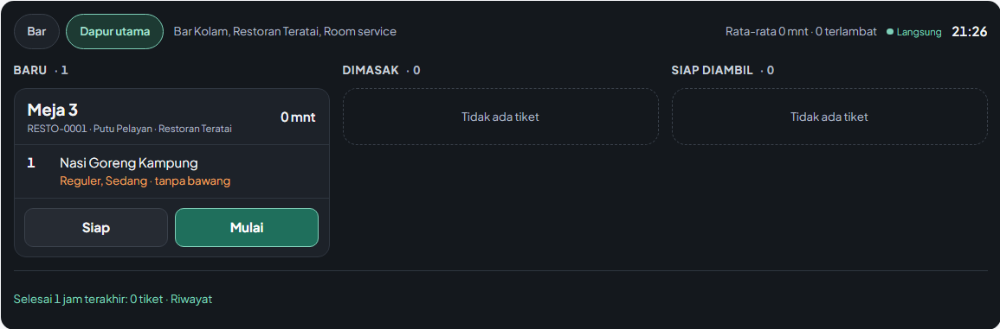

# Layar dapur

**Siapa yang melakukan:** juru masak atau bartender.
**Kapan dilakukan:** sepanjang jam operasional outlet, di layar atau tablet di dapur dan bar.
**Sebelum mulai:** stasiunnya harus mencentang **Tampil di layar dapur** di **POS → Stasiun dan printer**. Lihat [Menyiapkan outlet](menyiapkan-outlet.md).

**Layar dapur** (KDS, *kitchen display system*) menampilkan pesanan yang dikirim pelayan, menggantikan tiket kertas.

## Langkah-langkah

1. Buka **POS → Layar dapur**. Kalau ada beberapa stasiun, klik tab stasiun Anda, misalnya **Dapur utama**. Pilihan ini diingat di perangkat itu.
2. Tiket baru muncul di kolom **Baru**. Setiap tiket menunjukkan meja atau nama tamu, nomor bill, pelayan, lama menunggu, dan item beserta pilihan dan catatannya (berwarna oranye).

   

3. Saat mulai memasak, klik **Mulai**. Tiket pindah ke **Dimasak**.
4. Setelah makanan siap, klik **Siap**. Tiket pindah ke **Siap diambil**. Untuk pesanan cepat, Anda bisa langsung klik **Siap** dari kolom **Baru**.
5. Saat pelayan mengambilnya, klik **Sudah diambil**. Tiket hilang dari papan.

## Hasilnya

- Status setiap item terlihat di halaman bill pelayan: **Terkirim**, **Dimasak**, **Siap**, atau **Diantar**.
- Bagian bawah layar menghitung tiket yang selesai dalam satu jam terakhir. Klik **Riwayat** untuk melihatnya.

## Perlu diperhatikan

- **Tiket yang terlambat** berwarna merah dengan tanda **Terlambat**. Batas menitnya diatur per stasiun (**Tiket terlambat setelah (menit)**, bawaan 15). Bagian atas layar menampilkan rata-rata waktu dan jumlah tiket terlambat.
- **Tiket bertanda tambahan** adalah pesanan susulan untuk bill yang sama.
- **Item yang di-void** tetap tampil dicoret dengan tulisan **DIBATALKAN**. Jangan dimasak.
- **Status sambungan** di kanan atas: **Langsung** berarti tiket masuk seketika. **Menyambung ulang** berarti koneksi terputus. Tiket muncul lagi begitu tersambung.
- **"Belum ada stasiun dengan layar dapur"** berarti belum ada stasiun yang menyalakan layar dapur.
- Outlet bermode **Cetak tiket** mencetak tiketnya di printer dapur stasiun. Kalau stasiun itu juga menyalakan **Tampil di layar dapur**, tiketnya tampil di layar juga.

## Terkait

- [Mengambil pesanan](mengambil-pesanan.md)
- [Void, diskon, dan komplimen](void-diskon-komplimen.md)
