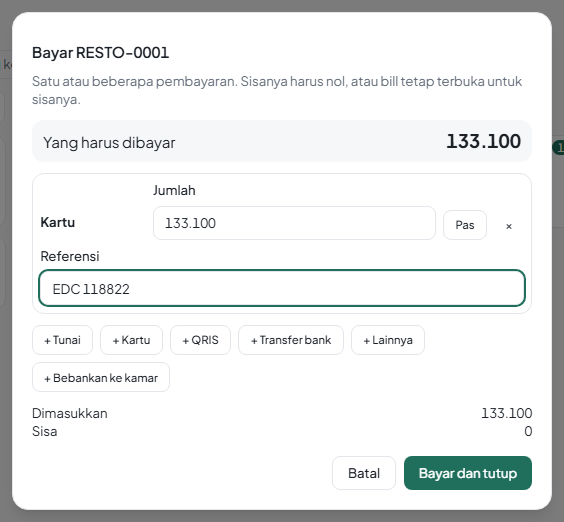
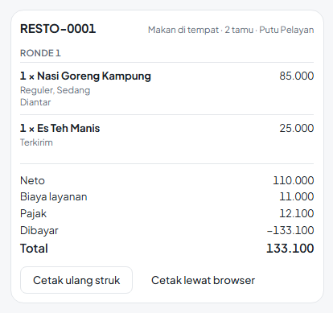

# Membayar bill

> 🎬 Video tutorial: menyusul

**Siapa yang melakukan:** kasir outlet.
**Kapan dilakukan:** saat tamu meminta bill dan membayar.
**Sebelum mulai:**
- Untuk pembayaran **tunai**, Anda harus punya shift kasir yang terbuka dengan **kode laci yang sama dengan laci outlet** (misalnya `LACI1`). Buka di **Tagihan → Shift kasir**. Lihat [Shift kasir](../03-kasir-dan-pembayaran/shift-kasir.md).
- Untuk kartu atau QRIS, siapkan nomor bukti dari mesin EDC.

## Langkah-langkah

1. Buka bill tamu: di **POS → Denah meja dan bill**, klik mejanya, atau klik bill di daftar **Bill terbuka**.
2. Klik **Bayar**. Jendela **Bayar {nomor bill}** terbuka dengan **Yang harus dibayar**. Jendela ini langsung berisi satu baris **Tunai** untuk seluruh tagihan (atau **Kartu**, kalau outlet tidak menerima tunai).
3. Atur cara bayarnya:
   - Untuk mengganti metode, klik **×** pada baris itu, lalu klik tombol metode yang benar, misalnya **+ Kartu**.
   - Klik **Pas** untuk mengisi jumlah sebesar sisa tagihan.
   - Untuk membayar dengan beberapa cara, tambahkan baris lain dan bagi jumlahnya.

   | Field | Wajib? | Keterangan |
   |---|---|---|
   | Jumlah | Ya | Jumlah yang dibayar dengan metode itu. |
   | Uang diterima | Untuk tunai | Uang yang diserahkan tamu. Kembaliannya dihitung otomatis. |
   | Yang membayar | Tidak | Untuk tunai, misalnya `Tamu 1/3` saat tagihan dibagi. |
   | Referensi | Tidak | Untuk kartu, QRIS, dan transfer: nomor bukti, misalnya `EDC 118822`. |

   

4. Periksa ringkasan di bawah: **Dimasukkan**, **Sisa**, dan **Kembalian**.
5. Klik **Bayar dan tutup**. Kalau jumlahnya kurang dari tagihan, tombolnya bertuliskan **Terima sebagian ini**, dan bill tetap terbuka untuk sisanya.

## Hasilnya

- Muncul "Lunas. Bill ditutup." atau "Lunas. Kembalian: …". Bill berstatus **Lunas**, dan mejanya kosong lagi. Saat bill dibuka lagi, tampil "Bill ini sudah lunas. Bisa dicetak, atau dibuka kembali dengan persetujuan.", dan total bill memuat baris **Dibayar**.
- Struk tercetak otomatis kalau outlet punya printer struk yang tersambung. Kalau tidak, klik **Cetak lewat browser**. Untuk salinan struk dari printer, klik **Cetak ulang struk**.

  

## Perlu diperhatikan

- **"Buka shift kasir sebelum menerima uang tunai."** berarti Anda belum punya shift terbuka pada laci outlet ini. Shift di laci lain tidak dihitung.
- **"Outlet ini tidak menerima tunai: tidak punya laci kas."** Outlet itu tidak diberi laci uang. Pakai metode lain.
- **Pembulatan tunai:** kalau outlet membulatkan pembayaran tunai, jendela bayar menampilkan "Tunai dibulatkan: … menjadi …".
- **Membagi tagihan per item:** klik **Pisah** di bill, centang item yang pindah ke bill baru, lalu klik **Pisah**. Setiap bill dibayar sendiri.
- **Menggabung bill:** klik **Gabung**, pilih bill tujuan di outlet yang sama, lalu klik **Gabung**. Bill yang lama berstatus **Digabung**. Bill yang sudah dibayar sebagian tidak bisa digabung.
- **Ditagihkan ke kamar** dan **ke perusahaan** juga dilakukan di jendela ini. Lihat [Bebankan ke kamar](bebankan-ke-kamar.md). **+ Perusahaan** hanya muncul kalau outlet boleh menagih perusahaan dan perusahaannya mengizinkan.
- **Cetak ulang struk** membutuhkan alasan. Salinannya bertanda COPY, dan alasannya tercatat di jejak audit.
- **Membuka laci tanpa penjualan:** di denah meja, klik **Buka laci** dan isi **Alasan**. Kejadian ini tercatat di laporan outlet.
- **Bill yang sudah lunas** hanya bisa dikoreksi dengan **Buka kembali**, yang butuh persetujuan. Lihat [Void, diskon, dan komplimen](void-diskon-komplimen.md).

## Terkait

- [Bebankan ke kamar](bebankan-ke-kamar.md)
- [Shift kasir](../03-kasir-dan-pembayaran/shift-kasir.md)
- [Laporan outlet](laporan-outlet.md)
