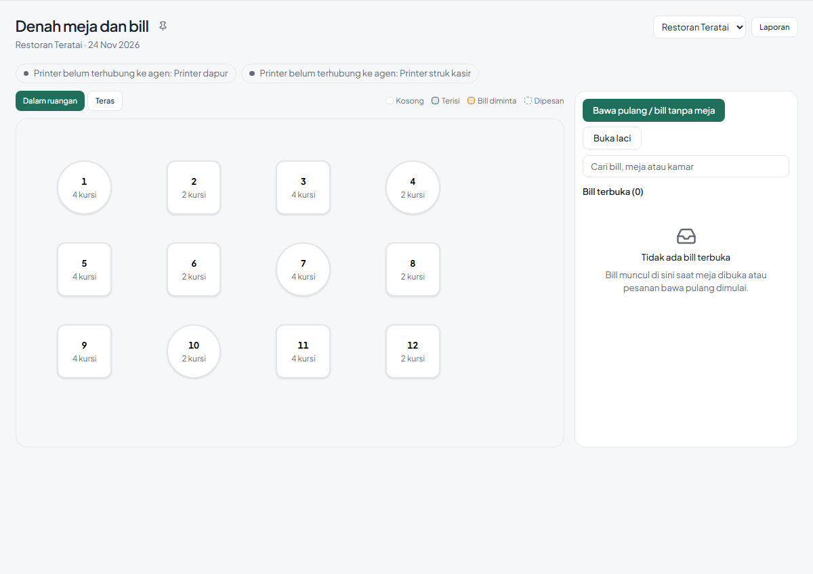
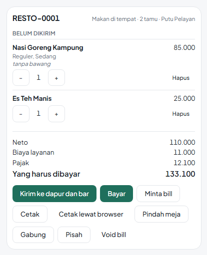
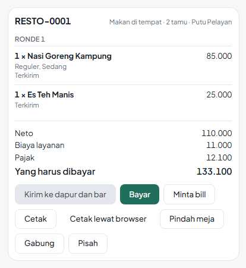

# Mengambil pesanan

> 🎬 Video tutorial: menyusul

**Siapa yang melakukan:** pelayan atau kasir outlet.
**Kapan dilakukan:** saat tamu duduk di meja, memesan untuk dibawa pulang, atau memesan room service.
**Sebelum mulai:** outlet sudah disiapkan. Lihat [Menyiapkan outlet](menyiapkan-outlet.md).

## Langkah-langkah

1. Buka **POS → Denah meja dan bill**. Kalau hotel punya beberapa outlet, pilih outletnya di kanan atas. Pilihan ini diingat di komputer itu.

   Warna meja menunjukkan keadaannya: **Kosong**, **Terisi**, **Bill diminta**, atau **Dipesan**.

   

2. Buka bill:
   - **Tamu di meja:** klik mejanya. Isi **Jumlah tamu**, lalu klik **Bill baru**. Kalau meja sudah punya satu bill, bill itu langsung terbuka.
   - **Tanpa meja:** klik **Bawa pulang / bill tanpa meja**. Pilih **Jenis pesanan** (**Bawa pulang**, **Kasir**, atau **Room service**), isi **Nama (opsional)**, lalu klik **Bill baru**.
3. Halaman **Bill** terbuka: menu di kiri, bill di kanan. Menu tampil per kategori: klik kategorinya di atas menu (misalnya **Minuman**), atau ketik nama produk di **Cari menu**. Klik produk untuk menambahkannya. Setiap klik menambah satu.
4. Untuk produk yang punya pilihan, misalnya porsi atau tingkat pedas, jendela pilihan terbuka. Pilih variannya, centang tambahannya, isi **Catatan untuk dapur** kalau perlu (misalnya `tanpa bawang`), lalu klik **Tambahkan ke bill**.

   | Field | Wajib? | Keterangan |
   |---|---|---|
   | Varian (misalnya Porsi) | Ya, kalau ada | Pilih satu. Pilihan bawaan sudah tercentang. |
   | Tambahan (misalnya Lauk tambahan) | Tidak | Boleh lebih dari satu, sampai batasnya. |
   | Jumlah | Ya | Bawaannya `1`. |
   | Catatan untuk dapur | Tidak | Tampil di tiket dapur. Maksimal 200 karakter. |

5. Item baru tampil di **Belum dikirim**. Ubah jumlahnya dengan **−** dan **+**, atau klik **Hapus**.

   

6. Klik **Kirim ke dapur dan bar**. Muncul pesan "Pesanan dikirim. Tiket dapur dibuat.". Item pindah ke **Ronde 1** dengan status dapurnya, misalnya **Terkirim**. Pesanan tambahan nanti menjadi **Tambahan 2**, dan seterusnya.

   

## Hasilnya

- Tiket dikirim ke setiap stasiun: dicetak di printer dapur, atau tampil di layar dapur, sesuai mode outlet. Lihat [Layar dapur](layar-dapur.md).
- Item yang dikirim tercatat sebagai penjualan pada tanggal bisnis hari ini, dan totalnya tampil di bill.

## Perlu diperhatikan

- **Item yang sudah dikirim tidak bisa diubah atau dihapus**: "Item yang sudah dikirim tidak bisa diubah: void saja.". Pembatalannya butuh persetujuan. Lihat [Void, diskon, dan komplimen](void-diskon-komplimen.md).
- **Item yang belum dikirim** bebas diubah dan dihapus tanpa persetujuan.
- **Pelayan dengan ponsel** bisa memakai **POS → Pelayan**: pilih meja, isi jumlah tamu dengan **−** dan **+**, klik **Buka bill**, tambahkan menu dengan **Tambah**, lalu klik **Kirim ke dapur dan bar**. Pelayan tidak menerima pembayaran. Lihat [Mencatat pesanan dari ponsel pelayan](pelayan.md).
- **Minta bill** menandai meja **Bill diminta** dan mencetak pra-tagihan bertanda "BUKAN STRUK" kalau outlet punya printer struk.
- **"Printer belum terhubung ke agen: …"** di atas denah berarti tiket atau struk untuk printer itu belum bisa tercetak. Minta administrator memeriksanya. Lihat [Menyiapkan outlet](menyiapkan-outlet.md).
- **Minuman dan makanan bisa pergi ke stasiun berbeda**: misalnya makanan ke dapur dan minuman ke bar. Setiap stasiun mendapat tiketnya sendiri.
- **Pindah meja** memindahkan bill ke meja lain. Tidak ada yang berubah di pembukuan.
- **"Ada isian yang tidak valid."** saat membuka bill meja biasanya berarti **Jumlah tamu** belum diisi, padahal outlet mewajibkannya.
- **Pesan meja:** klik meja → **Pesan meja**, isi **Nama pemesan**, **Mulai**, dan **Tamu**. Saat rombongan datang, klik **Sudah duduk**. Ini bukan reservasi hotel.
- **Bill yang dibiarkan terbuka** dengan item terkirim muncul sebagai peringatan saat audit malam, atau menahan audit kalau outlet mencentang **Bill terbuka menghambat audit malam**. Item yang belum dikirim tercatat pada tanggal saat dikirim.

## Terkait

- [Layar dapur](layar-dapur.md)
- [Mencatat pesanan dari ponsel pelayan](pelayan.md)
- [Membayar bill](membayar-bill.md)
- [Void, diskon, dan komplimen](void-diskon-komplimen.md)
