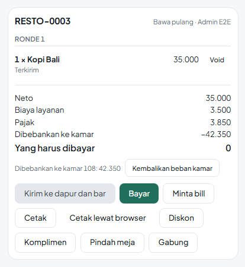

# Mengembalikan beban kamar dari bill POS

**Siapa yang melakukan:** kasir atau manajer outlet yang perannya boleh membuka kembali bill dan memegang izin **Membalik posting hari yang sama dan memindahkan tagihan ke folio lain**. Persetujuannya diberikan oleh penyetuju **Pemindahan antar folio**.
**Kapan dilakukan:** bill outlet sudah dibebankan ke kamar, tetapi bebannya salah: kamar yang salah, tamu ternyata membayar sendiri, atau isi bill perlu dikoreksi sebelum ditagihkan lagi.
**Sebelum mulai:**
- Siapkan nomor bill, nomor kamar, dan alasannya. Pastikan penyetuju ada di dekat Anda. Lihat [Meminta persetujuan](../00-memulai/meminta-persetujuan.md).
- Folio tamu harus masih terbuka. Lakukan sebelum tamu check-out.

Beban ke kamar ditarik dari bill-nya, bukan dari folio tamu. Di folio tamu, baris beban POS berkode `TRF` tidak bisa di-reverse atau dikoreksi dengan **Penyesuaian**.

## Langkah-langkah

1. Buka bill yang lunas, klik **Buka kembali**, isi **Alasan**, lalu minta persetujuan. Lihat [Void, diskon, komplimen, dan membuka kembali bill](void-diskon-komplimen.md).
2. Di bill yang terbuka lagi, baris "Dibebankan ke kamar {kamar}: {jumlah}" punya tombol **Kembalikan beban kamar**. Klik tombol itu.

   

3. Jendela **Kembalikan beban kamar** menyebut jumlah dan kamarnya. Isi **Alasan**, misalnya `Salah kamar: tamu restoran, bukan tamu kamar`, lalu klik **Lanjut ke persetujuan**.

   

4. Penyetuju memasukkan email dan kata sandinya, lalu klik **Setujui**. Baris "Dibebankan ke kamar" hilang, dan **Yang harus dibayar** kembali sebesar bill.

   

5. Bayar bill dengan cara lain: tunai, kartu, atau bebankan ke kamar yang benar. Lihat [Membayar bill](membayar-bill.md) dan [Membebankan bill ke kamar](bebankan-ke-kamar.md).

## Hasilnya

- Beban di folio tamu dibatalkan: folio menerima baris `TRF` dengan jumlah negatif yang sama, sehingga saldonya kembali seperti sebelum beban itu.
- Sisa batas outlet di folio tamu pulih sebesar beban yang dikembalikan, jadi tamu bisa dibebani lagi sampai batasnya.
- Bill outlet berutang lagi dan bisa dibayar dengan cara lain.
- Pengembalian, alasannya, dan penyetujunya tercatat di jejak audit bill dan folio. Tanggalnya tanggal bisnis hari ini.

## Perlu diperhatikan

- **Tombol tidak muncul** kalau bill belum dibuka kembali, kalau bebannya sudah dikembalikan, atau kalau peran Anda tidak memegang izin kasir dan izin **Membalik posting hari yang sama dan memindahkan tagihan ke folio lain**.
- **Bill yang dibayar sebagian ke kamar dan sebagian tunai**: hanya bagian kamar yang dikembalikan. Pembayaran lainnya tetap.
- **"Bill sudah tidak terbuka: sudah dibayar atau ditutup. Muat ulang."**: bill-nya belum dibuka kembali. Buka kembali dulu.
- **Folio tamu sudah tertutup** (tamu sudah check-out): pengembalian ditolak, dan belum ada layar lain untuk mengembalikannya (kendala KD-26). Laporkan ke supervisor atau administrator, beserta nomor kamar, nomor bill, dan jumlahnya.
- **Penyetuju** mengikuti aturan **Pemindahan antar folio** di [Aturan persetujuan](../13-pengaturan/aturan-persetujuan.md). Kalau aturannya meminta orang lain, Anda tidak boleh menyetujui pengembalian Anda sendiri.

## Terkait

- [Membebankan bill ke kamar](bebankan-ke-kamar.md)
- [Void, diskon, komplimen, dan membuka kembali bill](void-diskon-komplimen.md)
- [Reverse dan penyesuaian](../03-kasir-dan-pembayaran/reverse-dan-penyesuaian.md)
