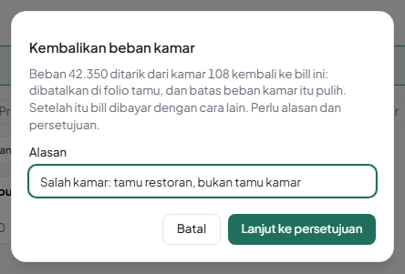
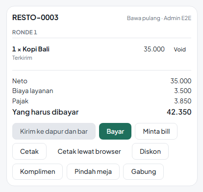

# Mengembalikan beban kamar dari bill POS

**Siapa yang melakukan:** kasir atau manajer outlet yang perannya boleh membuka kembali bill dan memegang izin **Membalik posting hari yang sama dan memindahkan tagihan ke folio lain**. Persetujuannya diberikan oleh penyetuju **Pemindahan antar folio**.
**Kapan dilakukan:** bill outlet sudah dibebankan ke kamar, tetapi bebannya salah: kamar yang salah, tamu ternyata membayar sendiri, atau isi bill perlu dikoreksi sebelum ditagihkan lagi.
**Sebelum mulai:**
- Siapkan nomor bill, nomor kamar, dan alasannya. Pastikan penyetuju ada di dekat Anda. Lihat [Meminta persetujuan](../00-memulai/meminta-persetujuan.md).
- Folio tamu masih terbuka: ikuti langkah di bawah. Tamu sudah check-out: lihat [Mengembalikan beban kamar setelah tamu check-out](#mengembalikan-beban-kamar-setelah-tamu-check-out).

Beban ke kamar ditarik dari bill-nya, bukan dari folio tamu. Di folio tamu, baris beban POS berkode `TRF` tidak bisa di-reverse atau dikoreksi dengan **Penyesuaian**.

## Langkah-langkah

1. Buka bill yang lunas, klik **Buka kembali**, isi **Alasan**, lalu minta persetujuan. Lihat [Void, diskon, komplimen, dan membuka kembali bill](void-diskon-komplimen.md).
2. Di bill yang terbuka lagi, baris "Dibebankan ke kamar {kamar}: {jumlah}" punya tombol **Kembalikan beban kamar**. Klik tombol itu.

   

3. Jendela **Kembalikan beban kamar** menyebut jumlah dan kamarnya. Isi **Alasan**, misalnya `Salah kamar: tamu restoran, bukan tamu kamar`, lalu klik **Lanjut ke persetujuan**.

   

4. Penyetuju memasukkan email dan kata sandinya, lalu klik **Setujui**. Baris "Dibebankan ke kamar" hilang, dan **Yang harus dibayar** kembali sebesar bill.

   

5. Bayar bill dengan cara lain: tunai, kartu, atau bebankan ke kamar yang benar. Lihat [Membayar bill](membayar-bill.md) dan [Membebankan bill ke kamar](bebankan-ke-kamar.md).

## Hasilnya

- Beban di folio tamu dibatalkan: folio menerima baris `TRF` dengan jumlah negatif yang sama, sehingga saldonya kembali seperti sebelum beban itu.
- Sisa batas outlet di folio tamu pulih sebesar beban yang dikembalikan, jadi tamu bisa dibebani lagi sampai batasnya.
- Bill outlet berutang lagi dan bisa dibayar dengan cara lain.
- Pengembalian, alasannya, dan penyetujunya tercatat di jejak audit bill dan folio. Tanggalnya tanggal bisnis hari ini.

## Perlu diperhatikan

- **Tombol tidak muncul** kalau bill belum dibuka kembali, kalau bebannya sudah dikembalikan, atau kalau peran Anda tidak memegang izin kasir dan izin **Membalik posting hari yang sama dan memindahkan tagihan ke folio lain**.
- **Bill yang dibayar sebagian ke kamar dan sebagian tunai**: hanya bagian kamar yang dikembalikan. Pembayaran lainnya tetap.
- **"Bill sudah tidak terbuka: sudah dibayar atau ditutup. Muat ulang."**: bill-nya belum dibuka kembali. Buka kembali dulu.
- **Folio tamu sudah tertutup** (tamu sudah check-out): baris beban bertanda **Sudah check-out**, dan tombolnya menjadi **Kembalikan setelah check-out**. Lihat bagian berikut.
- **Penyetuju** mengikuti aturan **Pemindahan antar folio** di [Aturan persetujuan](../13-pengaturan/aturan-persetujuan.md). Kalau aturannya meminta orang lain, Anda tidak boleh menyetujui pengembalian Anda sendiri.

## Mengembalikan beban kamar setelah tamu check-out

**Siapa yang melakukan:** kasir atau supervisor yang perannya memegang izin kasir POS dan **Membalik posting hari yang sama dan memindahkan tagihan ke folio lain**, ditambah **Membuka kembali folio yang sudah ditutup** kalau bill-nya sudah lunas, dan **Mengembalikan pembayaran (refund)** kalau uangnya dikembalikan ke pembayar. Persetujuannya diberikan oleh penyetuju yang memegang **Menyetujui koreksi (penyesuaian, pembalikan, void, dan refund) dengan kredensial sendiri**, menurut aturan **Pengembalian beban kamar setelah tamu check-out (dengan refund)**.
**Kapan dilakukan:** beban restoran atau bar ke kamar yang salah baru ketahuan setelah tamu kamar itu check-out, sehingga folionya sudah **Ditutup**.

Dalam satu langkah dengan satu persetujuan, sistem membuka kembali bill (kalau sudah lunas), menarik bebannya kembali ke bill, lalu menyeimbangkan lagi folio yang melunasi beban itu. Folio tamu tetap **Ditutup** dengan saldo nol. Bill dibiarkan terbuka sebesar beban itu, untuk dibayar dengan cara lain.

### Langkah-langkah

1. Buka bill outlet-nya. Anda tidak perlu mengklik **Buka kembali** lebih dulu. Baris "Dibebankan ke kamar {kamar}: {jumlah}" bertanda **Sudah check-out**. Klik **Kembalikan setelah check-out** pada baris itu.

   <!-- SCREENSHOT: bill POS dengan beban kamar bertanda Sudah check-out dan tombol Kembalikan setelah check-out. Data docs belum punya tamu yang sudah check-out dengan beban outlet (lihat _laporan.md bagian 6). -->

2. Jendela **Kembalikan beban kamar setelah check-out** membaca folio kamar itu, lalu menyebut apa yang akan terjadi:
   - "Folio {nomor} diseimbangkan lagi dengan refund sebesar jumlah itu ke pembayarnya.": tamu sudah membayar folionya. Pilih **Refund atas pembayaran**. Isian awalnya pembayaran terakhir yang bukan deposit dan sisanya cukup. Lalu pilih **Refund dengan** dan isi **Referensi**, misalnya nomor slip EDC. Kalau bill sudah lunas, jendela juga menulis "Bill sudah ditutup: bill dibuka kembali.".
   - "Saldo tamu sudah dipindah ke folio master {nomor} yang masih terbuka: …": tagihan tamu dipindah ke master folio grup yang masih terbuka. Tidak ada refund. Jumlahnya tetap sebagai kredit di master folio itu, dan ikut dihitung saat master ditagih atau dilunasi.
   - Pesan merah: beban tidak bisa dikembalikan di sini. Lihat **Perlu diperhatikan** di bawah.
3. Isi **Alasan**, misalnya `Salah kamar: tamu restoran, bukan tamu kamar 305`, lalu klik **Lanjut ke persetujuan**.
4. Penyetuju memasukkan email dan kata sandinya, lalu klik **Setujui**. Muncul "Beban sudah kembali ke bill. {jumlah} sudah di-refund ({nomor}, {metode})." atau "… tetap sebagai kredit di {folio}.".
5. Bill terbuka lagi dengan **Yang harus dibayar** sebesar beban itu. Bayar dengan cara lain, atau bebankan ke kamar yang benar. Lihat [Membayar bill](membayar-bill.md) dan [Membebankan bill ke kamar](bebankan-ke-kamar.md).

### Hasilnya

- Folio tamu yang sudah check-out tetap **Ditutup** dengan saldo nol. Folio itu menerima dua baris baru: baris `TRF` negatif sebesar beban, dan refund dengan jumlah yang sama (atau, pada master folio, pemindahan kredit ke master itu).
- Refund tercatat pada tanggal bisnis hari ini dan muncul di [Daftar kasir](../03-kasir-dan-pembayaran/daftar-kasir.md). Refund tunai masuk ke shift kasir Anda yang terbuka. Kalau properti mewajibkan shift untuk uang tunai, buka shift Anda dulu. Kalau belum, muncul "Buka shift kasir sebelum menerima uang tunai." dan tidak ada yang berubah.
- Hari yang sudah ditutup tidak berubah. Jurnal hari ini tidak menyentuh pendapatan: bebannya kembali ke bill outlet, yang lalu dibayar, dan refund mengurangi akun metode pembayarannya (misalnya kartu).
- Batas outlet di folio tamu pulih, dan pengembalian tercatat di jejak audit bill (**Beban kamar dikembalikan setelah check-out**) beserta alasan, refund, dan penyetujunya.

### Perlu diperhatikan

- **Refund dicatat saat disetujui.** Lakukan hanya kalau uangnya memang dikembalikan saat itu: tunai diserahkan ke tamu, atau refund kartu dijalankan di mesin EDC. Metode refund mengikuti metode pembayarannya kalau properti mengizinkannya untuk refund. Kalau tidak, isian awalnya metode pertama yang diizinkan. Contohnya, pembayaran QRIS dikembalikan lewat **Transfer bank** kalau QRIS tidak dicentang di **Pengaturan → Properti** (**Refund dapat dikeluarkan lewat**). Lihat [Properti](../13-pengaturan/properti.md).
- **Bill baru terbuka lagi setelah pengembalian ini disetujui.** Selama itu, tamu yang seharusnya membayar bisa check-out lebih dulu. Minta supervisor melakukan koreksi secepatnya. Kalau refund bisa dicatat hari itu juga, bebankan bill ke tamu yang benar sebelum tamu itu check-out.
- **"Hanya deposit folio yang mencukupi jumlahnya: deposit tidak dikembalikan setelah folionya ditutup. …"**: pembayaran yang cukup besar hanya deposit sebelum check-in. Deposit tidak di-refund lewat jalur ini. Minta akuntan memeriksanya.
- **"Pengembalian melebihi sisa pembayaran."**: tidak ada satu pembayaran yang sisanya cukup. Beban tidak bisa dikembalikan di sini. Laporkan ke supervisor atau administrator.
- **"Saldo folio itu sudah dipindah lebih dari sekali: …"**: tagihan tamu dipindah lebih dari satu kali, misalnya dari master folio ke folio lain lagi. Tanyakan ke bagian akuntansi.
- **"Folio itu dilunasi dengan transfer ke Piutang perusahaan: …"**: tagihan tamu sudah dipindah ke perusahaan. Jalur ini belum bisa mengurangi tagihan perusahaan (kendala KD-29). Cara manual yang bisa dipakai sekarang:
  1. Akuntan membuat **Nota kredit** sebesar beban itu pada invoice (atau pemindahan yang belum diinvoice) perusahaan, dengan akun potongan makanan dan minuman. Lihat [Nota kredit dan penghapusan piutang](../06-corporate-group-city-ledger/nota-kredit-dan-penghapusan-piutang.md).
  2. Pembayar yang benar ditagih: posting beban makanan dan minuman sebesar itu ke folionya, atau terima pembayarannya di kasir.
  3. Nota kredit mengurangi pendapatan di akun potongan, sedangkan beban baru menambah pendapatan di akun pendapatan biasa. Akuntan mungkin perlu jurnal reklasifikasi supaya laporan pendapatan outlet tetap benar.

  Bill outlet-nya tetap seperti semula, dibebankan ke kamar yang salah. Catat nomor nota kredit di alasan beban yang baru.
- **"Folio tamu kamar itu masih terbuka: …"**: tamu belum check-out. Pakai **Kembalikan beban kamar** di bagian atas halaman ini.
- **Tombol tidak muncul** kalau bill sudah dibatalkan, kalau bebannya sudah dikembalikan, atau kalau peran Anda tidak memegang izin kasir POS dan **Membalik posting hari yang sama dan memindahkan tagihan ke folio lain**.

## Terkait

- [Membebankan bill ke kamar](bebankan-ke-kamar.md)
- [Void, diskon, komplimen, dan membuka kembali bill](void-diskon-komplimen.md)
- [Reverse dan penyesuaian](../03-kasir-dan-pembayaran/reverse-dan-penyesuaian.md)
- [Void dan refund](../03-kasir-dan-pembayaran/void-dan-refund.md)
