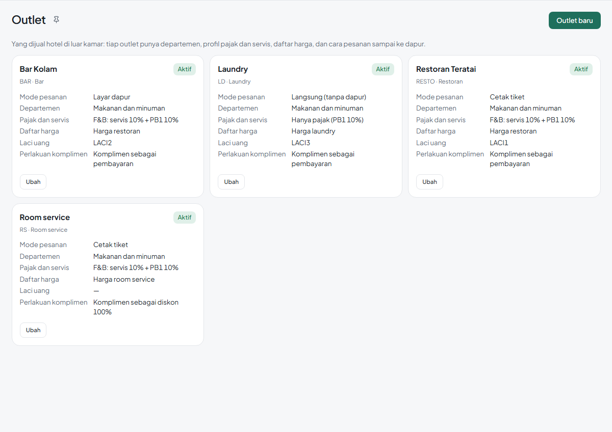
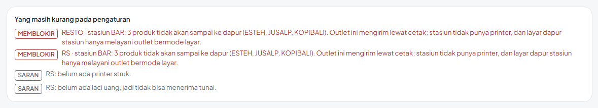

# Menyiapkan outlet POS

**Siapa yang melakukan:** manajer F&B atau administrator yang perannya boleh mengatur POS.
**Kapan dilakukan:** sekali sebelum outlet mulai berjualan, dan setiap kali menu, harga, atau meja berubah.
**Sebelum mulai:**
- Hotel Anda harus memakai modul POS. Kalau tidak, menu **POS** tidak muncul.
- Departemen outlet (misalnya `FB`) sudah dibuat di **Akuntansi → Departemen**. Lihat [Departemen](../07-accounting/departemen.md).
- Pajak, biaya layanan, dan kode biaya penjualan (misalnya `RESTAURANT`) sudah diatur. Lihat [Pajak dan kode biaya](../13-pengaturan/pajak-dan-kode-biaya.md).

**Outlet** adalah tempat hotel berjualan di luar kamar, misalnya restoran, bar, room service, spa, atau laundry. Setiap outlet punya departemen, profil pajak dan servis, daftar harga, dan cara pesanan sampai ke dapur.

Siapkan dengan urutan ini, karena setiap langkah memakai hasil langkah sebelumnya:

1. Kategori, daftar harga, dan profil pajak.
2. Outlet.
3. Stasiun dan printer.
4. Produk dan menu.
5. Denah meja.

## Langkah-langkah

### 1. Kategori, daftar harga, dan profil

1. Buka **POS → Kategori, harga, profil**. Halaman ini punya tiga kartu:
   - **Kategori**: kelompok menu, misalnya `Makanan utama` dan `Minuman`. Klik **Kategori baru**, isi **Kode** dan **Nama**, lalu klik **Simpan**.
   - **Daftar harga**: misalnya `Harga restoran` dan `Harga room service`. Harga produknya sendiri diisi di produk, per outlet.
   - **Profil pajak dan servis**: aturan pajak yang dipakai outlet, misalnya `Servis 10% + PB1 10%`. Pilih **Harga belum termasuk pajak dan servis** atau **Harga sudah termasuk pajak dan servis**, lalu tambahkan aturannya sesuai urutan hitung: biaya servis dulu, lalu pajak.

### 2. Outlet

2. Buka **POS → Outlet**, lalu klik **Outlet baru**.
3. Isi jendela **Outlet baru**. Isian terpenting:

   | Field | Wajib? | Keterangan |
   |---|---|---|
   | Kode | Ya | 1 sampai 6 huruf, misalnya `RESTO`. Menjadi awal nomor bill (`RESTO-0001`) dan tidak bisa diubah. |
   | Nama | Ya | Misalnya `Restoran Teratai`. |
   | Jenis | Ya | **Restoran**, **Bar**, **Kafe**, **Room service**, **Spa**, **Laundry**, dan lainnya. |
   | Mode pesanan | Ya | **Cetak tiket** (tiket dicetak di printer dapur), **Layar dapur** (pesanan tampil di layar dapur), atau **Langsung (tanpa dapur)** untuk laundry, spa, dan sejenisnya. |
   | Departemen | Ya | Departemen pendapatan outlet. |
   | Pajak dan servis | Ya | Profil dari langkah 1. |
   | Daftar harga | Ya | Daftar harga dari langkah 1. |
   | Printer struk | Tidak | Printer untuk struk pembayaran. |
   | Laci uang | Tidak | Kode laci kasir outlet, misalnya `LACI1`. Kosongkan kalau outlet tidak menerima tunai. Kasir harus membuka shift dengan kode laci yang sama. |
   | Pembulatan tunai yang dibayar | Tidak | Misalnya **Ke 100 terdekat**. |
   | Diskon tanpa persetujuan (%) | Tidak | Batas diskon yang boleh diberikan kasir tanpa persetujuan. `0` berarti setiap diskon perlu persetujuan. |

   Kotak centang di bawahnya mengatur perilaku outlet: **Memakai meja**, **Jumlah tamu wajib diisi**, **Boleh dibebankan ke kamar**, **Boleh dibebankan ke perusahaan**, **Boleh memberi komplimen**, dan **Bill terbuka menghambat audit malam**. Bagian **Kertas struk** mengatur kepala dan kaki struk.

   

4. Klik **Simpan**. Muncul pesan "Outlet disimpan.".

### 3. Stasiun dan printer

5. Buka **POS → Stasiun dan printer**. **Stasiun** adalah tempat produksi, misalnya dapur atau bar. Klik **Stasiun baru**, isi **Kode** dan **Nama**, pilih **Printer** dan/atau centang **Tampil di layar dapur**, lalu klik **Simpan**.
6. Untuk printer, klik **Printer baru** dan isi **Nama**, **Jenis** (**Struk** atau **Dapur**), **Lebar kertas**, dan **Sambungan** (misalnya `192.168.1.50:9100`).
7. Printer hanya mencetak lewat **agen cetak**, yaitu program kecil di komputer kasir. Di kartu **Perangkat**, klik **Buat kode pendaftaran**, lalu minta staf IT menjalankan perintah yang tampil di komputer kasir (kode berlaku 15 menit). Setelah agen tersambung, pilih agen itu di **Perangkat (agen cetak)** pada setiap printer.
8. Periksa kartu **Yang masih kurang pada pengaturan** di atas halaman. Baris bertanda **Memblokir** harus diperbaiki, misalnya "… produk belum punya stasiun, pesanannya tidak akan sampai ke dapur".

   

### 4. Produk dan menu

9. Buka **POS → Produk dan menu**, lalu klik **Produk baru**.
10. Isi **Nama**, **Kode / SKU**, **Nama pendek** (untuk tiket dapur), **Kategori**, **Kode biaya**, dan **Stasiun**. Di **Harga per outlet**, centang **Dijual** dan isi **Harga** untuk setiap outlet yang menjualnya.
11. Kalau perlu, tambahkan **Varian** (pilih satu, misalnya porsi reguler atau jumbo) dan **Tambahan** (boleh lebih dari satu, misalnya telur ceplok). Setiap pilihan bisa punya **Selisih harga**. Klik **Simpan**.

    Banyak produk sekaligus bisa diimpor dengan **Impor CSV**: klik **Periksa** dulu, lalu **Impor**.

### 5. Denah meja

12. Buka **POS → Denah meja**, lalu pilih outletnya. Klik **Area baru** untuk membuat area, misalnya `Dalam ruangan` atau `Teras`.
13. Klik **Tambah meja**, **Meja bulat**, atau **Meja panjang**. Seret meja ke tempatnya. Klik meja untuk mengubah **Kode** dan **Kursi**.
14. Klik **Simpan**. Muncul pesan "Denah disimpan.".

## Hasilnya

Outlet muncul di **POS → Denah meja dan bill**, dengan menu, harga, dan mejanya, siap menerima pesanan.

## Perlu diperhatikan

- **Kode outlet, kategori, stasiun, dan produk tidak bisa diubah** setelah disimpan.
- **Outlet tanpa laci uang tidak menerima tunai.** Tombol **+ Tunai** tidak muncul saat pembayaran.
- **Produk yang tidak dicentang Dijual** di suatu outlet tidak tampil di menu outlet itu.
- **Produk yang habis** belum bisa ditandai habis dari layar. Untuk sementara, hapus centang **Dijual** pada outlet itu, lalu centang lagi besok.
- **Printer tanpa agen** tidak mencetak: pekerjaan cetak menunggu di **Antrean cetak**. Struk tetap bisa dicetak lewat browser dari halaman bill.
- **Resep dan biaya bahan** di produk dipakai modul persediaan. Lihat [Resep](../09-inventory/resep.md).

## Terkait

- [Mengambil pesanan](mengambil-pesanan.md)
- [Layar dapur](layar-dapur.md)
- [Pajak dan kode biaya](../13-pengaturan/pajak-dan-kode-biaya.md)
