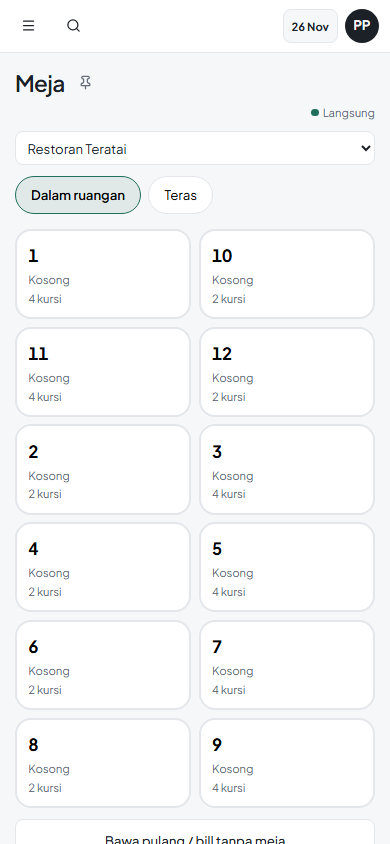
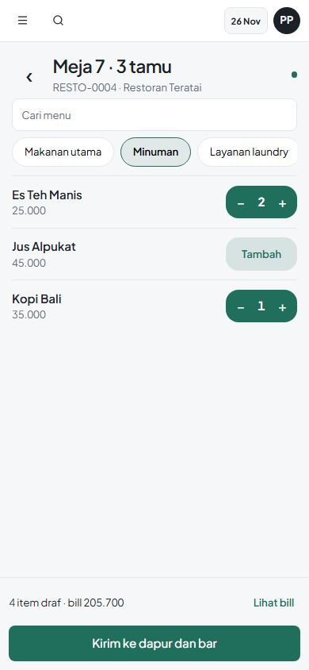
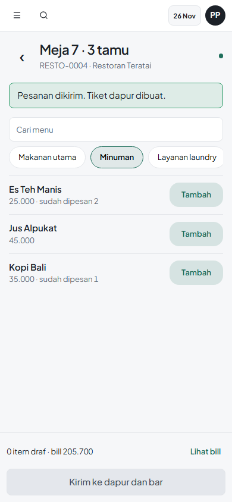

# Mencatat pesanan dari ponsel pelayan

> 🎬 Video tutorial: menyusul

**Siapa yang melakukan:** pelayan yang perannya boleh mencatat pesanan POS.
**Kapan dilakukan:** saat melayani tamu di meja, langsung dari ponsel atau tablet.
**Sebelum mulai:**
- Outlet sudah punya denah meja dan menu. Lihat [Menyiapkan outlet](menyiapkan-outlet.md).
- Anda sudah masuk ke KamaraPMS dari ponsel. Lihat [Login dan navigasi](../00-memulai/login-dan-navigasi.md).

Layar **Pelayan** adalah denah meja versi ponsel: meja tampil sebagai kartu besar, menu sebagai daftar, dan tombol kirim ada di bawah. Pelayan hanya mencatat pesanan. Pembayaran, void, diskon, dan komplimen dikerjakan kasir outlet di **POS → Denah meja dan bill**.

## Langkah-langkah

### Membuka meja

1. Buka **POS → Pelayan**. Halaman **Meja** terbuka. Kalau hotel punya beberapa outlet, pilih outletnya di daftar paling atas. Pilihan ini diingat di perangkat itu. Ketuk area di bawahnya, misalnya **Dalam ruangan** atau **Teras**, untuk melihat mejanya.

   Setiap kartu meja menunjukkan kodenya dan keadaannya: **Kosong**, **Terisi**, **Bill diminta**, atau **Dipesan**. Meja kosong menunjukkan jumlah kursinya. Meja yang punya bill menunjukkan totalnya dan sudah berapa lama bill itu terbuka.

   

2. Ketuk meja yang **Kosong**. Di jendela **Meja {kode}**, jawab "Berapa tamu?" dengan **−** dan **+**, lalu ketuk **Buka bill**. Halaman pesanan terbuka.
   - **Meja yang sudah punya bill:** ketuk mejanya, dan bill itu langsung terbuka. Kalau satu meja punya beberapa bill, pilih bill-nya di daftar **Bill terbuka ({n})** di bawah meja.
   - **Tamu tanpa meja:** ketuk **Bawa pulang / bill tanpa meja**. Bill bawa pulang langsung terbuka.

### Menambah menu

3. Di atas halaman pesanan tertulis mejanya dan jumlah tamu, misalnya **Meja 7 · 3 tamu**, dengan nomor bill dan nama outlet. Pilih kategori di bawah **Cari menu**, misalnya **Minuman**, atau ketik nama menu di **Cari menu**.
4. Ketuk **Tambah** pada menu yang dipesan. Tombolnya berubah menjadi **−**, jumlah, dan **+**. Ketuk **+** untuk menambah satu, atau **−** untuk mengurangi satu. Kalau jumlahnya menjadi nol, item itu terhapus.

   Untuk menu yang punya pilihan, misalnya porsi atau tingkat pedas, jendela pilihan terbuka. Isi pilihannya, lalu ketuk **Tambahkan ke bill**.

   | Field | Wajib? | Keterangan |
   |---|---|---|
   | Varian (misalnya Porsi) | Ya, kalau ada | Bertanda "pilih satu". Pilihan bawaan sudah terpilih. |
   | Tambahan (misalnya Lauk tambahan) | Tidak | Bertanda "sampai {n}": boleh lebih dari satu, sampai batasnya. |
   | Catatan untuk dapur | Tidak | Misalnya `tanpa bawang`. Tampil di tiket dapur. Paling banyak 200 karakter. |

   

5. Bagian bawah layar menunjukkan jumlah item yang belum dikirim dan total bill, misalnya "4 item draf · bill 205.700". Untuk melihat isi bill, ketuk **Lihat bill**. Jendela itu menunjukkan setiap item dengan keadaannya (**Belum dikirim**, **Terkirim**, **Dimasak**, **Siap**, atau **Diantar**), lalu **Neto**, **Biaya layanan**, **Pajak**, dan **Total**. Jendela ini hanya untuk dilihat. Ketuk **Tutup** untuk kembali.

### Mengirim pesanan

6. Ketuk **Kirim ke dapur dan bar**. Muncul "Pesanan dikirim. Tiket dapur dibuat.". Di daftar menu, menu yang sudah dikirim bertanda "sudah dipesan {n}".

   

7. Ketuk **‹** di kiri atas untuk kembali ke daftar meja. Meja itu sekarang **Terisi**, dengan totalnya. Untuk pesanan tambahan, ketuk meja itu lagi, lalu ulangi langkah 3 sampai 6.

## Hasilnya

- Tiket dikirim ke setiap stasiun, sama seperti pesanan dari denah meja: dicetak di printer dapur atau tampil di layar dapur, sesuai mode outlet. Lihat [Layar dapur](layar-dapur.md).
- Item yang dikirim tercatat sebagai penjualan pada tanggal bisnis hari ini. Bill tetap terbuka sampai kasir outlet menerima pembayarannya.

## Perlu diperhatikan

- **Yang tidak bisa dilakukan di layar Pelayan:** menerima pembayaran, meminta bill, void, diskon, komplimen, pindah meja, gabung bill, dan pisah bill. Minta kasir outlet atau supervisor Anda. Kasir membuka bill yang sama di **POS → Denah meja dan bill**. Lihat [Membayar bill](membayar-bill.md) dan [Void, diskon, dan komplimen](void-diskon-komplimen.md).
- **Item yang sudah dikirim tidak bisa dikurangi** di layar ini. **−** hanya mengurangi item yang belum dikirim. Pembatalan item yang sudah dikirim adalah void, dan dikerjakan kasir dengan persetujuan.
- **Habis:** menu yang habis hari ini dicoret dan bertanda **Habis**. Menu itu tidak bisa dipilih.
- **Dua pelayan pada satu bill** saling melihat pesanan masing-masing. Tanda di kanan atas menunjukkan **Langsung** kalau layar ikut berubah saat orang lain mengubah meja atau bill. **Menyambung** atau **Menyambung ulang** berarti koneksi sedang tersambung kembali. Tunggu sebentar sebelum mengirim pesanan.
- **"Bill ini sudah tidak terbuka: tidak bisa diubah di sini."** berarti kasir sudah menutup bill itu, misalnya sudah lunas atau digabung ke bill lain. Kembali ke daftar meja dan buka bill baru kalau tamu memesan lagi.
- **Jumlah tamu** di jendela **Meja {kode}** terisi `2` (atau `1` untuk meja satu kursi). Ubahlah sesuai jumlah tamu yang duduk. Jumlah ini tampil di judul halaman pesanan.
- **Bill yang dibiarkan terbuka** dengan item terkirim muncul di audit malam, sama seperti bill dari denah meja. Lihat [Mengambil pesanan](mengambil-pesanan.md).

## Terkait

- [Mengambil pesanan](mengambil-pesanan.md)
- [Layar dapur](layar-dapur.md)
- [Membayar bill](membayar-bill.md)
