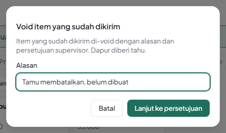
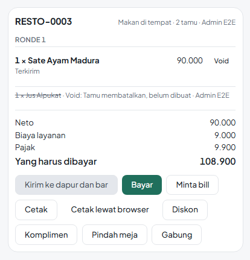

# Void, diskon, komplimen, dan membuka kembali bill

**Siapa yang melakukan:** kasir atau kapten outlet yang perannya boleh melakukan tindakan itu. Persetujuannya diberikan oleh supervisor outlet yang berwenang menyetujui.
**Kapan dilakukan:**
- **Void**: item yang sudah dikirim ke dapur dibatalkan, misalnya tamu berubah pikiran atau dapur salah masak.
- **Diskon**: potongan harga untuk satu item atau seluruh bill.
- **Komplimen**: bill atau isinya diberikan gratis, misalnya jamuan manajer.
- **Buka kembali**: bill yang sudah lunas perlu dikoreksi.

**Sebelum mulai:** siapkan alasannya, dan pastikan penyetuju ada di dekat Anda. Lihat [Meminta persetujuan](../00-memulai/meminta-persetujuan.md).

Item yang **belum dikirim** cukup dihapus dengan **Hapus**, tanpa alasan dan tanpa persetujuan.

## Langkah-langkah

### Void item yang sudah dikirim

1. Di bill, klik **Void** pada item yang dibatalkan.
2. Jendela **Void item yang sudah dikirim** terbuka. Isi **Alasan**, misalnya `Tamu membatalkan, belum dimasak`, lalu klik **Lanjut ke persetujuan**.

   

3. Di jendela persetujuan, penyetuju mengisi **Email penyetuju** dan **Kata sandi penyetuju**, lalu klik **Setujui**.

   

### Diskon

4. Di bill, klik **Diskon**. Isi jendela **Beri diskon**, lalu klik **Beri diskon**.

   | Field | Wajib? | Keterangan |
   |---|---|---|
   | Untuk | Ya | **Seluruh bill** atau **Satu item**. |
   | Item | Kalau satu item | Item yang didiskon. |
   | Dalam | Ya | **%** atau **Jumlah**. |
   | Persentase / Jumlah | Ya | Misalnya `10` (persen) atau `25000`. |
   | Alasan | Ya | Misalnya `Diskon member 10%`. |

5. Kalau diskonnya melebihi batas yang diizinkan outlet untuk kasir, jendela persetujuan terbuka. Penyetuju mengisi email dan kata sandinya, lalu klik **Setujui**.

### Komplimen

6. Di bill, klik **Komplimen**. Isi **Tamu atau manajer** (misalnya `GM, jamuan tamu VIP`) dan **Alasan**, lalu klik **Lanjut ke persetujuan**. Penyetuju menyetujuinya.

### Membuka kembali bill yang sudah lunas

7. Buka bill yang lunas, klik **Buka kembali**, isi **Alasan**, lalu minta persetujuan. Bill terbuka lagi. Koreksi isinya, lalu bayar lagi seperti biasa.

## Hasilnya

- Void: item dicoret di bill dengan keterangan "Void: {alasan} · {nama}". Dapur menerima pemberitahuan: tiketnya tampil dicoret dengan tulisan **DIBATALKAN**, atau tiket pembatalan dicetak.
- Diskon: baris **Diskon** muncul di total bill.
- Komplimen: bill yang tergratiskan seluruhnya langsung tertutup.
- Semua tindakan ini, beserta alasan dan penyetujunya, tercatat di **Laporan outlet** dan di jejak audit.

## Perlu diperhatikan

- **Tombol tidak muncul** kalau peran Anda tidak punya izinnya: **Void**, **Diskon**, dan **Komplimen** punya izin masing-masing, dan **Komplimen** juga butuh izin kasir. Kalau outlet tidak mencentang **Boleh memberi komplimen**, tombolnya tetap ada, tetapi komplimen ditolak: "Outlet ini tidak memberi bill komplimen."
- **Penyetuju** harus punya izin menyetujui POS. Kalau aturan properti meminta orang lain, Anda tidak boleh menyetujui tindakan Anda sendiri: "Aturan properti ini meminta penyetuju selain orang yang membuat perubahan.".
- **Diskon di bawah batas** outlet langsung diberikan tanpa jendela persetujuan. Batas `0` berarti setiap diskon perlu persetujuan.
- **Void bill** (seluruh bill) hanya ada untuk bill yang belum mengirim apa pun dan belum dibayar. Bill yang sudah menjual sesuatu harus dibayar, atau item-itemnya di-void satu per satu.
- **Void setelah dimasak:** item yang di-void saat tiketnya di layar dapur sudah **Dimasak**, **Siap**, atau **Diantar** dihitung sebagai waste di persediaan. Di outlet bermode cetak tiket, item yang di-void setelah melewati batas menit yang diatur outlet juga dihitung sebagai waste.
- **Perlakuan komplimen** diatur per outlet: sebagai pembayaran (pendapatan dan pajak tetap tercatat, nilainya masuk beban komplimen) atau sebagai diskon 100%. Konfirmasikan perlakuan pajaknya ke konsultan pajak hotel.
- **"Bill berubah: coba lagi."** berarti rekan Anda mengubah bill yang sama. Muat ulang, lalu ulangi.

## Terkait

- [Mengambil pesanan](mengambil-pesanan.md)
- [Laporan outlet](laporan-outlet.md)
- [Aturan persetujuan](../13-pengaturan/aturan-persetujuan.md)
