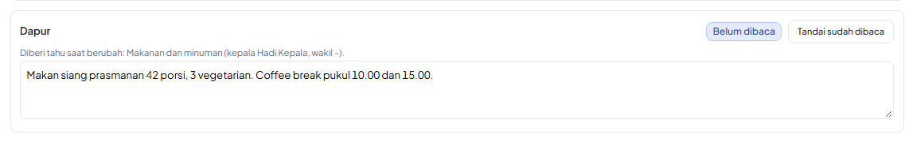
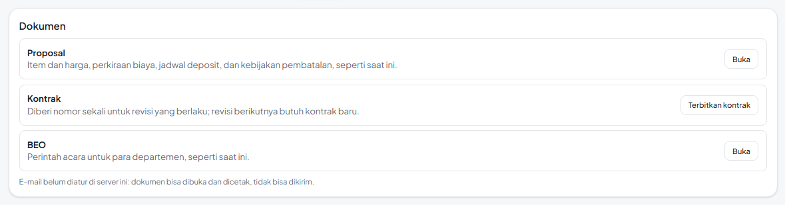

# BEO dan dokumen acara

**Siapa yang melakukan:**
- **BEO**: staf penjualan banquet yang mengisi. Kepala departemen yang membacanya.
- **Kontrak**: manajer banquet.

**Kapan dilakukan:** setelah acara dikonfirmasi, dan setiap kali detail acara berubah.
**Sebelum mulai:** departemen penerima setiap bagian BEO sudah diatur di **Pengaturan banquet**. Lihat [Menyiapkan banquet](menyiapkan-banquet.md).

**BEO** (*banquet event order*) adalah perintah kerja acara untuk setiap departemen: dapur, F&B service, housekeeping, engineering, security, dan front office. Sebelum acara **Definit**, BEO masih **Draf**. Setelah Definit, setiap penyimpanan menjadi revisi baru, dan departemen yang bagiannya berubah diberi tahu.

## Langkah-langkah

### Mengisi BEO

1. Buka acaranya, lalu buka tab **BEO**. Di kanan atas tertulis **Revisi {n}** atau **Draf**.
2. Pada setiap sesi, isi teks per bagian, misalnya di **Dapur**: `Makan siang prasmanan 42 porsi, 3 vegetarian`. Isi juga **Susunan acara**: jam dan kegiatannya. Klik **Tambah baris** untuk menambah baris.
3. Untuk acara Definit, isi kotak **Alasan (untuk riwayat)** di samping tombol simpan, misalnya `Tambah menu vegetarian`.

   

4. Klik **Simpan sebagai revisi**. Muncul "BEO tersimpan". Revisi baru tercatat di **Riwayat BEO**, beserta perubahannya dan jumlah orang yang diberi tahu.

### Membaca BEO (kepala departemen)

5. Buka acara dari pemberitahuan di lonceng banquet, misalnya "{nomor}: BEO direvisi (revisi {n})". Baca bagian departemen Anda, lalu klik **Tandai sudah dibaca**.

### Dokumen: proposal, kontrak, dan BEO

6. Buka tab **Dokumen**.
   - **Proposal**: item dan harga, perkiraan biaya, jadwal deposit, dan kebijakan pembatalan saat ini. Klik **Buka** untuk PDF, atau **Kirim lewat e-mail**.
   - **Kontrak**: klik **Terbitkan kontrak** (hanya acara Definit), lalu **Buka** atau **Kirim lewat e-mail**.
   - **BEO**: klik **Buka** untuk PDF.

   

7. Saat mengirim, isi **Kepada** (kosong berarti e-mail narahubung acara) dan pilih **Bahasa dokumen**, lalu kirim. Muncul "E-mail masuk antrean". Statusnya tampil di **E-mail terkirim**.

## Hasilnya

- Departemen menerima BEO terbaru. Status setiap bagian terlihat: **Belum dibaca**, **Sudah dibaca (revisi {n})**, atau **Berubah sejak revisi {n}**.
- Proposal dan kontrak terkirim sebagai PDF, dan tercatat di **E-mail terkirim**.

## Perlu diperhatikan

- **Setiap perubahan acara Definit** (sesi, item, jadwal deposit, kebijakan, teks BEO) menjadi revisi BEO. Klik **Lihat revisi ini** di riwayat untuk melihat acara seperti saat revisi itu.
- **Kontrak** diberi nomor sekali untuk revisi yang berlaku. Kalau acara berubah sesudahnya, terbitkan kontrak baru.
- **Bagian tanpa departemen** atau departemen tanpa kepala tidak memberi tahu siapa pun. Bagian itu bertuliskan keterangannya.
- **"E-mail belum diatur di server ini"**: dokumen tetap bisa dibuka dan dicetak, tetapi tidak bisa dikirim. Hubungi administrator.
- **Pilihan Bahasa dokumen** tertulis `English` (bahasa Inggris) dan `Bahasa Indonesia`.
- **PDF BEO per sesi** tersedia lewat **PDF sesi ini**. **Banquet → Laporan banquet → Jadwal harian** merangkum semua sesi satu hari.

## Terkait

- [Tentatif dan konfirmasi](tentatif-dan-konfirmasi.md)
- [Menyiapkan banquet](menyiapkan-banquet.md)
- [Departemen](../07-accounting/departemen.md)
