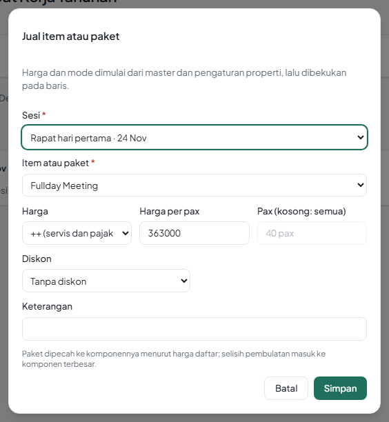
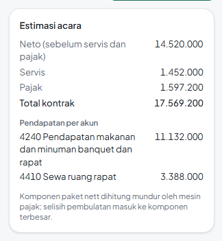
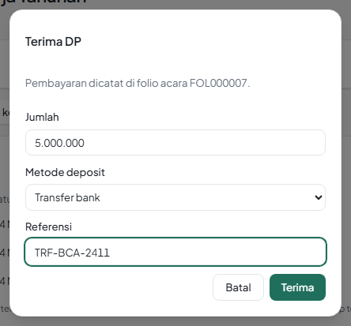

# Item, paket, dan deposit acara

**Siapa yang melakukan:** staf penjualan banquet. Penerimaan deposit juga membutuhkan izin menerima pembayaran.
**Kapan dilakukan:** setelah sesi dibuat, saat menyusun apa yang dijual ke pemesan, dan saat pemesan membayar uang muka (DP).
**Sebelum mulai:**
- Acara sudah punya sesi. Lihat [Membuat acara dan sesi](membuat-acara-dan-sesi.md).
- Deposit hanya bisa diterima untuk acara **Tentatif** atau **Definit**.
- Deposit **tunai** butuh shift kasir yang terbuka. Lihat [Shift kasir](../03-kasir-dan-pembayaran/shift-kasir.md).

## Langkah-langkah

### Menjual item atau paket

1. Di halaman acara, buka tab **Item & paket**, lalu klik **Jual item atau paket** (atau **Tambah** pada kartu sesinya).
2. Isi jendelanya.

   | Field | Wajib? | Keterangan |
   |---|---|---|
   | Sesi | Ya | Sesi yang membeli. |
   | Item atau paket | Ya | Misalnya paket `Fullday Meeting`. |
   | Harga | Ya | **Nett (sudah termasuk servis dan pajak)** atau **++ (servis dan pajak ditambahkan)**. Bawaannya dari pengaturan banquet. |
   | Harga per pax / Harga satuan | Ya | Terisi dengan harga daftar. Ubah kalau harganya dinegosiasikan. |
   | Pax (kosong: semua) / Jumlah | Tidak | Untuk item dan paket per tamu, kosong berarti semua tamu sesi. |
   | Diskon | Tidak | **Tanpa diskon**, **Persen**, atau **Jumlah**, lalu nilainya. |
   | Keterangan | Tidak | Teks yang tampil di proposal dan tagihan. |

   

3. Klik **Simpan**. Baris muncul di kartu sesinya.
4. Periksa kartu **Estimasi acara**: **Neto (sebelum servis dan pajak)**, **Servis**, **Pajak**, **Total kontrak**, dan **Pendapatan per akun**.

   

### Menerima deposit (DP)

5. Buka tab **Deposit & kebijakan**. Kartu **Jadwal deposit** menunjukkan tahap, tanggal jatuh tempo, jumlah, dan statusnya (**Lunas**, **Terlambat**, **Segera jatuh tempo**, atau **Terjadwal**).
6. Klik **Terima DP**, lalu isi jendelanya.

   | Field | Wajib? | Keterangan |
   |---|---|---|
   | Jumlah | Ya | Misalnya jumlah tahap pertama. |
   | Metode deposit | Ya | **Tunai**, **Kartu**, **QRIS**, atau **Transfer bank**. Tunai butuh shift kasir yang terbuka. |
   | Referensi | Tidak | Misalnya nomor bukti transfer. |

   

7. Klik **Terima**. **Deposit diterima** di tab itu bertambah, dan tahap yang terpenuhi menjadi **Lunas**.

## Hasilnya

- Baris item dan paket adalah **estimasi**. Belum ada yang masuk folio sampai sesinya diposting. Lihat [Posting sesi dan penagihan](posting-sesi-dan-penagihan.md).
- Deposit masuk ke folio acara dan dicatat sebagai uang muka, sampai tagihan sesi diposting.

## Perlu diperhatikan

- **Harga dan mode** dibekukan pada baris. Perubahan harga daftar sesudahnya tidak mengubah baris yang sudah ada.
- **Paket** dipecah ke item isinya menurut harga daftar. Selisih pembulatan masuk ke item terbesar.
- **Diskon di atas batas** pengaturan banquet membuka jendela **Setujui diskon**. Penyetuju harus boleh mengonfirmasi acara.
- **Pembayaran tidak ditautkan ke tahap tertentu.** Tahap dianggap lunas kalau deposit yang diterima mencapai jumlah kumulatif tahap itu.
- **Ubah jadwal** dan **Ubah** kebijakan pembatalan hanya untuk acara ini. Template tidak berubah, dan perubahannya tercatat di jejak audit.
- **Tenaga penjual** mendapat pemberitahuan saat sebuah tahap deposit jatuh tempo.
- **Persen** di jadwal deposit dan kebijakan pembatalan tampil dengan titik desimal, misalnya `30.00`.
- **Acara Definit:** setiap perubahan baris menjadi revisi BEO baru.

## Terkait

- [Posting sesi dan penagihan](posting-sesi-dan-penagihan.md)
- [Membatalkan acara](membatalkan-acara.md)
- [Menerima pembayaran](../03-kasir-dan-pembayaran/menerima-pembayaran.md)
