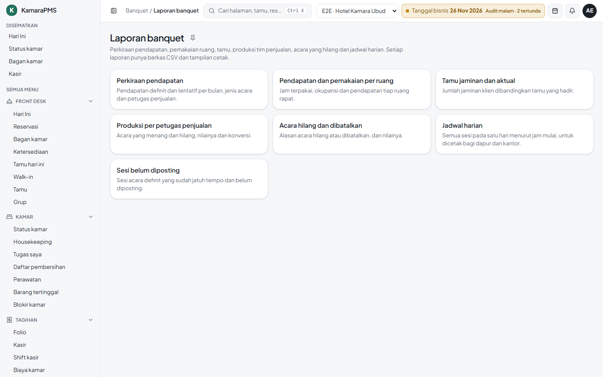
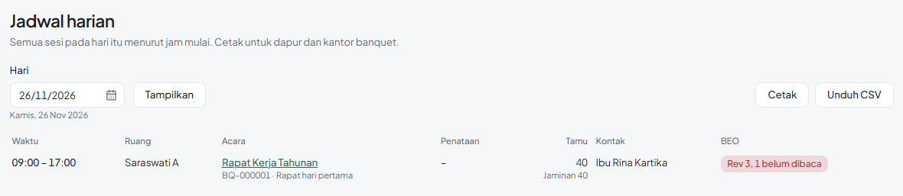
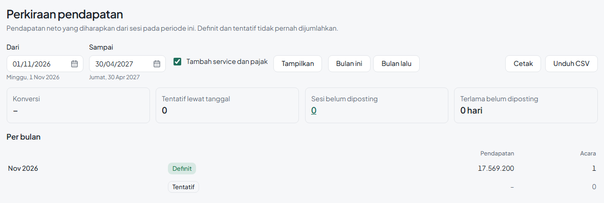

# Laporan banquet

**Siapa yang melakukan:** manajer banquet, tim penjualan banquet, atau manajemen hotel, dengan izin banquet apa pun. **Jadwal harian** juga dipakai staf banquet dan dapur.
**Kapan dilakukan:** **Jadwal harian** setiap hari, untuk hari ini dan besok. Laporan lainnya setiap minggu atau di akhir bulan.
**Sebelum mulai:** acara dan sesinya sudah dicatat. Angka pendapatan dan tamu aktual baru lengkap setelah sesinya diposting. Lihat [Posting sesi dan penagihan](posting-sesi-dan-penagihan.md).

## Langkah-langkah

### Memilih laporan

1. Buka **Banquet → Laporan banquet**. Setiap laporan punya kartunya sendiri.

   

   | Laporan | Isinya |
   |---|---|
   | Perkiraan pendapatan | Pendapatan definit dan tentatif per bulan, per jenis acara, dan per petugas penjualan. |
   | Pendapatan dan pemakaian per ruang | Jam terpakai, okupansi, dan pendapatan setiap ruang pertemuan. |
   | Tamu jaminan dan aktual | Jumlah tamu yang dijamin klien dibandingkan tamu yang hadir, per sesi. |
   | Produksi per petugas penjualan | Acara yang dibuka, menjadi definit, dan hilang, beserta nilainya dan konversinya. |
   | Acara hilang dan dibatalkan | Alasan acara hilang atau dibatalkan, dan nilai kontraknya. |
   | Jadwal harian | Semua sesi pada satu hari menurut jam mulai, untuk dicetak bagi dapur dan kantor banquet. |
   | Sesi belum diposting | Membuka **Banquet → Sesi belum diposting**. Lihat [Posting sesi dan penagihan](posting-sesi-dan-penagihan.md). |

2. Klik kartu laporannya.
3. Atur **Dari** dan **Sampai**, atau klik **Bulan ini** atau **Bulan lalu**, lalu klik **Tampilkan**. Periode bawaannya awal bulan sampai tanggal bisnis hari ini. **Perkiraan pendapatan** melihat ke depan: bawaannya awal bulan ini sampai akhir bulan kelima sesudahnya.
4. Klik **Cetak** untuk mencetak, atau **Unduh CSV** untuk membukanya di spreadsheet.

### Jadwal harian

5. Klik **Jadwal harian**. Isi **Hari** (terisi dengan tanggal bisnis hari ini), misalnya tanggal besok, lalu klik **Tampilkan**. Setiap sesi tampil satu baris:
   - **Waktu**: jam mulai dan selesai. `+1` berarti sesi selesai keesokan harinya.
   - **Ruang**, **Acara** (klik namanya untuk membuka acaranya), dan **Penataan**.
   - **Tamu**: jumlah aktual kalau sudah ada, kalau belum jumlah jaminan, kalau belum juga jumlah perkiraan. Jumlah jaminan tertulis di bawahnya, misalnya "Jaminan 40".
   - **Kontak**: narahubung acara dan teleponnya.
   - **BEO**: **Belum ada BEO**, **Rev {n}**, atau **Rev {n}, {m} belum dibaca** (merah) kalau ada bagian BEO revisi terakhir yang belum ditandai sudah dibaca oleh departemennya.

   

6. Klik **Cetak**, lalu tempelkan jadwalnya di dapur dan di kantor banquet.

### Perkiraan pendapatan

7. Klik **Perkiraan pendapatan**. Centang **Tambah service dan pajak** kalau Anda ingin melihat angka dengan biaya layanan dan pajak. Tanpa centang, angkanya pendapatan neto.
   - Kotak di atas: **Konversi**, **Tentatif lewat tanggal** (acara tentatif yang tanggal opsinya sudah lewat), **Sesi belum diposting** (klik angkanya untuk membuka daftarnya), dan **Terlama belum diposting**.
   - Tabel **Per bulan**, **Per jenis acara**, dan **Per petugas penjualan**. Setiap baris punya dua angka: **Definit** dan **Tentatif**, masing-masing dengan **Pendapatan** dan jumlah **Acara**.

   

### Laporan lainnya

8. Baca laporan lainnya dengan cara yang sama.

   | Laporan | Cara membacanya |
   |---|---|
   | Pendapatan dan pemakaian per ruang | **Sesi**, **Jam terpakai**, **Terkunci oleh ruang lain**, **Jam tersedia**, **Okupansi**, **Diposting**, **Pendapatan**, dan **Per jam**, per ruang. Di atas tabel tertulis jam operasional dan jumlah hari yang dihitung. |
   | Tamu jaminan dan aktual | **Perkiraan**, **Jaminan**, **Aktual**, dan **Selisih** per sesi. Selisih positif berarti tamu yang dilayani lebih banyak dari jaminan. Selisih negatif (merah) berarti klien membayar tamu yang tidak datang. |
   | Produksi per petugas penjualan | **Dibuka**, **Definit**, **Hilang**, **Nilai definit**, **Nilai hilang**, dan **Konversi**, per petugas penjualan. |
   | Acara hilang dan dibatalkan | **Per alasan**: jumlah acara dan nilainya untuk setiap alasan, dipisah **Hilang** dan **Dibatalkan**. Di bawahnya, setiap acara dengan tanggal **Ditutup**, alasannya, catatannya, petugas penjualannya, dan nilainya. |

## Hasilnya

Laporan hanya membaca data acara. Tidak ada yang diposting atau diubah.

## Perlu diperhatikan

- **Definit dan tentatif tidak pernah dijumlahkan.** Acara tentatif bisa saja tidak jadi, jadi angkanya selalu ditampilkan terpisah.
- **Konversi** = definit / (definit + hilang), dari acara yang diputuskan pada periode itu. Acara yang masih terbuka, misalnya masih inquiry atau tentatif, tidak dihitung.
- **Hilang dan dibatalkan berbeda.** Acara yang hilang tidak pernah menjadi definit. Acara yang dibatalkan sudah definit lalu batal. Lihat [Membatalkan acara](membatalkan-acara.md).
- **Petugas penjualan** adalah **Tenaga penjual** di halaman acara.
- **Pendapatan per ruang** hanya menghitung sesi yang sudah diposting. Jam terpakai menghitung sesi definit dan selesai.
- **Ruang gabungan:** kalau ruang gabungan dipakai, ruang bagiannya tidak bisa dipakai, dan sebaliknya. Jam itu tampil di **Terkunci oleh ruang lain**, dan tidak dihitung sebagai jam terpakai atau okupansi.
- **Jam operasional ruang** bawaannya 07.00 sampai 23.00, dan belum bisa diubah dari layar. Lihat [Menyiapkan banquet](menyiapkan-banquet.md).
- **"Tidak ada data pada periode ini."** berarti tidak ada acara atau sesi yang cocok. Periksa **Dari** dan **Sampai**.

## Terkait

- [BEO dan dokumen](beo-dan-dokumen.md)
- [Posting sesi dan penagihan](posting-sesi-dan-penagihan.md)
- [Membatalkan acara](membatalkan-acara.md)
